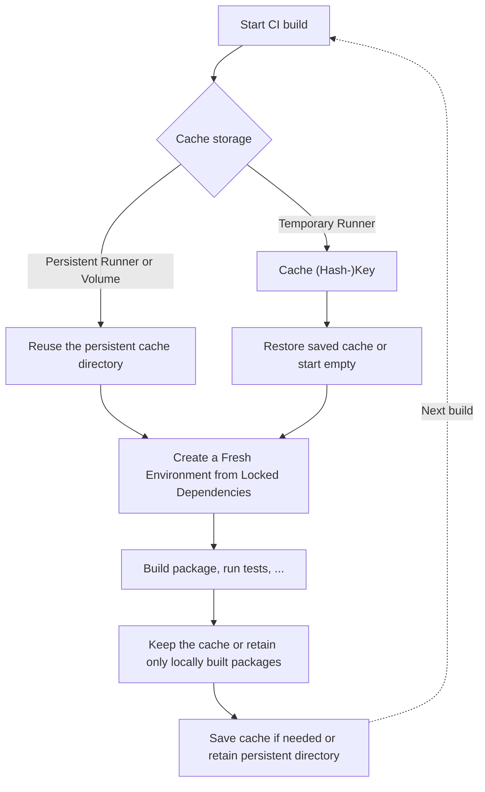

# Dependency Caching with uv

The cache is one of `uv`'s key features and a major contributor to its speed. It reuses package metadata, downloads, and built packages instead of fetching or building them again. Understanding the `uv` cache is an essential skill, especially in Continuous Integration (CI), where effective caching can shorten builds, reduce network traffic, and lower compute costs. This chapter explores how the cache is organized and how to create, reuse, and clean it during local development and in CI environments.

## Applied Project

The [uv cache demo](https://github.com/ValentinTwin1206/modern-python-devops-egineering/tree/main/projects/proj5_uv_cache) uses NumPy, SciPy, and Matplotlib to analyze a bundled 16 MiB synthetic embedding matrix and plot a report. Downloaded dependency wheels demonstrate the trade-off between download time and cache storage; the local package makes retention of a source-built wheel visible after CI pruning. A generator creates identical sample data before packaging, keeping the repository small. These are synthetic features, not trained model weights.

## Building Blocks

### Environment Variables That Influence Cache Behavior

The following environment variables configure where `uv` stores cache data, how it uses that data, or how it installs cached files. See the [uv environment variable reference](https://docs.astral.sh/uv/reference/environment/) for the full list.

| Variable | Cache behavior |
| --- | --- |
| `UV_CACHE_DIR` | Sets the cache directory, equivalent to `--cache-dir`. It takes precedence over the default location. |
| `UV_NO_CACHE` | Disables reading and writing the persistent cache, equivalent to `--no-cache`. `uv` uses a temporary cache for that invocation. |
| `UV_OFFLINE` | Disables network access, so `uv` must rely on cached data and locally available files, equivalent to `--offline`. |
| `UV_LINK_MODE` | Sets how cached files are installed: `clone` shares storage until files change; `hardlink` shares files on the same filesystem; `copy` duplicates files; `symlink` points to cached files. Cloning and linking usually install faster than copying. Avoid `symlink`: clearing the cache can break the environment. Current defaults: `clone` on macOS/Linux, `hardlink` on Windows. |
| `UV_LOCK_TIMEOUT` | Sets how long `uv` waits to acquire a file lock, including when cache operations are blocked by other `uv` processes. |
| `UV_CONCURRENT_CACHE_READS` | Sets the number of threads reading cached HTTP responses. Accepts a positive integer; the default is `4`. Higher values may speed up cache reads, but can slow them down if the storage is overloaded. |

### Commands That Influence the Cache

The following table lists common `uv` commands and describes their effects on the `uv` cache. For details on dependency locking and syncing, see [*Dependency Management with uv*](./section-02.md); for more on cache behavior, see the [uv caching guide](https://docs.astral.sh/uv/concepts/cache/).

| Command | Effect on the cache |
| --- | --- |
| `uv pip install {pkg}` | Installs a package, reusing cached metadata and artifacts and adding newly downloaded or built data to the cache. `--refresh` forces cached data to be revalidated and updates it for subsequent operations; `--refresh-package {pkg}` limits this to one package. |
| `uv add {pkg}` | Adds a dependency, resolves and synchronizes the project, and reuses or adds package data in the cache. |
| `uv sync` | Synchronizes the project environment and reuses or adds cached package data. `--refresh` forces cached data to be revalidated and updates it for subsequent operations; `--refresh-package {pkg}` limits this to one package. |
| `uv tool install {tool}` | Installs a tool in its own environment while sharing `uv`'s package cache. |
| `uv cache prune` | Removes unused cache data and project environments to free disk space. Add `--ci` to also remove downloaded wheels and unpacked source files while preserving wheels built from source. This reduces CI cache size without requiring expensive rebuilds. |
| `uv cache clean [package]` | Removes all cache entries, or only entries for the named `[package]`. |

### Build Configuration and Wheel Reuse

When installing a local package, `uv` can reuse a cached wheel instead of building it again. Projects can define `tool.uv.cache-keys` in `pyproject.toml` to tell `uv` which inputs to check before reusing that wheel. These keys can includes specific files, version control information, or environment variables; when a tracked input changes, `uv` rebuilds the wheel. They replace the default checks, so cover all build inputs. For example, tracking only `pyproject.toml` triggers a rebuild when you add a dependency there, but may let `uv` reuse a wheel with old code when you edit only a Python source file. The following examples show common configurations:

=== "Files"

    Track `pyproject.toml` and an additional file used to determine dependencies:

    ```toml
    [tool.uv]
    cache-keys = [{ file = "pyproject.toml" }, { file = "requirements.txt" }]
    ```

=== "Git Commit"

    Track `pyproject.toml` and the current commit, useful when the package version depends on Git. Add `tags = true` alongside `commit = true` if tags also affect the build. A commit key alone does not detect uncommitted source edits.

    ```toml
    [tool.uv]
    cache-keys = [{ file = "pyproject.toml" }, { git = { commit = true } }]
    ```

=== "Environment Variable"

    Track `pyproject.toml` and an environment variable that affects the build:

    ```toml
    [tool.uv]
    cache-keys = [{ file = "pyproject.toml" }, { env = "MY_BUILD_SETTING" }]
    ```

!!! info "The demo project's fingerprint"

    The demo uses only `cache-keys = [{ env = "CACHE_DEMO_KEY" }]`. After generating the fixture, set this variable to the output of `scripts/build_key.py` before each sync that installs the local package. The script hashes `pyproject.toml`, source files, and bundled data, so changed contents trigger rebuilding while unchanged contents allow wheel reuse across fresh CI checkouts, regardless of file timestamps.

## Managing uv's Cache

For day-to-day development, `uv` manages the cache automatically, and your project's `.venv` usually stays in place between sessions. Understanding the cache is useful when recreating environments, working offline, or freeing disk space, but managing it is less critical than in CI/CD, where environments are often rebuilt for every run. The following workflow lets you explore cache reuse and cleanup locally.

From the repository's `projects/` directory, the following command builds the image from `Dockerfile.devEnv` and launches a `bash` session inside the container:

```bash
./build.sh build \
    --path proj5_uv_cache/Dockerfile.devEnv \
    --rm-container
```

!!! warning "The project is bind-mounted"
    Changes to `/app` also change `projects/proj5_uv_cache` on your host. The following steps recreate `.venv`; do not use that environment in another session while following them. The container's package cache is disposable and separate from your host's uv cache.

### Inspect and Reuse the Cache

#### Create and Inspect the Cache

First, this command creates `.venv` if needed and installs the dependencies from `uv.lock`. The `--no-install-project` flag skips installing the local project itself, while `--locked` makes the command fail if the lockfile is missing or out of date instead of creating or updating it:

```bash
uv sync --locked --no-install-project
```

Inspect the populated cache, including hidden housekeeping files; `uv cache dir` supplies the active cache path:

```bash
tree -aL 1 --noreport "$(uv cache dir)"
```

You should see an output similiar to the following:

```text
/home/bob/.cache/uv
├── .gitignore
├── .lock
├── CACHEDIR.TAG
├── archive-v0
├── interpreter-v4
├── sdists-v9
└── wheels-v6
```

Each entry stores reusable package data or helps `uv` manage the cache safely:

| Entry | Purpose |
| --- | --- |
| `archive-v0` | Stores unpacked package files that `uv` copies or links into an environment. Reusing these files avoids downloading and unpacking the same package again. |
| `wheels-v6` | Stores records for `.whl`s (ready-to-install packages), including download metadata and links to unpacked files. These records help `uv` locate cached packages for installation. |
| `interpreter-v4` | Stores information about Python interpreters, such as their versions and supported platforms. `uv` can reuse this information instead of inspecting the same interpreter repeatedly. |
| `sdists-v9` | Stores cached source distributions and build results for packages that need to be built into wheels. The directory can exist even when all installed packages came from ready-made wheels. |
| `.gitignore`, `.lock`, `CACHEDIR.TAG` | `.gitignore` keeps cache contents out of Git, `.lock` coordinates cache access, and `CACHEDIR.TAG` marks the directory as disposable cache data. `uv` manages these files; they are not dependency declarations or settings to edit. |

> Other workflows may also create package-index metadata in `simple-v20`

Further inspect the wheel record of `numpy` package:

```bash
tree -L 1 --noreport "$(uv cache dir)/wheels-v6/pypi/numpy"
```

The dedicated cache folder for `numpy` contains the structure shown below. The first entry marks a symbolic link (`->`) to the unpacked files in `archive-v0`. The second entry, is a binary file (`*.http`) that stores download-cache metadata managed by `uv`.

```text
/home/bob/.cache/uv/wheels-v6/pypi/numpy
├── <version>-<python-tag>-<abi-tag>-<platform-tag> -> /home/bob/.cache/uv/archive-v0/<archive-id>
└── <version>-<python-tag>-<abi-tag>-<platform-tag>.http
```

> See [Package Layout in Chapter 2, Section 1](../chapter-02/section-01.md#package-layout) to undertand wheel filename tags.

Check the cache size with `uv cache size --human`:

```bash
uv cache size --human
```

In this Linux x86_64 container run with Python 3.12.13 and uv 0.11.1, the cache size was about 242.6 MiB:

```text
242.6MiB
```

#### Reuse the Cache

The `Dockerfile.devEnv` sets `UV_LINK_MODE=copy`, so `uv` copies cached package files, including Python modules, into `.venv` instead of linking them. This leaves separate copies in the cache and environment; deleting `.venv` removes only the installed copy, preserving cached packages for reuse. Remove `.venv` to make `uv` recreate the environment:

```bash
rm -r .venv
```

Then sync the project from `uv.lock` again. The `--offline` flag prevents network access, so all required packages must be available in the local cache:

```bash
uv sync --locked --no-install-project --offline
```

A successful run installs the numerical and plotting dependencies from the local cache without downloading them. Verify that `numpy` imports from `.venv`, not the cache:

```bash
.venv/bin/python -c "import numpy; print(numpy.__file__)"
```

### Cleanup the Cache

#### Prepare the Cache

First, run [`generate_fixture.py`](https://github.com/ValentinTwin1206/modern-python-devops-egineering/blob/main/projects/proj5_uv_cache/scripts/generate_fixture.py) to create a reproducible 16 MiB sample dataset (`embeddings.bin`) with 32,768 rows of 512 one-byte values. The package bundles this file in its wheel so the demo can show how a large package affects cache size after CI pruning:

```bash
python scripts/generate_fixture.py
```

The following command uses [`build_key.py`](https://github.com/ValentinTwin1206/modern-python-devops-egineering/blob/main/projects/proj5_uv_cache/scripts/build_key.py) to fingerprint `pyproject.toml` and the package's Python, JSON, and binary files, then passes that fingerprint to `uv` as `CACHE_DEMO_KEY`. The project's [`pyproject.toml`](https://github.com/ValentinTwin1206/modern-python-devops-egineering/blob/main/projects/proj5_uv_cache/pyproject.toml) lists this variable under `tool.uv.cache-keys`, so changes to the fingerprinted inputs trigger a new wheel instead of reusing a stale one. The `--reinstall` flag reinstalls packages even if they are already installed, and `--no-editable` installs the local package as a regular wheel rather than an editable install from the source tree:

```bash
CACHE_DEMO_KEY=$(python scripts/build_key.py) uv sync --no-editable --reinstall
```

Next, create a cache entry in an older format to see how `uv cache prune` removes obsolete entries. Use `uvx` to run `uv` 0.4.12 in an isolated tool environment; it stores package entries in the legacy `wheels-v1` format. Install `scipy` into `/home/bob/scipy-demo`, skipping its dependencies with `--no-deps`:

```bash
uvx --from uv==0.4.12 uv pip install --python "$(uv python find 3.12)" --no-deps --target /home/bob/scipy-demo "scipy==1.15.3"
```

This creates a `scipy` cache record under `wheels-v1` without changing the project dependencies. Use `find` to locate it and verify the cache format:

```bash
find "$(uv cache dir)" -type d -path '*/wheels-v*/pypi/scipy' -print
```

Check the size again with `uv cache size --human`; in this run it grew from about 242.6 MiB to 274.7 MiB after adding the local wheel, then to 454.0 MiB after adding the older `uv` and `scipy` entries:

```text
454.0MiB
```


#### Cleanup Commands

The tabs are alternative workflows starting from the same prepared cache. Repeat [Prepare the Cache](#prepare-the-cache) before trying another tab to restore the entries removed by cleanup.

=== "Prune Cache"

    The `uv cache prune` command frees cache space by removing obsolete and unreferenced data while keeping valid package entries and leaving `.venv` unchanged.

    Remove the old-format `scipy` cache record by running the following command:

    ```bash
    uv cache prune
    ```

    In this run, `uv` reported:

    ```text
    Removed 1460 files (144.3MiB)
    ```

    After pruning, `wheels-v1` was deleted, but `uv cache size --human` still reported `305.9MiB`: `uvx` had cached the `uv` 0.4.12 tool in `wheels-v6`, leaving the cache slightly larger than before the demo.

=== "Prune Cache in CI"

    The `uv cache prune --ci` command removes unused data, downloaded wheels, and unpacked sources while retaining source-built wheels, reducing CI cache transfer size. For more context, see [uv's CI caching guidance](https://docs.astral.sh/uv/concepts/cache/#caching-in-continuous-integration). Locate the `'uv_cache_demo-*.whl'` wheel before pruning:
  
    ```bash
    find "$(uv cache dir)" -type f -name 'uv_cache_demo-*.whl' -print
    ```

    > If the `.whl` is not present, repeat [Prepare the Cache](#prepare-the-cache).

    Measure the cache with `uv cache size --human`. In this container run, it reported:

    ```text
    454.0MiB
    ```

    Prune the cache using the CI strategy:

    ```bash
    uv cache prune --ci
    ```

    After pruning, `uv cache size --human` reported `19.3MiB`, down from `454.0MiB` (434.7 MiB reclaimed), including the local wheel and about 3.3 MiB of retained package-index metadata from the older uv run; sizes vary by platform and cache contents. Future CI runs can reuse the unchanged local wheel but must download dependency wheels again. Confirm that the built wheel remains at the same path:

    ```bash
    find "$(uv cache dir)" -type f -name 'uv_cache_demo-*.whl' -print
    ```

=== "Clean Cache"

    The `uv cache clean` command removes **all** entries from the shared cache, including valid wheels and unpacked package files, while keeping installed packages in project environments unchanged. Future installs that need those packages must download or build them again.

    Clear the shared cache:

    ```bash
    uv cache clean
    ```

    Inspect the project files with `ls -lah`; `uv cache clean` leaves `.venv` and its installed packages untouched, along with `pyproject.toml` and `uv.lock`. It removes cached wheel data, not the package files already installed from those wheels. Verify that `numpy` still works:

    ```bash
    .venv/bin/python -c "import numpy; print(numpy.__file__)"
    ```

#### Cache Size Comparison

The table summarizes the measured cache sizes for each alternative workflow starting from the same prepared cache.

| Workflow | Commands | Initial cache size | Final cache size |
| --- | --- | ---: | ---: |
| Prune Cache | `uv cache prune` | 454.0 MiB | 305.9 MiB |
| Prune Cache in CI | `uv cache prune --ci` | 454.0 MiB | 19.3 MiB |
| Clean Cache | `uv cache clean` | 454.0 MiB | 0 MiB |

## Using uv's Cache in CI Environments

In CI workflows such as *GitHub Actions*, reusing `uv`'s cache avoids repeated downloads and builds. This shortens jobs, reduces network use, and gives your team faster feedback. Keeping large downloaded packages, such as machine-learning libraries, in the cache avoids downloading them on every build. This can save time and network traffic, but also increases the cache size. Compare those savings with the time needed to restore and save the cache.

### CI Caching Pattern

The diagram below visualizes a sample CI caching pattern. Start with *Cache storage* to determine how package data is kept between jobs:

- **Persistent runner:** Reuse a cache directory outside the job's temporary workspace so cleanup does not delete it.
- **Temporary runner:** Restore a saved cache using a key based on the platform and dependency files; if no matching cache is available, `uv` populates a new one during installation. The [GitHub Actions example](#github-actions-example) uses this approach.

Both approaches converge at *Create a Fresh Environment from Locked Dependencies*, using the committed `uv.lock`. Missing packages are downloaded or built and cached; an outdated lockfile causes the sync to fail rather than changing it. After *Build package, run tests, ...*, *Keep the cache or retain only locally built packages*. Regular pruning removes unused entries; `--ci` additionally removes downloaded wheels and unpacked sources while retaining source-built wheels to avoid rebuilding. Finally, *Save cache if needed or retain persistent directory* for the next build. Preserve the package cache, not `.venv`, and include cache transfer time when comparing build durations.



### GitHub Actions Example

!!! info "Compare the Cache Strategies"
    The `uv-cache.yml` demo compares a full cache with a CI-pruned cache. For each variant, run once with a *cold cache* and once with a *warm cache*, keeping dependencies and package files unchanged:

    - **Warm cache:** Set `clean_cache: false` to reuse the restored cache. Set `prune_cache: false` to keep the full cache, or `true` to run `uv cache prune --ci` after installation; it removes downloaded dependency wheels but keeps the demo wheel and uses a separate GitHub cache key.
    - **Cold cache:** Set `clean_cache: true` to run `uv cache clean` before `uv sync`. Keep the same `prune_cache` value as in the warm run.

The workflow uses fresh GitHub-hosted runners, recreates `.venv` from `uv.lock`, and reports installation time and cache size.

Additionally, GitHub's official [cache-sharing rules](https://docs.github.com/en/actions/reference/dependency-caching-reference#restrictions-for-accessing-a-cache) must be taken into account; for example, pull requests can restore the target branch's cache but can save caches only for that pull request. Saved caches cannot be overwritten and expire after seven days without access, or earlier under storage pressure. Without a matching accessible cache, `uv` downloads or builds dependencies as usual.

#### Workflow Triggers

The workflow runs on pushes to `main` that change `proj5_uv_cache/` or the workflow file `uv-cache.yml` itself, and it can also be started manually. Manual runs expose `prune_cache` and `clean_cache` options:

```yaml
on:
  push:
    branches:
      - main
    paths:
      - "projects/proj5_uv_cache/**"
      - ".github/workflows/uv-cache.yml"
  workflow_dispatch:
    inputs:
      prune_cache:
        description: "Run uv cache prune --ci after installation"
        type: boolean
        default: true
      clean_cache:
        description: "Run uv cache clean before installing (cold run)"
        type: boolean
        default: false
```

#### Set the Cache Directory and Measure Its Initial Size

Initially, the workflow sets `UV_CACHE_DIR` under the GitHub runner's temporary storage and writes it to `GITHUB_ENV`, making the path available to subsequent steps. The inline measurement checks this directory without running `uv` or creating the cache; on a fresh runner, it normally reports 0 KiB.

```yaml
- name: Measure cache at the beginning of the job
  id: cache_start
  env:
    UV_CACHE_DIR: ${{ runner.temp }}/uv-cache
  run: |
    echo "UV_CACHE_DIR=$UV_CACHE_DIR" >> "$GITHUB_ENV"
    kib=0
    if [[ -d "$UV_CACHE_DIR" ]]; then
      kib=$(du -sk "$UV_CACHE_DIR" | cut -f1)
    fi
    echo "Before restoration: ${kib} KiB"
    echo "kib=$kib" >> "$GITHUB_OUTPUT"
```

#### Prepare the Fixture and Cache Key

Before restoring the cache, the workflow generates the fixture and fingerprints the local package's build inputs in one step. It writes the fingerprint to the `$GITHUB_ENV` environment file as `CACHE_DEMO_KEY`, making it available to subsequent steps. The project's [`pyproject.toml`](https://github.com/ValentinTwin1206/modern-python-devops-egineering/blob/main/projects/proj5_uv_cache/pyproject.toml) uses this value in `tool.uv.cache-keys`: unchanged inputs can reuse the local wheel across fresh checkouts, while changed inputs trigger a rebuild. This `uv` wheel-cache key is separate from the GitHub Actions cache key described in [Configure the Cache Key and Restore the Cache](#configure-the-cache-key-and-restore-the-cache).

```yaml
- name: Generate fixture and fingerprint build inputs
  run: |
    python projects/proj5_uv_cache/scripts/generate_fixture.py
    build_key=$(python projects/proj5_uv_cache/scripts/build_key.py)
    echo "CACHE_DEMO_KEY=$build_key" >> "$GITHUB_ENV"
```

#### Configure the Cache Key and Restore the Cache

The GitHub Action `astral-sh/setup-uv` installs the pinned `uv` version and manages its package cache. With caching enabled, the action restores a matching cache before dependency installation and saves a new cache after a successful job when needed. Unlike `tool.uv.cache-keys`, the action creates a separate GitHub cache key from inputs such as the platform, `cache-dependency-glob`, and `cache-suffix`. The glob below includes the package's build inputs, so changes can affect both cache keys. These settings control caching:

```yaml
- name: Set up uv and restore its package cache
  id: uv
  uses: astral-sh/setup-uv@v5
  with:
    version: "0.11.1"
    enable-cache: true
    cache-local-path: ${{ env.UV_CACHE_DIR }}
    cache-dependency-glob: |
      projects/proj5_uv_cache/pyproject.toml
      projects/proj5_uv_cache/uv.lock
      projects/proj5_uv_cache/src/**/*.py
      projects/proj5_uv_cache/src/**/*.json
      projects/proj5_uv_cache/src/**/*.bin
    cache-suffix: ${{ env.PRUNE_CACHE == 'true' && 'embeddings-demo-ci-pruned' || 'embeddings-demo-full' }}
    prune-cache: false
```

- **`enable-cache`**: Setting this to `true` enables `setup-uv` to restore and save `uv`'s package cache across eligible runs.
- **`cache-local-path`**: Setting this to `${{ env.UV_CACHE_DIR }}` points the action to the cache directory already used by `uv` and the measurements.
- **`cache-dependency-glob`**: The multiline value lists the demo's `pyproject.toml`, `uv.lock`, and `.py`, `.json`, and `.bin` files under `src/`; changing one of these inputs changes the cache key.
- **`cache-suffix`**: This value resolves to `embeddings-demo-ci-pruned` when `PRUNE_CACHE` is `true`, or `embeddings-demo-full` otherwise, keeping the cache strategies separate.
- **`prune-cache`**: Setting this to `false` disables automatic pruning so the workflow can prune explicitly and measure its effect, even on cache hits.

GitHub does not overwrite an existing cache with the same key, even if the job prunes its local copy. The workflow summary reports local cache size and the change from the previous checkpoint: positive changes mean growth, and negative changes mean space reclaimed. These are local disk measurements of the cache directory, not the compressed GitHub archive or `.venv` size; they do not alter the cache, and optional cleanup steps are measured even when skipped.

#### Clear the uv Cache for a Cold Install

When `CLEAN_CACHE` is `true`, the workflow clears the restored cache to simulate a cold install; otherwise, it keeps the cache for reuse. It records the cache size after this optional step:

```yaml
- name: Clear uv cache for a cold install
  id: cache_cleaned
  run: |
    if [[ "$CLEAN_CACHE" == "true" ]]; then
      uv cache clean
    fi
    kib=0
    if [[ -d "$UV_CACHE_DIR" ]]; then
      kib=$(du -sk "$UV_CACHE_DIR" | cut -f1)
    fi
    echo "After optional cleaning: ${kib} KiB"
    echo "kib=$kib" >> "$GITHUB_OUTPUT"
```

#### Create a Fresh Environment from Locked Dependencies

The sync step installs the project's dependencies from `uv.lock` into a fresh environment and builds or reuses the local package wheel. Later runs can reuse this cached wheel. Furthermore, the step records installation time, including any necessary downloads and builds, then measures cache size outside the timer:

```yaml
- name: Create a fresh environment from locked dependencies
  id: install
  shell: bash
  run: |
    start_ms=$(date +%s%3N)
    uv sync --directory projects/proj5_uv_cache --locked --no-editable --python 3.12
    end_ms=$(date +%s%3N)
    echo "milliseconds=$((end_ms - start_ms))" >> "$GITHUB_OUTPUT"
    kib=0
    if [[ -d "$UV_CACHE_DIR" ]]; then
      kib=$(du -sk "$UV_CACHE_DIR" | cut -f1)
    fi
    echo "After uv sync: ${kib} KiB"
    echo "kib=$kib" >> "$GITHUB_OUTPUT"
```

#### Generate the Embedding Report

After syncing the environment, the workflow runs the installed package to analyze the bundled embeddings and saves its report under the runner's temporary directory:

```yaml
- name: Analyze the installed embeddings and generate a report
  run: |
    projects/proj5_uv_cache/.venv/bin/python -m uv_cache_demo.main \
      --output "${{ runner.temp }}/embeddings.png"
```

#### Keep the Cache or Retain Only Locally Built Packages

After the report runs, the workflow can use `uv cache prune --ci` to remove cached dependency downloads while keeping the wheel built for this demo. This saves cache space, but later runs may need to download the dependencies again; keeping the full cache can be faster. The demo wheel includes 16 MiB of sample data, making its impact on cache size easy to see. `PRUNE_CACHE` controls whether pruning runs, and the workflow measures cache size at each checkpoint, counting a missing cache directory as zero:

```yaml
- name: Keep the cache or retain locally built packages
  id: cache_size
  shell: bash
  run: |
    if [[ "$PRUNE_CACHE" == "true" ]]; then
      uv cache prune --ci
    fi
    kib=0
    if [[ -d "$UV_CACHE_DIR" ]]; then
      kib=$(du -sk "$UV_CACHE_DIR" | cut -f1)
    fi
    echo "After optional CI pruning: ${kib} KiB"
    echo "kib=$kib" >> "$GITHUB_OUTPUT"
```
