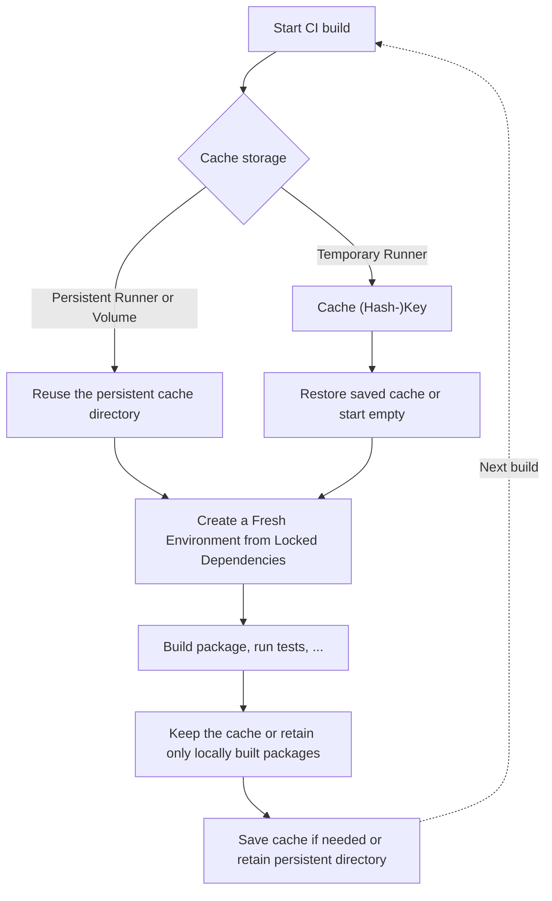

# Dependency Caching with uv

The cache is one of `uv`'s key features and a major contributor to its speed. It reuses package metadata, downloads, and built packages instead of fetching or building them again. Understanding the `uv` cache is an essential skill, especially in continuous integration (CI), where effective caching can shorten builds, reduce network traffic, and lower compute costs. This chapter explores how the cache is organized and how to create, reuse, and clean it during local development and in CI environments.

## Applied Project

The [uv cache demo](https://github.com/ValentinTwin1206/modern-python-devops-egineering/tree/main/projects/proj5_uv_cache) combines large machine-learning dependencies with a local package containing a 16 MiB synthetic embedding matrix. Downloaded ML wheels demonstrate the trade-off between download time and cache storage; the local package makes retention of a source-built wheel visible after CI pruning. A generator creates identical sample data before packaging, keeping the repository small. These are synthetic features, not trained model weights.

## Building Blocks

### Environment Variables That Influence Cache Behavior

The following environment variables configure where `uv` stores cache data, how it uses that data, or how it installs cached files. See the [uv environment variable reference](https://docs.astral.sh/uv/reference/environment/) for the full list.

| Variable | Cache behavior |
| --- | --- |
| `UV_CACHE_DIR` | Sets the cache directory, equivalent to `--cache-dir`. It takes precedence over the default location. |
| `UV_NO_CACHE` | Disables reading and writing the persistent cache, equivalent to `--no-cache`. `uv` uses a temporary cache for that invocation. |
| `UV_OFFLINE` | Disables network access, so `uv` must rely on cached data and locally available files, equivalent to `--offline`. |
| `UV_LINK_MODE` | Sets how cached files are installed: `clone` shares storage until files change; `hardlink` shares files on the same filesystem; `copy` duplicates files; `symlink` points to cached files. Cloning and linking usually install faster than copying. Avoid `symlink`: clearing the cache can break the environment. Current defaults: `clone` on macOS/Linux, `hardlink` on Windows. |
| `UV_LOCK_TIMEOUT` | Sets how long `uv` waits to acquire a file lock, including when cache operations are blocked by other `uv` processes. |
| `UV_CONCURRENT_CACHE_READS` | Sets the number of threads reading cached HTTP responses. Accepts a positive integer; the default is `4`. Higher values may speed up cache reads, but can slow them down if the storage is overloaded. |

### Commands That Influence the Cache

The following table lists common `uv` commands and describes their effects on the `uv` cache. For details on dependency locking and syncing, see [*Dependency Management with uv*](./section-02.md); for more on cache behavior, see the [uv caching guide](https://docs.astral.sh/uv/concepts/cache/).

| Command | Effect on the cache |
| --- | --- |
| `uv pip install {pkg}` | Installs a package, reusing cached metadata and artifacts and adding newly downloaded or built data to the cache. `--refresh` forces cached data to be revalidated and updates it for subsequent operations; `--refresh-package {pkg}` limits this to one package. |
| `uv add {pkg}` | Adds a dependency, resolves and synchronizes the project, and reuses or adds package data in the cache. |
| `uv sync` | Synchronizes the project environment and reuses or adds cached package data. `--refresh` forces cached data to be revalidated and updates it for subsequent operations; `--refresh-package {pkg}` limits this to one package. |
| `uv tool install {tool}` | Installs a tool in its own environment while sharing `uv`'s package cache. |
| `uv cache prune` | Removes unused cache data and project environments to free disk space. Add `--ci` to also remove downloaded wheels and unpacked source files while preserving wheels built from source. This reduces CI cache size without requiring expensive rebuilds. |
| `uv cache clean [package]` | Removes all cache entries, or only entries for the named package. |

## Managing uv's Cache

For day-to-day development, `uv` manages the cache automatically, and your project's `.venv` usually stays in place between sessions. Understanding the cache is useful when recreating environments, working offline, or freeing disk space, but managing it is less critical than in CI/CD, where environments are often rebuilt for every run. The following workflow lets you explore cache reuse and cleanup locally.

From the repository's `projects/` directory, the following command builds the image from `Dockerfile.devEnv` and launches a `bash` session inside the container:

```bash
./build.sh build \
    --path proj5_uv_cache/Dockerfile.devEnv \
    --rm-container
```

!!! warning "The project is bind-mounted"
    Changes to `/app` also change `projects/proj5_uv_cache` on your host. The following steps recreate `.venv`; do not use that environment in another session while following them. The container's package cache is disposable and separate from your host's uv cache.

### Inspect and Reuse the Cache

#### Create and Inspect the Cache

First, `generate_fixture.py` creates a reproducible 16 MiB synthetic embedding matrix (`embeddings.bin`) from the project's data specification. The matrix is bundled in the local package's wheel, making its retained cache size visible after CI pruning; it is sample data, not a trained model:

```bash
python scripts/generate_fixture.py
```

Next, `uv sync` creates `.venv` if needed and installs the dependencies. `--locked` uses the committed dependency versions, and `--no-editable` builds and caches a regular wheel for the local package. This project's cache settings use the fingerprint from `build_key.py` to rebuild that wheel when source files or the generated matrix change:

```bash
UV_CACHE_DEMO_BUILD_KEY=$(python scripts/build_key.py) uv sync --locked --no-editable
```

Inspect the populated cache, including hidden housekeeping files; `uv cache dir` supplies the active cache path:

```bash
tree -aL 1 --noreport "$(uv cache dir)"
```

You should see an output similiar to the following:

```text
/home/bob/.cache/uv
├── .gitignore
├── .lock
├── CACHEDIR.TAG
├── archive-v0
├── interpreter-v4
├── sdists-v9
└── wheels-v6
```

Each entry stores reusable package data or helps `uv` manage the cache safely:

| Entry | Purpose |
| --- | --- |
| `archive-v0` | Stores unpacked package files that `uv` copies or links into an environment. Reusing these files avoids downloading and unpacking the same package again. |
| `wheels-v6` | Stores records for `.whl`s (ready-to-install packages), including download metadata and links to unpacked files. These records help `uv` locate cached packages for installation. |
| `interpreter-v4` | Stores information about Python interpreters, such as their versions and supported platforms. `uv` can reuse this information instead of inspecting the same interpreter repeatedly. |
| `sdists-v9` | Stores cached source distributions and build results for packages that need to be built into wheels. The directory can exist even when all installed packages came from ready-made wheels. |
| `.gitignore`, `.lock`, `CACHEDIR.TAG` | `.gitignore` keeps cache contents out of Git, `.lock` coordinates cache access, and `CACHEDIR.TAG` marks the directory as disposable cache data. `uv` manages these files; they are not dependency declarations or settings to edit. |

> Other workflows may also create package-index metadata in `simple-v20`

Further inspect the wheel record of `scikit-learn` package:

```bash
tree -L 1 --noreport "$(uv cache dir)/wheels-v6/pypi/scikit-learn"
```

The dedicated cache folder for `scikit-learn` contains the structure shown below. The first entry marks a symbolic link (`->`) to the unpacked files in `archive-v0`. The second entry, is a binary file (`*.http`) that stores download-cache metadata managed by `uv`.

```text
/home/bob/.cache/uv/wheels-v6/pypi/scikit-learn
├── <version>-<python-tag>-<abi-tag>-<platform-tag> -> /home/bob/.cache/uv/archive-v0/<archive-id>
└── <version>-<python-tag>-<abi-tag>-<platform-tag>.http
```

> See [Package Layout in Chapter 2, Section 1](../chapter-02/section-01.md#package-layout) to undertand wheel filename tags.

Check the cache size with `uv cache size --human`:

```bash
uv cache size --human
```

In this run, the cache size was about 1.6 GiB:

```text
1.6GiB
```

#### Reuse the Cache

To demonstrate cache reuse, remove the `.venv` first. Thus, `uv` must recreate the environment from `uv.lock` instead of using packages already installed there. Removing it deletes the environment's installed packages, scripts, and metadata; it does not delete the separate `uv` cache. In this demo, `UV_LINK_MODE=copy` makes `uv` copy package files from its cache into `.venv`, so reusable cache data and the active environment reside in two locations. The `--offline` flag prevents downloads, requiring the sync to use the local cache:

```bash
rm -r .venv
UV_CACHE_DEMO_BUILD_KEY=$(python scripts/build_key.py) uv sync --locked --no-editable --offline
```

A successful run installs the ML dependencies from the local cache without downloading them. Verify that `scikit-learn` imports from `.venv`, not the cache:

```bash
.venv/bin/python -c "import sklearn; print(sklearn.__file__)"
```

### Cleanup the Cache

The project environment and the shared cache are separate. Choose the cleanup command based on what you want to remove and whether later installs should reuse cached packages.

=== "Prune Cache"

    The `uv cache prune` command frees cache space by removing obsolete and unreferenced data while keeping valid package entries and leaving `.venv` unchanged.

    To see pruning in action, first add cache entries that the current `uv` version can no longer use. Use `uvx` to run an older release, `uv` 0.4.12, in an isolated tool environment. This older release writes to the shared cache using an outdated format (`wheels-v1`), giving the current `uv` version something to remove. Start by creating a temporary installation directory outside the project:

    ```bash
    prune_demo=$(mktemp -d)
    ```

    Install `scipy` with the older `uv` release, skipping dependencies with `--no-deps`:

    ```bash
    uvx --from uv==0.4.12 uv pip install --python "$(uv python find 3.12)" --no-deps --target "$prune_demo" "scipy==1.15.3"
    ```

    The older `uv` release created a `scipy` cache record under `wheels-v1` without changing the project dependencies. Use `find` to locate the record and see which cache format contains it:

    ```bash
    find "$(uv cache dir)" -type d -path '*/wheels-v*/pypi/scipy' -print
    ```

    Check the size again with `uv cache size --human`; in this run it grew from about 1.6 GiB to 1.8 GiB. Remove the temporary installation; the old-format cache entries remain until they are pruned:

    ```bash
    rm -r "$prune_demo"
    ```

    Finally, remove the old-format `scipy` cache record by running the following command:

    ```bash
    uv cache prune
    ```

    In this run, `uv` reported:

    ```text
    Removed 1460 files (144.3MiB)
    ```

    After pruning, `wheels-v1` was deleted, but `uv cache size --human` still reported `1.7GiB`: `uvx` had cached the `uv` 0.4.12 tool in `wheels-v6`, leaving the cache slightly larger than before the demo.

=== "Prune Cache in CI"

    The `uv cache prune --ci` command removes unused data, downloaded wheels, and unpacked sources while retaining source-built wheels, reducing CI cache transfer size. Locate the `'uv_cache_demo-*.whl'` wheel before pruning:
  
    ```bash
    find "$(uv cache dir)" -type f -name 'uv_cache_demo-*.whl' -print
    ```

    > If the `.whl` is not present, pass [Create and Inspect the Cache](#create-and-inspect-the-cache)

    Measure the cache with `uv cache size --human`. In this container run, it reported:

    ```text
    1.6GiB
    ```

    Prune the cache using the CI strategy:

    ```bash
    uv cache prune --ci
    ```

    After pruning, `uv cache size --human` reported `16.1MiB`, down from `1.6GiB`; sizes vary by platform and cache contents. Future CI runs can reuse the unchanged local wheel but must download ML wheels again. Confirm that the built wheel remains at the same path:

    ```bash
    find "$(uv cache dir)" -type f -name 'uv_cache_demo-*.whl' -print
    ```

=== "Clean Cache"

    The `uv cache clean` command removes **all** entries from the shared cache, including valid wheels and unpacked package files, while keeping installed packages in project environments unchanged. Future installs that need those packages must download or build them again.

    Clear the shared cache:

    ```bash
    uv cache clean
    ```

    Inspect the project files with `ls -lah`; `uv cache clean` leaves `.venv` and its installed packages untouched, along with `pyproject.toml` and `uv.lock`. It removes cached wheel data, not the package files already installed from those wheels. Verify that `scikit-learn` still works:

    ```bash
    .venv/bin/python -c "import sklearn; print(sklearn.__file__)"
    ```

=== "Complete Cleanup"

    Deleting `.venv` and running `uv cache clean` removes this project's installed packages and clears the shared cache for all projects, but leaves other projects' environments in place. A later `uv sync` must download or build dependencies again; `--offline` cannot restore them from an empty cache.

    Remove this project's environment:

    ```bash
    rm -r .venv
    ```

    Clear the shared cache:

    ```bash
    uv cache clean
    ```

## Using uv's Cache in CI Environments

In CI workflows such as GitHub Actions, reusing `uv`'s cache avoids repeated downloads and builds. This shortens jobs, reduces network use, and gives your team faster feedback. Keeping large downloaded packages, such as machine-learning libraries, in the cache avoids downloading them on every build. This can save time and network traffic, but also increases the cache size. Compare those savings with the time needed to restore and save the cache.

### The CI Caching Pattern

The diagram below visualizes a sample CI caching pattern. Start with *Cache storage* to determine how package data is kept between jobs:

- **Persistent runner:** Reuse a cache directory outside the job's temporary workspace so cleanup does not delete it.
- **Temporary runner:** Restore a saved cache using a key based on the platform and dependency files; if no matching cache is available, `uv` populates a new one during installation. The [GitHub Actions example](#github-actions-example) uses this approach.

Both approaches converge at *Create a Fresh Environment from Locked Dependencies*, using the committed `uv.lock`. Missing packages are downloaded or built and cached; an outdated lockfile causes the sync to fail rather than changing it. After building and checking the package, keep the full cache or run `uv cache prune --ci`. Regular pruning removes unused entries; `--ci` additionally removes downloaded wheels and unpacked sources while retaining source-built wheels to avoid rebuilding. Finally, *Save cache if needed or retain persistent directory* for the next build. Preserve the package cache, not `.venv`, and include cache transfer time when comparing build durations.



### GitHub Actions Example

The [uv-cache.yml](https://github.com/ValentinTwin1206/modern-python-devops-egineering/blob/main/.github/workflows/uv-cache.yml) demo workflow shows how `uv`'s cache can speed up dependency installation in CI. It uses a **temporary runner**, so each job starts on a fresh machine. Only `uv`'s package cache is saved between runs; `.venv` is recreated from `uv.lock`. The workflow compares full and CI-pruned caches across runs, measuring installation time and cache storage. It runs manually or on pushes to `main` that change `projects/proj5_uv_cache/**` or the workflow file. Push runs enable pruning and disable cache clearing. Manual runs can change either setting using `prune_cache` and `clean_cache`.

#### Set the Cache Directory and Measure Its Initial Size

Initially, the workflow sets `UV_CACHE_DIR` under the GitHub runner's temporary storage and writes it to `GITHUB_ENV`, making the path available to subsequent steps. The inline measurement checks this directory without running `uv` or creating the cache; on a fresh runner, it normally reports 0 KiB.

```yaml
- name: Measure cache at the beginning of the job
  id: cache_start
  env:
    UV_CACHE_DIR: ${{ runner.temp }}/uv-cache
  run: |
    echo "UV_CACHE_DIR=$UV_CACHE_DIR" >> "$GITHUB_ENV"
    kib=0
    if [[ -d "$UV_CACHE_DIR" ]]; then
      kib=$(du -sk "$UV_CACHE_DIR" | cut -f1)
    fi
    echo "Before restoration: ${kib} KiB"
    echo "kib=$kib" >> "$GITHUB_OUTPUT"
```

#### Configure the Cache Key and Restore the Cache

The GitHub Action `astral-sh/setup-uv` installs the pinned `uv` version and manages its package cache. With caching enabled, the action restores a matching cache before dependency installation and saves a new cache after a successful job when needed. The action generates a cache key using inputs including the platform and selected files. These settings control caching:

- **`enable-cache: true`** — Enables restoring and saving uv's package cache across eligible runs.
- **`cache-local-path`** — Uses the previously exported `UV_CACHE_DIR`, so the action, uv, and the measurements share the same cache directory.
- **`cache-dependency-glob`** — Selects files whose contents contribute to the key. Dependency files, local package sources, and generated fixture data are included so changes produce a new key.
- **`cache-suffix`** — Gives full and CI-pruned caches separate keys, allowing both strategies to be compared. `PRUNE_CACHE` includes the default for push runs and the choice made for manual runs.
- **`prune-cache: false`** — Disables the action's automatic pruning. The workflow prunes explicitly later, so it can measure the effect even on exact cache hits.

```yaml
- name: Set up uv and restore its package cache
  id: uv
  uses: astral-sh/setup-uv@v5
  with:
    version: "0.11.1"
    enable-cache: true
    cache-local-path: ${{ env.UV_CACHE_DIR }}
    cache-dependency-glob: |
      projects/proj5_uv_cache/pyproject.toml
      projects/proj5_uv_cache/uv.lock
      projects/proj5_uv_cache/src/**/*.py
      projects/proj5_uv_cache/src/**/*.json
      projects/proj5_uv_cache/src/**/*.bin
    cache-suffix: ${{ env.PRUNE_CACHE == 'true' && 'ml-demo-ci-pruned' || 'ml-demo-full' }}
    prune-cache: false
```

!!! info "GitHub Cache Access and Retention"

    GitHub determines which caches a workflow can access. Branch runs can reuse caches from their own branch or the default branch. Pull-request runs can also access caches from the target branch, but caches they save are available only to that pull request. Matching caches on `main` therefore benefit other branches.

    Saved cache entries cannot be overwritten and expire after seven days without access; storage pressure may evict them sooner. Without a matching accessible cache, `uv` downloads or builds dependencies as usual. See GitHub's [cache-sharing rules](https://docs.github.com/en/actions/reference/dependency-caching-reference#restrictions-for-accessing-a-cache).

#### Create a Fresh Environment from Locked Dependencies

The workflow uses `uv sync --locked --no-editable` to install into a fresh environment. `--locked` requires an up-to-date committed lockfile; `--no-editable` builds and installs the local package as a regular wheel, which uv caches alongside downloaded dependencies. Later runs can reuse this wheel. A separate `uv build --wheel` produces a distribution artifact but does not by itself demonstrate this installation-cache reuse.

A GitHub cache hit only restores files: uv still checks whether the local wheel is current. Fresh checkouts change file timestamps, so the workflow generates the fixture, then runs `scripts/build_key.py` to fingerprint `pyproject.toml` and the `.py`, `.json`, and `.bin` files under `src/`. It exports the result as `UV_CACHE_DEMO_BUILD_KEY`, which the project's `tool.uv.cache-keys` setting uses instead of timestamps. Unchanged contents can reuse the wheel; changed build inputs trigger rebuilding. Generate the fixture and recompute this fingerprint before local syncs too, as shown in the [project README](https://github.com/ValentinTwin1206/modern-python-devops-egineering/blob/main/projects/proj5_uv_cache/README.md#run-locally).

The following step records installation time, including any necessary downloads and builds, then measures cache size outside the timer:

```yaml
- name: Create a fresh environment from locked dependencies
  id: install
  shell: bash
  run: |
    start_ms=$(date +%s%3N)
    uv sync --directory projects/proj5_uv_cache --locked --no-editable --python 3.12
    end_ms=$(date +%s%3N)
    echo "milliseconds=$((end_ms - start_ms))" >> "$GITHUB_OUTPUT"
    kib=0
    if [[ -d "$UV_CACHE_DIR" ]]; then
      kib=$(du -sk "$UV_CACHE_DIR" | cut -f1)
    fi
    echo "After uv sync: ${kib} KiB"
    echo "kib=$kib" >> "$GITHUB_OUTPUT"
```

#### Keep the Cache or Retain Only Locally Built Packages

After checking the installed fixture and package imports, the workflow can run `uv cache prune --ci`. This retains the demo's source-built wheel but removes downloaded ML wheels, which later installs must download again. The job-level `PRUNE_CACHE` setting controls this step. Each checkpoint measures local cache disk usage with `du -sk`; a missing cache directory counts as zero:

```yaml
- name: Keep the cache or retain locally built packages
  id: cache_size
  shell: bash
  run: |
    if [[ "$PRUNE_CACHE" == "true" ]]; then
      uv cache prune --ci
    fi
    kib=0
    if [[ -d "$UV_CACHE_DIR" ]]; then
      kib=$(du -sk "$UV_CACHE_DIR" | cut -f1)
    fi
    echo "After optional CI pruning: ${kib} KiB"
    echo "kib=$kib" >> "$GITHUB_OUTPUT"
```

The roughly 16 MiB wheel makes retained space visible, but packaging data is still quick. A larger wheel does not necessarily mean an expensive build. Pruning saves cache space, but keeping the full cache may be faster for these large ML downloads. Measure both strategies.

#### Save the Cache and Compare Builds

With `enable-cache: true`, `setup-uv` saves the cache after a successful run when needed. GitHub does not overwrite an existing exact-key cache entry, even if local pruning runs.

The job summary reports cache size in KiB and the change from the previous checkpoint:

| Checkpoint | What it shows |
| --- | --- |
| Job start, before restoration | The runner's initial cache, normally 0 KiB. |
| After restoration | Cache data downloaded from GitHub. |
| After optional `uv cache clean` | 0 KiB if clearing ran; otherwise the retained cache. |
| After `uv sync` | Cache growth from downloads, builds, and unpacking. |
| After optional `uv cache prune --ci` | Space retained for the next run. |

Positive changes mean growth; negative changes mean reclaimed space. Optional commands are measured even when skipped. These are local disk sizes, not GitHub's compressed archive size or the installed `.venv` size. The measurements do not run uv or modify its cache.

Run each strategy twice without changing dependencies or package sources. On a cold run, uv logs `Building` and `Built uv-cache-demo`; an unchanged warm run should reuse the wheel without building it again. Compare **whole build times**, including cache transfers on GitHub Actions, rather than cache size or `uv sync` time alone. See [uv's CI caching guidance](https://docs.astral.sh/uv/concepts/cache/#caching-in-continuous-integration).
