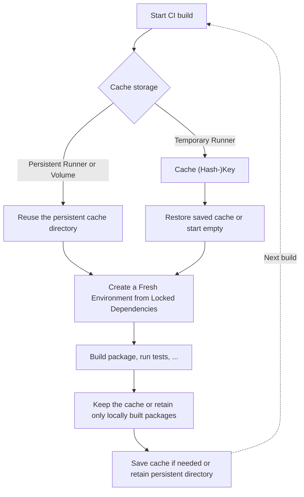

# Dependency Caching with uv

`uv` caches package metadata, downloaded wheels, and wheels built from source. A project environment (`.venv`) is normally beside `pyproject.toml`; it is **not** the package cache. The [Bob Follows the Cache notebook](../../notebooks/uv_cache_lab/uv_cache_lab.ipynb) runs the same experiments as this section. Run the commands below from `/workspace` in the [lab's Dev Container](../../notebooks/uv_cache_lab/README.md), in order. A first run needs network access.

## Applied Lab

The lab locks NumPy, SciPy, and Matplotlib and builds a local `uv-cache-demo` wheel containing a generated 16 MiB synthetic matrix. Its fixture is deterministic and not a trained model. Downloaded numerical-library wheels make cache growth visible; the locally built wheel makes CI pruning visible. The container supplies `uv` 0.13.3 (for the centralized-environment preview), Python 3.12, and Jupyter, but does not install the project or populate its `uv` cache at startup. The separate CI workflow pins `uv` 0.11.1. The lab's `UV_LINK_MODE=copy` keeps installed files independent of the cache. The container's cache is separate from your host's.

## Building Blocks

### Environment Variables That Influence Cache Behavior

These variables configure where `uv` caches data, whether it can reuse it, and how it installs files from the cache. See the [`uv` environment variable reference](https://docs.astral.sh/uv/reference/environment/) for the complete list.

| Variable | Cache behavior |
| --- | --- |
| `UV_CACHE_DIR` | Selects the shared cache directory instead of the system default; equivalent to `--cache-dir`. |
| `UV_NO_CACHE` | Uses a temporary cache for that invocation rather than the persistent cache; equivalent to `--no-cache`. |
| `UV_OFFLINE` | Disables network access, requiring cached or local packages; equivalent to `--offline`. |
| `UV_LINK_MODE` | Chooses `clone` (copy-on-write when supported), `hardlink` (shared files on one filesystem), `copy` (independent files), or `symlink` (depends on the cache). Defaults to `clone` on Linux/macOS and `hardlink` on Windows. |
| `UV_LOCK_TIMEOUT` | Sets how long `uv` waits for a cache lock, including when other `uv` processes are using the cache. |
| `UV_CONCURRENT_CACHE_READS` | Controls threads reading cached HTTP responses; defaults to `4`. |

### Commands That Influence the Cache

Package operations populate or reuse cache entries; cleanup commands remove them. For project locking and syncing, see [Dependency Management with `uv`](./section-02.md).

| Command | Effect on the cache |
| --- | --- |
| `uv pip install {pkg}` | Reuses or adds package metadata and wheels. `--refresh` revalidates cached data; `--refresh-package {pkg}` limits that to one package. |
| `uv add {pkg}` | Adds a dependency, resolves and synchronizes the project, and reuses or adds cached packages. |
| `uv sync` | Synchronizes a project from its lockfile, using or adding cached packages. |
| `uv tool install {tool}` | Installs a tool in its own environment while sharing `uv`'s package cache. |
| `uv cache prune` | Removes unused entries and centralized project environments. With `--ci`, also removes downloaded wheels and unzipped source distributions while retaining source-built wheels. |
| `uv cache clean [package]` | Removes all cache entries, or entries for only the named package. |

### Build Configuration and Wheel Reuse

For a local package, `tool.uv.cache-keys` in `pyproject.toml` defines which build inputs invalidate a cached wheel. Keys replace `uv`'s default checks: include every input that affects the build. A key containing only `pyproject.toml`, for example, may miss source-only changes. These configurations illustrate three ways to track inputs:

=== "Files"

    Track the manifest and an additional dependency file used by the build.

    ```toml
    [tool.uv]
    cache-keys = [{ file = "pyproject.toml" }, { file = "requirements.txt" }]
    ```

=== "Git Commit"

    Track the manifest and Git commit when the build depends on version control; add `tags = true` if tags affect it too. A commit key alone will not detect uncommitted source edits.

    ```toml
    [tool.uv]
    cache-keys = [{ file = "pyproject.toml" }, { git = { commit = true } }]
    ```

=== "Environment Variable"

    Track the manifest and a build-setting variable, whose changed value forces a rebuild.

    ```toml
    [tool.uv]
    cache-keys = [{ file = "pyproject.toml" }, { env = "MY_BUILD_SETTING" }]
    ```

!!! info "The lab's content fingerprint"

    This lab uses `cache-keys = [{ env = "CACHE_DEMO_KEY" }]`. After generating the fixture, `scripts/build_key.py` hashes `pyproject.toml`, Python source, JSON, and bundled data. Supply its result to every sync that installs the local package. Identical content can reuse a wheel across fresh CI checkouts even when file timestamps differ. `--no-editable` installs that wheel instead of linking the source tree.

## Populate and Inspect the Cache

`uv` caches several kinds of reusable data, including downloaded wheels, wheels built from source, unpacked source distributions, and centralized project environments when enabled. The first three are package artifacts that `uv` can reuse for later installations, while a centralized environment keeps a project's installed packages in the cache for reuse by that project.

=== "Downloaded wheels"

    Create an ignored directory for the disposable experiments in later tabs.

    ```bash
    mkdir -p lab
    ```

    Install the locked third-party dependencies; `--no-install-project` leaves the local wheel for the next tab.

    ```bash
    uv sync --locked --no-install-project --python 3.12
    ```

    Measure the populated cache; `cache-size` is a preview feature in this `uv` version.

    ```bash
    uv cache size --human --preview-features cache-size
    ```

=== "Locally built wheel"

    Generate the deterministic 16 MiB fixture before building the local package.

    ```bash
    .venv/bin/python scripts/generate_fixture.py
    ```

    Install the project as a regular wheel; the content fingerprint determines when `uv` rebuilds it.

    ```bash
    CACHE_DEMO_KEY=$(.venv/bin/python scripts/build_key.py) \
    uv sync \
      --locked \
      --no-editable \
      --python 3.12
    ```

    Run the installed package and write a PNG report.

    ```bash
    .venv/bin/python -m uv_cache_demo.main --output reports/embeddings.png
    ```

    Locate the locally built wheel; its path is the checkpoint for later pruning.

    ```bash
    find "$(uv cache dir)" -type f -name 'uv_cache_demo-*.whl' -print
    ```

=== "Unzipped source distribution"

    `uv` can unpack a source distribution (sdist), build a wheel, and cache both. Force a source build of small `idna` into an ignored target, without changing the project's lockfile.

    ```bash
    uv pip install \
      --python "$(uv python find 3.12)" \
      --target lab/sdist-target \
      --no-deps \
      --no-binary idna \
      'idna==3.10'
    ```

    Inspect source-cache buckets; their version suffixes are internal details and may change.

    ```bash
    find "$(uv cache dir)" -type d -name 'sdists-v*' -print
    ```

    Locate `uv`'s unpacked `idna` source (`src/idna`) while it is still present.

    ```bash
    find "$(uv cache dir)" -type d -path '*/sdists-v*/pypi/idna/3.10/*/src/idna' -print
    ```

    Find the `idna` wheel built from that source, distinct from the downloaded numerical-library wheels.

    ```bash
    find "$(uv cache dir)" -type f -name 'idna-*.whl' -print
    ```

=== "Centralized project environment"

    Normally `uv` creates `.venv` beside `pyproject.toml`. With the opt-in `centralized-project-envs` preview feature, `uv` instead stores the default environment in its cache and tries to link the virtual environment to it. Create an ignored, disposable project to keep the main `.venv` separate.

    ```bash
    mkdir -p lab/centralized
    ```

    Copy the locked project declarations into that directory; the project itself will not be installed there.

    ```bash
    cp pyproject.toml uv.lock lab/centralized/
    ```

    Populate the cached environment without specifying `UV_PROJECT_ENVIRONMENT` or `--active`: explicit environment paths bypass centralization.

    ```bash
    uv --preview-features centralized-project-envs sync \
      --directory lab/centralized \
      --locked \
      --no-install-project \
      --python 3.12
    ```

    Inspect the `.venv` link pointing into `uv`'s cache (`uv` may use a path file if linking is unavailable).

    ```bash
    ls -ld lab/centralized/.venv
    ```

    Check that dependencies import from the new environment rather than the main project's `.venv`.

    ```bash
    lab/centralized/.venv/bin/python -c 'import numpy; print(numpy.__version__)'
    ```

## Reuse Cached Packages

### Offline Synchronization

Remove just the installed environment, leaving `uv`'s cache available.

```bash
rm -rf .venv
```

Restore it without network access; the fixture and build fingerprint are still available.

```bash
CACHE_DEMO_KEY=$("$(uv python find 3.12)" scripts/build_key.py) \
  uv sync \
  --locked \
  --no-editable \
  --offline \
  --python 3.12
```

Confirm that NumPy and the local wheel import from `.venv`.

```bash
.venv/bin/python -c 'import numpy, uv_cache_demo; print(numpy.__file__, uv_cache_demo.__file__)'
```

### Compare UV_LINK_MODE

Use four disposable environments to compare installation modes without changing the main `.venv`. Each tab synchronizes the locked dependencies into a separate environment; `--offline` ensures these trials reuse the cached wheels. On a bind-mounted workspace, `hardlink` or `clone` may fall back to copying if the cache and environment are on different filesystems.

=== "Clone"

    Sync into a disposable environment with `clone`, `uv`'s normal Linux/macOS mode. Where supported, the environment initially shares disk blocks with the cache, then gets separate blocks when files change. This can use less disk space than making full copies.

    ```bash
    UV_PROJECT_ENVIRONMENT=lab/clone \
      UV_LINK_MODE=clone \
      uv sync \
      --locked \
      --no-install-project \
      --offline \
      --python 3.12
    ```

    Inspect the installed file and its hard-link count; `stat` alone cannot prove whether copy-on-write cloning occurred.

    ```bash
    stat -c '%F; hard links: %h' lab/clone/lib/python3.12/site-packages/numpy/__init__.py
    ```

    Verify the installed NumPy version.

    ```bash
    lab/clone/bin/python -c 'import numpy; print(numpy.__version__)'
    ```

=== "Copy"

    Sync using `copy` to make independent files in the environment. This uses more disk space than shared-block modes, but changes to installed files do not change the cached files.

    ```bash
    UV_PROJECT_ENVIRONMENT=lab/copy \
      UV_LINK_MODE=copy \
      uv sync \
      --locked \
      --no-install-project \
      --offline \
      --python 3.12
    ```

    Inspect the installed file's type and link count.

    ```bash
    stat -c '%F; hard links: %h' lab/copy/lib/python3.12/site-packages/numpy/__init__.py
    ```

=== "Hardlink"

    Use `hardlink` to let the environment and cache share the same file on one filesystem, which saves disk space. Editing a hardlinked file also changes the cached file. If they are on different filesystems, `uv` falls back to making a copy.

    ```bash
    UV_PROJECT_ENVIRONMENT=lab/hardlink \
      UV_LINK_MODE=hardlink \
      uv sync \
      --locked \
      --no-install-project \
      --offline \
      --python 3.12
    ```

    Check whether the installed file has multiple hard links (`%h` greater than one).

    ```bash
    stat -c '%F; hard links: %h' lab/hardlink/lib/python3.12/site-packages/numpy/__init__.py
    ```

=== "Symlink"

    Use `symlink` to make the environment's files point to files in the cache, avoiding separate copies. The environment depends on those cache paths, so cleaning or moving the cache can break it.

    ```bash
    UV_PROJECT_ENVIRONMENT=lab/symlink \
      UV_LINK_MODE=symlink \
      uv sync \
      --locked \
      --no-install-project \
      --offline \
      --python 3.12
    ```

    Inspect a link target to see why cleaning the cache would break this installation.

    ```bash
    readlink lab/symlink/lib/python3.12/site-packages/numpy/__init__.py
    ```

    Remove this disposable environment before the cleanup stages; retain the copy-mode `.venv`.

    ```bash
    rm -rf lab/symlink
    ```

## Clean the Cache in Stages

Follow these tabs **left to right**. They are successive experiments, not a ranking by how little each command removes: `--ci` may remove *more* than ordinary pruning. After each operation, inspect both cached artifacts and installed packages. The main `.venv` uses independent copies, so it remains usable after cache cleanup.

=== "CI prune"

    `uv cache prune --ci` removes unused data, downloaded wheels, and **unzipped source distributions**, but retains wheels built from source. Record the local wheel before pruning.

    ```bash
    find "$(uv cache dir)" -type f -name 'uv_cache_demo-*.whl' -print
    ```

    Locate the unzipped `idna` source before it is removed.

    ```bash
    find "$(uv cache dir)" -type d -path '*/sdists-v*/pypi/idna/3.10/*/src/idna' -print
    ```

    Measure the cache before cleanup.

    ```bash
    uv cache size --human --preview-features cache-size
    ```

    Prune downloadable wheels and unpacked sources while keeping source-built wheels.

    ```bash
    uv cache prune --ci
    ```

    Confirm the local wheel is still present.

    ```bash
    find "$(uv cache dir)" -type f -name 'uv_cache_demo-*.whl' -print
    ```

    Confirm the wheel built from `idna` source is also retained.

    ```bash
    find "$(uv cache dir)" -type f -name 'idna-*.whl' -print
    ```

    Check that the unzipped `idna` source is gone (no output expected).

    ```bash
    find "$(uv cache dir)" -type d -path '*/sdists-v*/pypi/idna/3.10/*/src/idna' -print
    ```

    Compare the cache size with its previous measurement.

    ```bash
    uv cache size --human --preview-features cache-size
    ```

    Confirm that installed packages in the main copy-mode `.venv` still import.

    ```bash
    .venv/bin/python -c 'import numpy; from uv_cache_demo.main import cache_message; print(cache_message())'
    ```

=== "Normal prune"

    `uv cache prune` removes unused entries and **centralized project environments**. The centralized project from the population tab may already have been removed by CI pruning, so create a *new* target now. Reuse its ignored project files and resync; this may redownload dependency wheels discarded by CI pruning.

    ```bash
    uv --preview-features centralized-project-envs sync --directory lab/centralized --locked --no-install-project --python 3.12
    ```

    Verify that the centralized project works again before pruning it.

    ```bash
    lab/centralized/.venv/bin/python -c 'import numpy; print(numpy.__version__)'
    ```

    Save the resolved target of the `.venv` link so it can be checked after pruning.

    ```bash
    readlink -f lab/centralized/.venv > lab/centralized-target
    ```

    Remove unused cache entries and cached project environments.

    ```bash
    uv cache prune
    ```

    Verify the saved centralized environment target is gone; its `.venv` link may be dangling.

    ```bash
    test ! -d "$(cat lab/centralized-target)"
    ```

    Confirm the locally built wheel remains in the cache.

    ```bash
    find "$(uv cache dir)" -type f -name 'uv_cache_demo-*.whl' -print
    ```

    Confirm the main, non-centralized `.venv` remains usable.

    ```bash
    .venv/bin/python -c 'import numpy; print(numpy.__version__)'
    ```

=== "Complete Clean"

    `uv cache clean` removes *all* remaining cache entries, including source-built wheels. Clear the cache now.

    ```bash
    uv cache clean
    ```

    Measure the emptied cache; `uv` may retain housekeeping files.

    ```bash
    uv cache size --human --preview-features cache-size
    ```

    Verify that the local wheel is no longer cached (no output expected).

    ```bash
    find "$(uv cache dir)" -type f -name 'uv_cache_demo-*.whl' -print
    ```

    Confirm installed copies still work. A symlink-mode environment would instead depend on the removed cache paths.

    ```bash
    .venv/bin/python -c 'import numpy; from uv_cache_demo.main import cache_message; print(cache_message())'
    ```

    Check that the previously generated report also remains in the workspace.

    ```bash
    test -f reports/embeddings.png
    ```

## Using uv's Cache in CI Environments

In CI workflows such as *GitHub Actions*, reusing `uv`'s cache avoids repeated downloads and builds. Keeping large downloaded packages can save network traffic but increases the size and transfer time of the saved cache. Compare both strategies rather than assuming that the smaller cache is always faster.

### CI Caching Pattern

The diagram below starts at *Cache storage* to show two ways of keeping package data between CI jobs:

- **Persistent runner:** Reuse a cache directory outside the job's temporary workspace so cleanup does not delete it.
- **Temporary runner:** Restore a saved cache using a key based on the platform and dependency files; if no matching cache is available, `uv` populates a new one during installation. The [GitHub Actions example](#github-actions-example) uses this approach.

Both paths recreate a fresh environment from the committed `uv.lock`. `--locked` fails if the lockfile needs updating; missing packages are downloaded or built and cached by `uv`. After the build, keep the full cache or prune it for CI, then save the cache (or retain its persistent directory) for the next job. Preserve the package cache rather than `.venv`, and include cache transfer time when comparing build durations.



### GitHub Actions Example

!!! info "Compare the Cache Strategies"

    The [`uv` cache workflow](../../.github/workflows/uv-cache.yml) compares a full cache with a CI-pruned cache. For each variant, run once cold and once warm without changing dependencies or sources:

    - **Warm cache:** Set `clean_cache: false` to reuse restored packages. Set `prune_cache: false` to keep the full cache, or `true` to prune downloaded wheels after installation; the workflow uses separate cache-key suffixes for these strategies.
    - **Cold cache:** Set `clean_cache: true` to clear the restored cache before syncing. Keep the same `prune_cache` choice as the warm run.

The workflow uses fresh GitHub-hosted runners, recreates `.venv` from `uv.lock`, and reports installation time and cache size. GitHub's [cache-sharing rules](https://docs.github.com/en/actions/reference/dependency-caching-reference#restrictions-for-accessing-a-cache) affect which saved caches a job can restore: pull requests can restore the target branch's cache but save only for that pull request. Entries expire after seven days without access, or earlier under storage pressure. Without an accessible matching cache, `uv` downloads or builds dependencies normally.

#### Workflow Triggers

The workflow runs on pushes to `main` that change `notebooks/uv_cache_lab/` or the workflow itself, and can be started manually. Manual runs expose independent `prune_cache` and `clean_cache` choices:

```yaml
on:
  push:
    branches:
      - main
    paths:
      - "notebooks/uv_cache_lab/**"
      - ".github/workflows/uv-cache.yml"
  workflow_dispatch:
    inputs:
      prune_cache:
        description: "Run uv cache prune --ci after installation"
        type: boolean
        default: true
      clean_cache:
        description: "Run uv cache clean before installing (cold run)"
        type: boolean
        default: false
```

#### Set the Cache Directory and Measure Its Initial Size

Initially, the workflow sets `UV_CACHE_DIR` under the runner's temporary storage and writes it to `GITHUB_ENV` so subsequent steps use the same path. The measurement does not create the cache; a fresh runner normally starts at 0 KiB.

```yaml
- name: Measure cache at the beginning of the job
  id: cache_start
  env:
    UV_CACHE_DIR: ${{ runner.temp }}/uv-cache
  run: |
    echo "UV_CACHE_DIR=$UV_CACHE_DIR" >> "$GITHUB_ENV"
    kib=0
    if [[ -d "$UV_CACHE_DIR" ]]; then
      kib=$(du -sk "$UV_CACHE_DIR" | cut -f1)
    fi
    echo "Before restoration: ${kib} KiB"
    echo "kib=$kib" >> "$GITHUB_OUTPUT"
```

#### Prepare the Fixture and Cache Key

Before restoring the cache, the workflow generates the synthetic fixture and fingerprints all build inputs. It writes `CACHE_DEMO_KEY` to `$GITHUB_ENV` for later steps. The project's [`pyproject.toml`](../../notebooks/uv_cache_lab/pyproject.toml) uses that fingerprint in `tool.uv.cache-keys`: unchanged content can reuse the local wheel after a fresh checkout, while changed content triggers a rebuild. This *`uv` wheel-cache key* differs from the GitHub Actions cache key described next.

```yaml
- name: Generate fixture and fingerprint build inputs
  run: |
    python notebooks/uv_cache_lab/scripts/generate_fixture.py
    build_key=$(python notebooks/uv_cache_lab/scripts/build_key.py)
    echo "CACHE_DEMO_KEY=$build_key" >> "$GITHUB_ENV"
```

#### Configure the Cache Key and Restore the Cache

`astral-sh/setup-uv` installs the pinned CI `uv` version (0.11.1) and restores or saves the shared cache when eligible. Unlike `tool.uv.cache-keys`, its GitHub cache key depends on inputs such as platform, `cache-dependency-glob`, and `cache-suffix`. The globs include the package's build inputs, so changed sources affect both keys.

```yaml
- name: Set up uv and restore its package cache
  id: uv
  uses: astral-sh/setup-uv@v5
  with:
    version: "0.11.1"
    enable-cache: true
    cache-local-path: ${{ env.UV_CACHE_DIR }}
    cache-dependency-glob: |
      notebooks/uv_cache_lab/pyproject.toml
      notebooks/uv_cache_lab/uv.lock
      notebooks/uv_cache_lab/src/**/*.py
      notebooks/uv_cache_lab/src/**/*.json
      notebooks/uv_cache_lab/src/**/*.bin
    cache-suffix: ${{ env.PRUNE_CACHE == 'true' && 'embeddings-demo-ci-pruned' || 'embeddings-demo-full' }}
    prune-cache: false
```

- **`enable-cache`**: Restores and saves `uv`'s package cache across eligible runs.
- **`cache-local-path`**: Matches the `UV_CACHE_DIR` used by `uv` and the measurements.
- **`cache-dependency-glob`**: Hashes the manifest, lockfile, source, and generated fixture for the saved-cache key.
- **`cache-suffix`**: Separates full (`embeddings-demo-full`) and CI-pruned (`embeddings-demo-ci-pruned`) caches.
- **`prune-cache`**: Disables automatic pruning so the workflow can explicitly prune and measure the result, including on cache hits.

GitHub cannot overwrite an existing cache with the same key, even if a job prunes its local restored copy. The workflow records sizes in KiB for the *local* cache directory, not the compressed GitHub archive or `.venv`; optional steps are measured even when skipped.

#### Clear the uv Cache for a Cold Install

With `CLEAN_CACHE=true`, the workflow clears the restored cache to simulate a cold install; otherwise it reuses cached packages. Either way it records the size afterward.

```yaml
- name: Clear uv cache for a cold install
  id: cache_cleaned
  run: |
    if [[ "$CLEAN_CACHE" == "true" ]]; then
      uv cache clean
    fi
    kib=0
    if [[ -d "$UV_CACHE_DIR" ]]; then
      kib=$(du -sk "$UV_CACHE_DIR" | cut -f1)
    fi
    echo "After optional cleaning: ${kib} KiB"
    echo "kib=$kib" >> "$GITHUB_OUTPUT"
```

#### Create a Fresh Environment from Locked Dependencies

The sync step recreates `.venv` from the committed lockfile and builds or reuses the local wheel. It times only `uv sync`; the size measurement happens after the timer.

```yaml
- name: Create a fresh environment from locked dependencies
  id: install
  shell: bash
  run: |
    start_ms=$(date +%s%3N)
    uv sync --directory notebooks/uv_cache_lab --locked --no-editable --python 3.12
    end_ms=$(date +%s%3N)
    echo "milliseconds=$((end_ms - start_ms))" >> "$GITHUB_OUTPUT"
    kib=0
    if [[ -d "$UV_CACHE_DIR" ]]; then
      kib=$(du -sk "$UV_CACHE_DIR" | cut -f1)
    fi
    echo "After uv sync: ${kib} KiB"
    echo "kib=$kib" >> "$GITHUB_OUTPUT"
```

#### Generate the Embedding Report

After syncing, the workflow analyzes the installed synthetic embeddings and saves its report under the runner's temporary directory.

```yaml
- name: Analyze the installed embeddings and generate a report
  run: |
    notebooks/uv_cache_lab/.venv/bin/python -m uv_cache_demo.main \
      --output "${{ runner.temp }}/embeddings.png"
```

#### Keep the Cache or Retain Only Locally Built Packages

After the report, `PRUNE_CACHE` controls whether `uv cache prune --ci` discards dependency downloads while retaining built wheels. Future jobs may need to download the numerical libraries again. The 16 MiB bundled fixture makes the retained local wheel visible; wheel size does not imply an expensive rebuild or a guaranteed speedup. The workflow records the final cache size even when pruning is skipped.

```yaml
- name: Keep the cache or retain locally built packages
  id: cache_size
  shell: bash
  run: |
    if [[ "$PRUNE_CACHE" == "true" ]]; then
      uv cache prune --ci
    fi
    kib=0
    if [[ -d "$UV_CACHE_DIR" ]]; then
      kib=$(du -sk "$UV_CACHE_DIR" | cut -f1)
    fi
    echo "After optional CI pruning: ${kib} KiB"
    echo "kib=$kib" >> "$GITHUB_OUTPUT"
```
