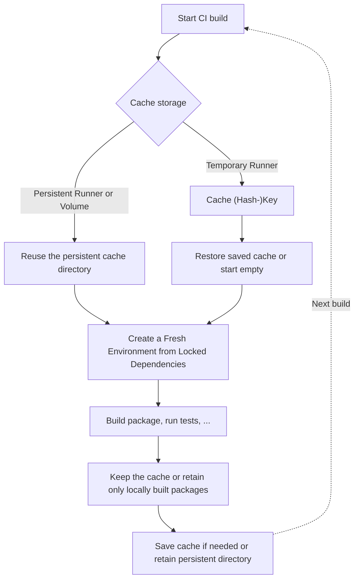

# Using uv's Cache in CI Environments


In CI workflows such as *GitHub Actions*, reusing `uv`'s package cache avoids repeated downloads and builds. This page uses the repository's [`.github/workflows/uv-cache.yml`](https://github.com/ValentinTwin1206/modern-python-devops-egineering/blob/main/.github/workflows/uv-cache.yml) workflow to compare cache strategies and measure their effects. Keeping large downloaded packages can save network traffic but increases the size and transfer time of the saved cache, so compare both strategies rather than assuming that the smaller cache is always faster.

## Used Project

This table lists the workflow and project files used in the examples.

| Component | Description |
| --- | --- |
| [`.github/workflows/uv-cache.yml`](https://github.com/ValentinTwin1206/modern-python-devops-egineering/blob/main/.github/workflows/uv-cache.yml) | GitHub Actions workflow that compares full and CI-pruned caches and records install time and local cache size. |
| [`notebooks/uv_cache_lab/pyproject.toml`](https://github.com/ValentinTwin1206/modern-python-devops-egineering/blob/main/notebooks/uv_cache_lab/pyproject.toml) and [`uv.lock`](https://github.com/ValentinTwin1206/modern-python-devops-egineering/blob/main/notebooks/uv_cache_lab/uv.lock) | Define the package build configuration and locked dependencies installed by the workflow. |

## CI Caching Pattern
The diagram below starts at *Cache storage* to show two ways of keeping package data between CI jobs:

- **Persistent runner:** Reuse a cache directory outside the job's temporary workspace so cleanup does not delete it.
- **Temporary runner:** Restore a saved cache using a key based on the platform and dependency files; if no matching cache is available, `uv` populates a new one during installation. The [GitHub Actions example](#github-actions-example) uses this approach.

Both paths recreate a fresh environment from the committed `uv.lock`. `--locked` fails if the lockfile needs updating; missing packages are downloaded or built and cached by `uv`. After the build, keep the full cache or prune it for CI, then save the cache (or retain its persistent directory) for the next job. Preserve the package cache rather than `.venv`, and include cache transfer time when comparing build durations.



## GitHub Actions Example
!!! info "Compare the Cache Strategies"

    The [`uv` cache workflow](https://github.com/ValentinTwin1206/modern-python-devops-egineering/blob/main/.github/workflows/uv-cache.yml) compares a full cache with a CI-pruned cache. For each variant, run once cold and once warm without changing dependencies or sources:

    - **Warm cache:** Set `clean_cache: false` to reuse restored packages. Set `prune_cache: false` to keep the full cache, or `true` to prune downloaded wheels after installation; the workflow uses separate cache-key suffixes for these strategies.
    - **Cold cache:** Set `clean_cache: true` to clear the restored cache before syncing. Keep the same `prune_cache` choice as the warm run.

The workflow uses fresh GitHub-hosted runners, recreates `.venv` from `uv.lock`, and reports installation time and cache size. GitHub's [cache-sharing rules](https://docs.github.com/en/actions/reference/dependency-caching-reference#restrictions-for-accessing-a-cache) affect which saved caches a job can restore: pull requests can restore the target branch's cache but save only for that pull request. Entries expire after seven days without access, or earlier under storage pressure. Without an accessible matching cache, `uv` downloads or builds dependencies normally.

### Workflow Triggers
The workflow runs on pushes to `main` that change `notebooks/uv_cache_lab/` or the workflow itself, and can be started manually. Manual runs expose independent `prune_cache` and `clean_cache` choices:

```yaml
on:
  push:
    branches:
      - main
    paths:
      - "notebooks/uv_cache_lab/**"
      - ".github/workflows/uv-cache.yml"
  workflow_dispatch:
    inputs:
      prune_cache:
        description: "Run uv cache prune --ci after installation"
        type: boolean
        default: true
      clean_cache:
        description: "Run uv cache clean before installing (cold run)"
        type: boolean
        default: false
```

### Set the Cache Directory and Measure Its Initial Size
Initially, the workflow sets `UV_CACHE_DIR` under the runner's temporary storage and writes it to `GITHUB_ENV` so subsequent steps use the same path. The measurement does not create the cache; a fresh runner normally starts at 0 KiB.

```yaml
- name: Measure cache at the beginning of the job
  id: cache_start
  env:
    UV_CACHE_DIR: ${{ runner.temp }}/uv-cache
  run: |
    echo "UV_CACHE_DIR=$UV_CACHE_DIR" >> "$GITHUB_ENV"
    kib=0
    if [[ -d "$UV_CACHE_DIR" ]]; then
      kib=$(du -sk "$UV_CACHE_DIR" | cut -f1)
    fi
    echo "Before restoration: ${kib} KiB"
    echo "kib=$kib" >> "$GITHUB_OUTPUT"
```

### Prepare the Fixture and Cache Key
Before restoring the cache, the workflow generates the synthetic fixture and fingerprints all build inputs. It writes `CACHE_DEMO_KEY` to `$GITHUB_ENV` for later steps. The project's [`pyproject.toml`](https://github.com/ValentinTwin1206/modern-python-devops-egineering/blob/main/notebooks/uv_cache_lab/pyproject.toml) uses that fingerprint in `tool.uv.cache-keys`: unchanged content can reuse the local wheel after a fresh checkout, while changed content triggers a rebuild. This *`uv` wheel-cache key* differs from the GitHub Actions cache key described next.

```yaml
- name: Generate fixture and fingerprint build inputs
  run: |
    python notebooks/uv_cache_lab/scripts/generate_fixture.py
    build_key=$(python notebooks/uv_cache_lab/scripts/build_key.py)
    echo "CACHE_DEMO_KEY=$build_key" >> "$GITHUB_ENV"
```

### Configure the Cache Key and Restore the Cache
`astral-sh/setup-uv` installs the pinned CI `uv` version (0.11.1) and restores or saves the shared cache when eligible. Unlike `tool.uv.cache-keys`, its GitHub cache key depends on inputs such as platform, `cache-dependency-glob`, and `cache-suffix`. The globs include the package's build inputs, so changed sources affect both keys.

```yaml
- name: Set up uv and restore its package cache
  id: uv
  uses: astral-sh/setup-uv@v5
  with:
    version: "0.11.1"
    enable-cache: true
    cache-local-path: ${{ env.UV_CACHE_DIR }}
    cache-dependency-glob: |
      notebooks/uv_cache_lab/pyproject.toml
      notebooks/uv_cache_lab/uv.lock
      notebooks/uv_cache_lab/src/**/*.py
      notebooks/uv_cache_lab/src/**/*.json
      notebooks/uv_cache_lab/src/**/*.bin
    cache-suffix: ${{ env.PRUNE_CACHE == 'true' && 'embeddings-demo-ci-pruned' || 'embeddings-demo-full' }}
    prune-cache: false
```

- **`enable-cache`**: Restores and saves `uv`'s package cache across eligible runs.
- **`cache-local-path`**: Matches the `UV_CACHE_DIR` used by `uv` and the measurements.
- **`cache-dependency-glob`**: Hashes the manifest, lockfile, source, and generated fixture for the saved-cache key.
- **`cache-suffix`**: Separates full (`embeddings-demo-full`) and CI-pruned (`embeddings-demo-ci-pruned`) caches.
- **`prune-cache`**: Disables automatic pruning so the workflow can explicitly prune and measure the result, including on cache hits.

GitHub cannot overwrite an existing cache with the same key, even if a job prunes its local restored copy. The workflow records sizes in KiB for the *local* cache directory, not the compressed GitHub archive or `.venv`; optional steps are measured even when skipped.

### Clear the uv Cache for a Cold Install
With `CLEAN_CACHE=true`, the workflow clears the restored cache to simulate a cold install; otherwise it reuses cached packages. Either way it records the size afterward.

```yaml
- name: Clear uv cache for a cold install
  id: cache_cleaned
  run: |
    if [[ "$CLEAN_CACHE" == "true" ]]; then
      uv cache clean
    fi
    kib=0
    if [[ -d "$UV_CACHE_DIR" ]]; then
      kib=$(du -sk "$UV_CACHE_DIR" | cut -f1)
    fi
    echo "After optional cleaning: ${kib} KiB"
    echo "kib=$kib" >> "$GITHUB_OUTPUT"
```

### Create a Fresh Environment from Locked Dependencies
The sync step recreates `.venv` from the committed lockfile and builds or reuses the local wheel. It times only `uv sync`; the size measurement happens after the timer.

```yaml
- name: Create a fresh environment from locked dependencies
  id: install
  shell: bash
  run: |
    start_ms=$(date +%s%3N)
    uv sync --directory notebooks/uv_cache_lab --locked --no-editable --python 3.12
    end_ms=$(date +%s%3N)
    echo "milliseconds=$((end_ms - start_ms))" >> "$GITHUB_OUTPUT"
    kib=0
    if [[ -d "$UV_CACHE_DIR" ]]; then
      kib=$(du -sk "$UV_CACHE_DIR" | cut -f1)
    fi
    echo "After uv sync: ${kib} KiB"
    echo "kib=$kib" >> "$GITHUB_OUTPUT"
```

### Generate the Embedding Report
After syncing, the workflow analyzes the installed synthetic embeddings and saves its report under the runner's temporary directory.

```yaml
- name: Analyze the installed embeddings and generate a report
  run: |
    notebooks/uv_cache_lab/.venv/bin/python -m uv_cache_demo.main \
      --output "${{ runner.temp }}/embeddings.png"
```

### Keep the Cache or Retain Only Locally Built Packages
After the report, `PRUNE_CACHE` controls whether `uv cache prune --ci` discards dependency downloads while retaining built wheels. Future jobs may need to download the numerical libraries again. The 16 MiB bundled fixture makes the retained local wheel visible; wheel size does not imply an expensive rebuild or a guaranteed speedup. The workflow records the final cache size even when pruning is skipped.

```yaml
- name: Keep the cache or retain locally built packages
  id: cache_size
  shell: bash
  run: |
    if [[ "$PRUNE_CACHE" == "true" ]]; then
      uv cache prune --ci
    fi
    kib=0
    if [[ -d "$UV_CACHE_DIR" ]]; then
      kib=$(du -sk "$UV_CACHE_DIR" | cut -f1)
    fi
    echo "After optional CI pruning: ${kib} KiB"
    echo "kib=$kib" >> "$GITHUB_OUTPUT"
```
