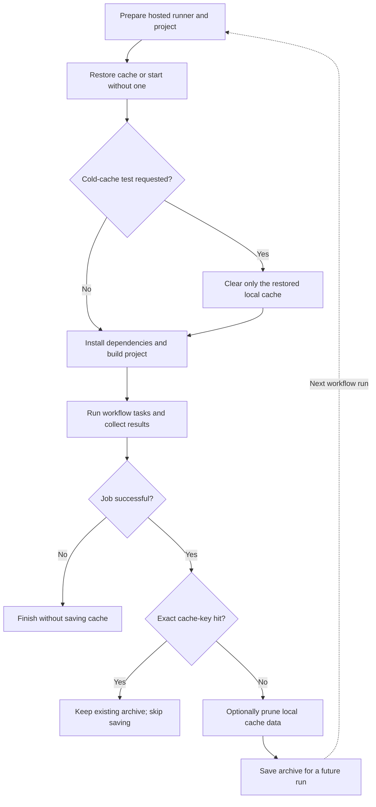
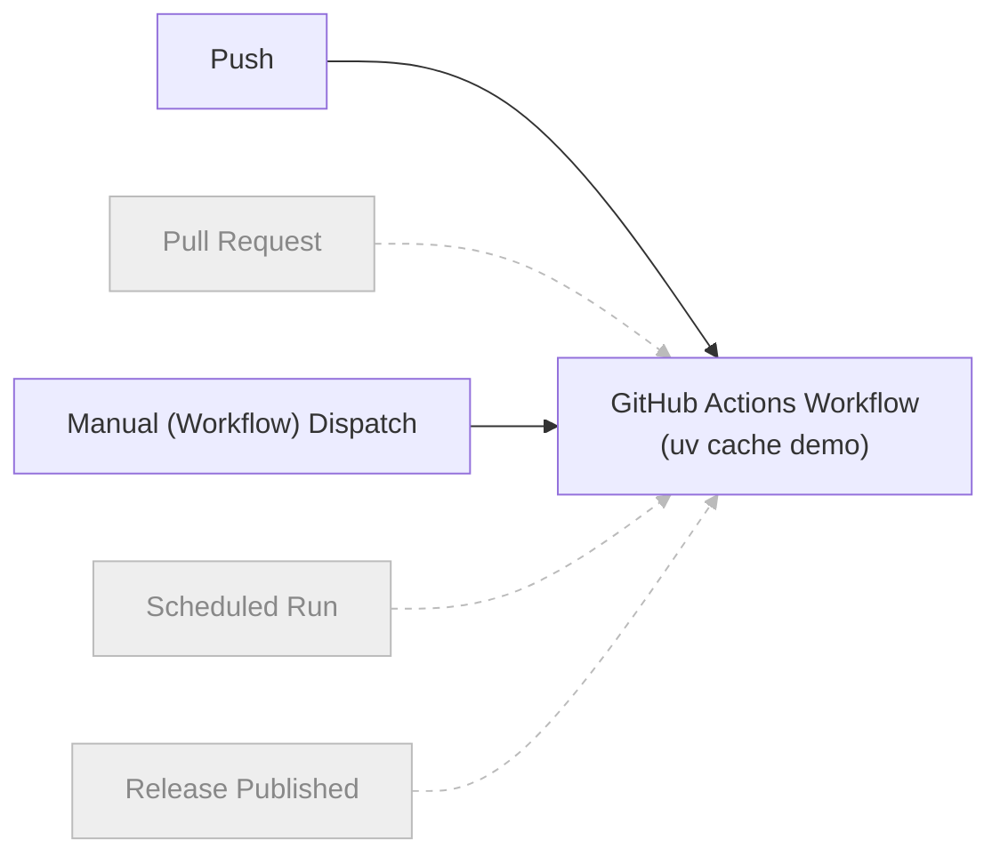

# Using uv's Cache in CI Environments

Aggressive caching helps make `uv` fast by avoiding repeated downloads and builds of dependencies. In CI, however, transferring a cache between temporary runners adds overhead, so preserving everything is not always worthwhile. [Astral's CI caching guidance](https://docs.astral.sh/uv/concepts/cache/#caching-in-continuous-integration) distinguishes between *Prebuilt Wheels* (ready-to-install Python packages), which are often quick to download again and install, and *Wheels Built from Source*, which can be expensive to recreate, especially when compiling native extensions. Its strategy therefore favors retaining source-built wheels rather than downloaded prebuilt wheels. This guidance does not cite a formal study quantifying the trade-off; this section explains how to adopt the strategy and measure its benefits in your own CI workflow rather than assume a speedup.

## Used Project

This table lists the workflow and project files used in the examples.

| Component | Description |
| --- | --- |
| [`.github/workflows/uv-cache.yml`](https://github.com/ValentinTwin1206/modern-python-devops-egineering/blob/main/.github/workflows/uv-cache.yml) | GitHub Actions workflow that compares full and CI-pruned caches and records install time and local cache size. |
| [`notebooks/uv_cache_lab/pyproject.toml`](https://github.com/ValentinTwin1206/modern-python-devops-egineering/blob/main/notebooks/uv_cache_lab/pyproject.toml) and [`uv.lock`](https://github.com/ValentinTwin1206/modern-python-devops-egineering/blob/main/notebooks/uv_cache_lab/uv.lock) | Define the package build configuration and locked dependencies installed by the workflow. |

## GitHub Actions Caching Pattern

### Cache Layers

GitHub Actions provides an [***Integrated Cache Service***](https://docs.github.com/en/actions/reference/dependency-caching-reference) for storing and restoring files across workflow runs. It works alongside tools' own caches and the project's environment, so understanding the separate layers helps explain what persists and when it can be reused. Three distinct layers participate in this example.

1. **The GitHub Actions cache** stores a remote archive selected by an action-generated key and GitHub's access rules.
2. **Language and package-manager caches** hold tool-managed downloads and build artifacts on the runner. This pattern applies to tools such as Python's `uv`, Rust's `cargo`, and Node.js's `npm`
3. **The project `.venv`** contains installed packages. Each hosted runner creates it fresh, and it is not cached.

### Hosted Runner Cache Lifecycle

GitHub Actions supports **Persistent Runners**, typically long-lived self-hosted machines that can retain a package cache between jobs, and **(GitHub) Hosted Runners**, temporary GitHub-managed machines provisioned for a job. Since *(GitHub) Hosted Runners* are temporary, workflows can restore a remote cache at the start of a run, use its contents while installing dependencies or building the project, and save an updated archive after a successful run. Cache keys commonly combine environment details and project inputs so compatible runs can reuse an archive. An exact key hit can skip saving because cache entries are immutable; after a miss, a workflow can prune unnecessary local data before saving a new archive. A cold-cache test can clear only the runner's restored copy while leaving the remote archive intact. The chart illustrates this general workflow.



### Cache Retention and Access

GitHub removes cache entries not accessed for over seven days, and repository storage limits can cause earlier eviction ([retention and eviction policy](https://docs.github.com/en/actions/reference/dependency-caching-reference#usage-limits-and-eviction-policy)). A matching key alone is insufficient if its archive has expired or is outside the run's permitted scope. Runs can restore caches from their current branch and the default branch, not arbitrary sibling branches ([cache-sharing rules](https://docs.github.com/en/actions/reference/dependency-caching-reference#restrictions-for-accessing-a-cache)). Manual experiments should use the same branch/revision to keep comparisons meaningful.

## Using uv's Cache in GitHub Actions

The `uv cache demo` workflow in [`.github/workflows/uv-cache.yml`](https://github.com/ValentinTwin1206/modern-python-devops-egineering/blob/main/.github/workflows/uv-cache.yml) is a streamlined example of using `uv`'s package cache in CI. It compares warm and cold installations to measure the potential installation-time savings from cache reuse.

### Workflow Triggers and Job Configuration

GitHub Actions starts a workflow when an event configured under `on` occurs. Common triggers include **Pushes**, **Pull Requests**, **Manual (Workflow) Dispatches**, **Scheduled Runs**, and **Published Releases**. The `uv cache demo` workflow runs automatically when a push to `main` changes files matching either path pattern listed in the YAML below. It can also be started manually from the repository's **Actions** tab, with an optional cold-cache experiment. Both triggers run the same analysis job on a GitHub-hosted Ubuntu runner. In the diagram, grayed-out triggers and dashed arrows indicate events not configured in this workflow.



The following excerpt combines the triggers introduced above - *Pushes (`push`)* and *Manual (Workflow) Dispatches (`workflow_dispatch`)* - with the analysis job configuration. The `permissions` setting grants read-only access to repository contents. To form a runnable workflow, the job also needs its `steps`: the full workflow first checks out the repository and sets up Python 3.12, then prepares the fixture, configures caching, and runs the analysis, as explained below.

```yaml
name: uv cache demo

on:
  push:
    branches:
      - main
    paths:
      - "notebooks/uv_cache_lab/**"
      - ".github/workflows/uv-cache.yml"
  workflow_dispatch:
    inputs:
      cold_cache:
        description: "Skip uv cache restoration and saving for a cold installation"
        type: boolean
        default: false

permissions:
  contents: read

jobs:
  analyze-embeddings:
    runs-on: ubuntu-latest
    env:
      COLD_CACHE: ${{ github.event_name == 'workflow_dispatch' && inputs.cold_cache }}
```

- **`on`** defines the events that start the workflow. Here, `push` requires both a push to `main` and a change matching at least one listed path pattern. `workflow_dispatch` enables manual runs; pull requests and documentation-only pushes do not trigger this workflow automatically.
- **`inputs`** defines options for manual runs. The boolean `cold_cache` defaults to `false`. The job exposes it as `COLD_CACHE`, which later cache steps use to decide whether to restore and save the cache; automatic push runs set `COLD_CACHE` to `false`.
- **`jobs`** defines the work performed by the workflow. Here, `analyze-embeddings` identifies the analysis job. Its steps prepare the project, configure caching, and run the analysis.
- **`runs-on`** selects the machine that executes the job. `ubuntu-latest` uses a fresh GitHub-hosted runner with GitHub's current default Ubuntu image, rather than a fixed Ubuntu release.

### Prepare the Fixture and Local Wheel Fingerprint

After the CI environment is set up, `generate_fixture.py` creates a synthetic embedding matrix included in the `uv-cache-demo` project to demonstrate efficient cache reuse in CI. Then `build_key.py` calculates a SHA-256 fingerprint from the relative paths and contents of the project's `pyproject.toml` and all files under the `src` folder. The step exposes this value as `CACHE_DEMO_KEY` to the GitHub environment, making it available to the [later workflow step](#create-a-fresh-environment-from-locked-dependencies).

```yaml
  steps:
    - name: Generate fixture and fingerprint build inputs
      env:
        FIXTURE_SIZE_MIB: "256"
      run: |
        python notebooks/uv_cache_lab/scripts/generate_fixture.py --size "$FIXTURE_SIZE_MIB"
        build_key=$(python notebooks/uv_cache_lab/scripts/build_key.py)
        echo "CACHE_DEMO_KEY=$build_key" >> "$GITHUB_ENV"
```

### Setup uv and Restore the Cache

The [`astral-sh/setup-uv`](https://github.com/astral-sh/setup-uv) GitHub Action is developed, released, and maintained by Astral, the company behind `uv`. It installs `uv`, adds it to the runner's `PATH`, and provides options to configure its setup and package-cache behavior, including cache restoration, pruning, and saving. Its remote cache key incorporates an internal cache version, architecture, platform, and detected Python version, along with a hash of matching files; the explicit patterns in this workflow cover dependencies and local build inputs, including generated data, so changes invalidate the remote cache. Manual runs can optionally skip restoration for a **cold installation** because each fresh GitHub-hosted runner starts without the project's package cache.

```yaml
- name: Set up uv and optionally restore its package cache
  id: uv
  uses: astral-sh/setup-uv@07a047e608db84b3d8c06cd9a7c7dcc9c355c18e # v10.3.2
  with:
    version: "0.11.1"
    enable-cache: true
    restore-cache: ${{ env.COLD_CACHE != 'true' }}
    save-cache: ${{ env.COLD_CACHE == 'true' && 'false' || 'auto' }}
    prune-cache: true
    cache-dependency-glob: |
      notebooks/uv_cache_lab/pyproject.toml
      notebooks/uv_cache_lab/uv.lock
      notebooks/uv_cache_lab/scripts/*.py
      notebooks/uv_cache_lab/src/**/*.py
      notebooks/uv_cache_lab/src/**/*.json
      notebooks/uv_cache_lab/src/**/*.bin
```

- `version` - Pins `uv` to 0.11.1 independently of the action release, so updates to the action do not change the installed `uv` version.
- `enable-cache` - Explicitly enables GitHub Actions caching; its `auto` default enables caching on GitHub-hosted runners for supported events.
- `restore-cache` restores matching artifacts during normal runs. Selecting `cold_cache` disables restoration, giving a cold installation without `uv cache clean`. This relies on fresh hosted runners. The action defaults to `"true"`.
- `save-cache` uses `"auto"` during normal runs and `"false"` during cold experiments, leaving remote archives unchanged. The `"auto"` default allows eligible saving except for `merge_group` events; it does not make installation cold.
- `prune-cache` - Enables `uv cache prune --ci` before a new cache is saved after a cache miss; in v10.3.2, the default is `false`.
- `cache-dependency-glob` - replaces the default lockfile and requirements patterns with the listed repository-relative paths, which are used to generate the remote cache key.
- `UV_CACHE_DIR` - Is set by the action to its runner-temporary cache location, so the workflow does not need to override it.
- `cache-hit` indicates whether restoration found an archive. When restoration is disabled, v10.3.2 leaves this output unset, so the summary explicitly reports `Skipped`.

!!! info "How setup-uv Saves Cache Updates"

    After a successful job, the action's [post-action](https://github.com/astral-sh/setup-uv/blob/07a047e608db84b3d8c06cd9a7c7dcc9c355c18e/src/save-cache.ts) saves the remote cache when needed. An exact key hit skips both pruning and saving. Without an exact-key match, this workflow prunes the local cache with `uv cache prune --ci` before saving it under the current key. GitHub cache entries are immutable, so the action creates a new entry rather than overwriting an existing one. Cold experiments disable saving entirely.

### Optional Cold-Cache Experiment

The `uv cache demo` workflow reuses an accessible cache by default. For a **cold-cache** experiment, a manual run can set `cold_cache` to `true`; this disables cache restoration and saving, so the fresh hosted runner installs dependencies without a restored package cache and leaves existing remote archives unchanged.

```yaml
with:
  restore-cache: ${{ env.COLD_CACHE != 'true' }}
  save-cache: ${{ env.COLD_CACHE == 'true' && 'false' || 'auto' }}
```

!!! info "Cold Runs Leave the Remote Cache Unchanged"

    Cold runs skip both restoring and saving the cache. Previously saved archives remain available to later warm runs.

### Create a Fresh Environment from Locked Dependencies

Each hosted *(GitHub) Runner* starts with a clean environment. However, GitHub Actions provides a cache service that tools such as `uv`, `cargo`, etc. can use to save and restore package caches between workflow runs. Additionally, `uv` lets a project identify its local wheel-cache entries by configuring `tool.uv.cache-keys` in `pyproject.toml`, that is used in the current example to complements the remote GitHub Actions cache key.

```toml
[tool.uv]
cache-keys = [{ env = "CACHE_DEMO_KEY" }]
```

> See [*Prepare the Fixture and Local Wheel Fingerprint*](#prepare-the-fixture-and-local-wheel-fingerprint) for how `UV_CACHE_KEY` is generated

When `uv sync` runs, it creates the `.venv` and uses the fingerprint to reuse a matching wheel or rebuild the local package if the inputs have changed. The following step runs `uv sync` with the committed lockfile and measures only the sync duration, excluding fixture generation, cache transfers, pruning, and report execution.

```yaml
- name: Create a fresh environment from locked dependencies
  id: install
  shell: bash
  run: |
    start_ms=$(date +%s%3N)
    uv sync \
      --directory notebooks/uv_cache_lab \
      --locked \
      --no-editable \
      --python 3.12
    end_ms=$(date +%s%3N)
    echo "milliseconds=$((end_ms - start_ms))" >> "$GITHUB_OUTPUT"
```

- `--directory` - Selects the lab project.
- `--locked` - Uses the committed `uv.lock` and fails if it needs updating.
- `--no-editable` - Builds and installs a regular local wheel instead of linking the source tree. A cold cache builds it; an unchanged warm cache can reuse it.
- `--python 3.12` - Selects the interpreter set up earlier.

### Generate the Embedding Report

The command validates the installed matrix and calculates statistics and cosine distances in chunks. Memory-mapping avoids a full-size `float64` copy of the 256 MiB fixture. The PNG is generated on the runner without being uploaded as an artifact.

```yaml
- name: Analyze the installed embeddings and generate a report
  run: |
    notebooks/uv_cache_lab/.venv/bin/python -m uv_cache_demo.main \
      --output "${{ runner.temp }}/embeddings.png"
```

### Show Cache and Installation Time

Immediately after `setup-uv` and before `uv sync`, the workflow measures the restored local package cache. `du -sb` counts its size in bytes, and `numfmt` converts that value to a human-readable IEC unit such as MiB. Measuring before installation shows what was retained in the remote cache, before downloaded packages grow the local cache again.

```yaml
- name: Measure restored package cache size
  run: |
    mkdir -p "$UV_CACHE_DIR"
    bytes=$(du -sb "$UV_CACHE_DIR" | cut -f1)
    echo "RESTORED_CACHE_BYTES=$bytes" >> "$GITHUB_ENV"
    echo "RESTORED_CACHE_SIZE=$(numfmt --to=iec-i --suffix=B "$bytes")" >> "$GITHUB_ENV"
```

The final step writes cache restoration status, the requested experiment, and installation time to the job summary. It derives `RESTORE_STATUS` from the action's boolean `cache-hit` output: `Skipped` when cold mode disables restoration, `Restored` when a cache entry is found, or `Not restored` when no entry matches. The install step calculates `INSTALL_MS` by subtracting `start_ms` from `end_ms` around `uv sync`; the duration is in milliseconds and excludes fixture generation, cache restoration and saving, and report execution. Thus, `COLD_CACHE=true` measures a cold installation, while `COLD_CACHE=false` is a warm run only when `RESTORE_STATUS` is `Restored`.

The report also includes the cache size recorded before installation and its size after `uv sync`, before `setup-uv`'s post-action pruning. These are local directory sizes, not compressed remote archive sizes. A size reported after skipped or unsuccessful restoration does not represent a restored archive; interpret it alongside the restoration status.

```yaml
- name: Show cache and installation time
  env:
    RESTORE_STATUS: ${{ env.COLD_CACHE == 'true' && 'Skipped' || (steps.uv.outputs.cache-hit == 'true' && 'Restored' || 'Not restored') }}
    INSTALL_MS: ${{ steps.install.outputs.milliseconds }}
  run: |
    cache_bytes=$(du -sb "$UV_CACHE_DIR" | cut -f1)
    cache_size=$(numfmt --to=iec-i --suffix=B "$cache_bytes")
    echo "RESTORED_CACHE_SIZE=$RESTORED_CACHE_SIZE ($RESTORED_CACHE_BYTES bytes)"
    echo "CACHE_SIZE_AFTER_SYNC=$cache_size ($cache_bytes bytes; before setup-uv post-action pruning)"
    {
      echo '## uv cache demo'
      echo ''
      echo '| Measurement | Result |'
      echo '| --- | --- |'
      echo "| setup-uv cache restoration | $RESTORE_STATUS |"
      echo "| Cold-cache experiment requested | $COLD_CACHE |"
      echo "| Restored local uv cache | $RESTORED_CACHE_SIZE |"
      echo "| uv sync duration | ${INSTALL_MS} ms |"
      echo "| Local uv cache after sync, before post-action pruning | $cache_size |"
      echo ''
      echo 'Duration measures only uv sync; it excludes GitHub cache restoration and saving time.'
      echo 'Cold experiments skip cache restoration and saving; remote archives remain unchanged.'
      echo 'Compare multiple runs with unchanged dependencies and build inputs; no speedup is guaranteed.'
    } >> "$GITHUB_STEP_SUMMARY"
```

## Run the Workflow and Compare Cache Performance

### Execute the Cache Strategy Comparison

The project contains two workflows for comparing cache strategies in CI. One uses CI-optimized cache pruning (**uv cache demo**, [`uv-cache.yml`](https://github.com/ValentinTwin1206/modern-python-devops-egineering/blob/main/.github/workflows/uv-cache.yml)), while the other preserves a full cache (**uv full cache demo**, [`uv-cache-compare.yml`](https://github.com/ValentinTwin1206/modern-python-devops-egineering/blob/main/.github/workflows/uv-cache-compare.yml)). Comparing both strategies against a cold installation helps show how cache retention affects storage needs and execution time. The numbered steps below describe how the experiment was carried out.

1. **Populate the CI-optimized cache.** In **Actions**, select **uv cache demo**, open **Run workflow**, choose `main`, and leave `cold_cache` unchecked (`false`). Start the run and wait for success. Keep `main` unchanged throughout the experiment.
2. **Populate the full cache.** Select **uv full cache demo** and run it on `main`. This workflow has no `cold_cache` input. Wait for success; exclude both population runs from the results.
3. **Measure the CI-optimized warm run.** Run **uv cache demo** again on `main` with `cold_cache` unchecked (`false`). After success, confirm `Restored` in **Show cache and installation time** before recording the result.
4. **Measure the full-cache warm run.** Run **uv full cache demo** again on `main`, with no additional input. After success, confirm `Restored` in the same reporting step. If either warm run reports `Not restored`, investigate and retry that workflow before continuing; stop after three unsuccessful warm attempts.
5. **Measure the cold baseline.** Run **uv cache demo** on `main` with `cold_cache` checked (`true`). After success, confirm `Skipped` in the reporting step. For each of the three measured runs, record its link, `INSTALL_MS`, cache size before installation, and total job time. Confirm that all used the same commit before comparing them.

### Compare Cache Size and Execution Time

The table below compares measured `uv sync` times and cache sizes for a CI-optimized cache, a full cache, and a cold installation without a restored cache. All measured runs used the same project revision, dependencies, fixture, Python and uv versions, and runner image; cache-population runs are excluded. Installation times exclude cache transfers and analysis. Cache sizes describe the local cache before installation, not compressed archives; the cold run's 1.4 KiB contains only initial uv cache metadata.

| Workflow | Run | Cache Restored | Cache Size | `uv sync` (duration) | Total job (s) |
| --- | --- | --- | --- | --- | --- |
| `uv-cache.yml` | [40477587054](https://github.com/ValentinTwin1206/modern-python-devops-egineering/actions/runs/40477587054) | Yes (Warm) | 257 MiB | 1.241 s | 16 |
| `uv-cache-compare.yml` | [40477673592](https://github.com/ValentinTwin1206/modern-python-devops-egineering/actions/runs/40477673592) | Yes (Warm) | 925 MiB | 0.100 s | 30 |
| `uv-cache.yml` | [40477788176](https://github.com/ValentinTwin1206/modern-python-devops-egineering/actions/runs/40477788176) | No (Cold) | 1.4 KiB | 6.507 s | 23 |

### Conclusion

**The CI-optimized cache provided substantial installation-time savings while producing the shortest total job in this comparison.** Its `uv sync` took 1.241 s instead of the cold run's 6.507 s, about 81% less time and roughly 82% of the installation-time saving achieved by the full cache. Retaining the full cache's additional 668 MiB reduced installation time by just another 1.141 s, to 0.100 s, while its total job took 30 s versus 16 s for the CI-optimized run. CI-optimized pruning therefore used about 72% less cache and finished about 47% sooner than the full-cache run. It also finished 7 s sooner than the cold run, whereas the full-cache run took 7 s longer despite having the fastest installation. A faster `uv sync` alone does not guarantee a faster CI job. The table below summarizes these differences; percentages use the baseline named in each row.

| Strategy | Baseline | `uv sync` difference | Total job difference | Cache size difference |
| --- | --- | --- | --- | --- |
| CI-optimized cache | Cold installation | 5.266 s faster (80.9% less time) | 7 s faster (30.4% less time) | Not compared |
| Full cache | Cold installation | 6.407 s faster (98.5% less time) | 7 s slower (30.4% more time) | Not compared |
| CI-optimized cache | Full cache | 1.141 s slower | 14 s faster (46.7% less time) | 668 MiB smaller (72.2% less data) |

> Cache size reductions are compared only between the two warm runs

!!! tip "Favor CI-Optimized Cache Pruning"

    These results support [Astral's CI caching strategy](https://docs.astral.sh/uv/concepts/cache/#caching-in-continuous-integration), which favors retaining expensive source-built wheels rather than prebuilt wheels that can be downloaded quickly. CI-optimized pruning offered the better observed balance of cache size, installation time, and total job time here.
