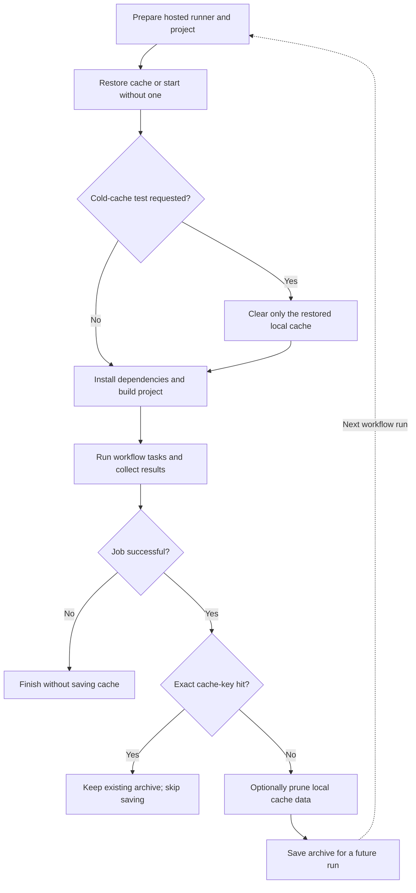

# Using uv's Cache in CI Environments

Reusing `uv`'s package cache in *GitHub Actions* can avoid repeated builds. The repository's [`.github/workflows/uv-cache.yml`](https://github.com/ValentinTwin1206/modern-python-devops-egineering/blob/main/.github/workflows/uv-cache.yml) uses `astral-sh/setup-uv` to restore, prune, and save the cache while installing locked dependencies into a fresh environment. An optional cold-cache experiment measures installation-time savings without assuming a speedup.

## Used Project

This table lists the workflow and project files used in the examples.

| Component | Description |
| --- | --- |
| [`.github/workflows/uv-cache.yml`](https://github.com/ValentinTwin1206/modern-python-devops-egineering/blob/main/.github/workflows/uv-cache.yml) | GitHub Actions workflow that compares full and CI-pruned caches and records install time and local cache size. |
| [`notebooks/uv_cache_lab/pyproject.toml`](https://github.com/ValentinTwin1206/modern-python-devops-egineering/blob/main/notebooks/uv_cache_lab/pyproject.toml) and [`uv.lock`](https://github.com/ValentinTwin1206/modern-python-devops-egineering/blob/main/notebooks/uv_cache_lab/uv.lock) | Define the package build configuration and locked dependencies installed by the workflow. |

## GitHub Actions Caching Pattern

### Cache Layers

GitHub Actions provides an [***Integrated Cache Service***](https://docs.github.com/en/actions/reference/dependency-caching-reference) for storing and restoring files across workflow runs. It works alongside tools' own caches and the project's environment, so understanding the separate layers helps explain what persists and when it can be reused. Three distinct layers participate in this example.

1. **The GitHub Actions cache** stores a remote archive selected by an action-generated key and GitHub's access rules.
2. **Language and package-manager caches** hold tool-managed downloads and build artifacts on the runner. This pattern applies to tools such as Python's `uv`, Rust's `cargo`, and Node.js's `npm`
3. **The project `.venv`** contains installed packages. Each hosted runner creates it fresh, and it is not cached.

### Hosted Runner Cache Lifecycle

GitHub Actions supports **Persistent Runners**, typically long-lived self-hosted machines that can retain a package cache between jobs, and **(GitHub) Hosted Runners**, temporary GitHub-managed machines provisioned for a job.

Because *(GitHub) Hosted Runners* are temporary, workflows can restore a remote cache at the start of a run, use its contents while installing dependencies or building the project, and save an updated archive after a successful run. Cache keys commonly combine environment details and project inputs so compatible runs can reuse an archive. An exact key hit can skip saving because cache entries are immutable; after a miss, a workflow can prune unnecessary local data before saving a new archive. A cold-cache test can clear only the runner's restored copy while leaving the remote archive intact. The chart illustrates this general workflow.



### Cache Retention and Access

GitHub removes cache entries not accessed for over seven days, and repository storage limits can cause earlier eviction ([retention and eviction policy](https://docs.github.com/en/actions/reference/dependency-caching-reference#usage-limits-and-eviction-policy)). A matching key alone is insufficient if its archive has expired or is outside the run's permitted scope. Runs can restore caches from their current branch and the default branch, not arbitrary sibling branches ([cache-sharing rules](https://docs.github.com/en/actions/reference/dependency-caching-reference#restrictions-for-accessing-a-cache)). Manual experiments should use the same branch/revision to keep comparisons meaningful.

## GitHub Actions Example

### Compare Warm and Cold Runs

To see how reusing a restored cache affects installation on GitHub-hosted runners, compare warm and cold-cache runs of the same workflow revision. First populate an accessible cache, then use these runs while keeping dependencies, sources, fixture size, generator, Python version, and runner platform unchanged:

1. Run the workflow successfully to create a cache archive that later runs can access.
2. Run it manually with `cold_cache` disabled. The workflow attempts to restore the cache; confirm the summary reports `Restored` before treating the run as warm, then record the installation time.
3. Run the same revision manually with `cold_cache` enabled. The action skips restoration and saving, so the fresh runner starts without a restored cache; record the installation time.
4. Repeat the warm and cold runs with the same inputs and runner platform to gather comparable measurements.

### Workflow Triggers

GitHub Actions starts a workflow when an event listed under `on` occurs. The `uv cache demo` workflow runs automatically for pushes to `main` that change one of the listed paths; it does not run for pull requests or documentation-only pushes. The `workflow_dispatch` trigger also lets you start a run manually from the repository's Actions tab in GitHub. Manual runs expose an optional cold-cache experiment through the `cold_cache` boolean input, which defaults to `false` so normal runs reuse the cache.

```yaml
name: uv cache demo

on:
  push:
    branches:
      - main
    paths:
      - "notebooks/uv_cache_lab/**"
      - ".github/workflows/uv-cache.yml"
  workflow_dispatch:
    inputs:
      cold_cache:
        description: "Skip uv cache restoration and saving for a cold installation"
        type: boolean
        default: false
```

### Run the Analysis Job

The workflow runs `analyze-embeddings` on GitHub's `ubuntu-latest` hosted runner and grants the job read-only access to repository contents. At the beginning, it checks out the repository so later steps can access its files, then sets up the Python version specified by the workflow for fixture generation and dependency installation. The job exposes the optional manual `cold_cache` input as `COLD_CACHE` so the cache action can select whether to restore and save an archive.

```yaml
jobs:
  analyze-embeddings:
    runs-on: ubuntu-latest
    env:
      COLD_CACHE: ${{ github.event_name == 'workflow_dispatch' && inputs.cold_cache }}
```

### Prepare the Fixture and Local Wheel Fingerprint

After the CI environment is set up, `generate_fixture.py` creates a synthetic embedding matrix included in the `uv-cache-demo` project to demonstrate efficient cache reuse in CI. Then `build_key.py` calculates a SHA-256 fingerprint from the relative paths and contents of the project's `pyproject.toml` and all files under the `src` folder. The step exposes this value as `CACHE_DEMO_KEY` to the GitHub environment, making it available to the [later workflow step](#create-a-fresh-environment-from-locked-dependencies).

```yaml
  steps:
    - name: Generate fixture and fingerprint build inputs
      env:
        FIXTURE_SIZE_MIB: "256"
      run: |
        python notebooks/uv_cache_lab/scripts/generate_fixture.py --size "$FIXTURE_SIZE_MIB"
        build_key=$(python notebooks/uv_cache_lab/scripts/build_key.py)
        echo "CACHE_DEMO_KEY=$build_key" >> "$GITHUB_ENV"
```

### Configure setup-uv and Restore the Cache

The [`astral-sh/setup-uv`](https://github.com/astral-sh/setup-uv) GitHub Action is developed, released, and maintained by Astral, the company behind `uv`. It installs `uv`, adds it to the runner's `PATH`, and provides options to configure its setup and package-cache behavior, including cache restoration, pruning, and saving. Its remote cache key incorporates an internal cache version, architecture, platform, and detected Python version, along with a hash of matching files; the explicit patterns in this workflow cover dependencies and local build inputs, including generated data, so changes invalidate the remote cache. Manual runs can optionally skip restoration for a **cold installation** because each fresh GitHub-hosted runner starts without the project's package cache.

```yaml
- name: Set up uv and optionally restore its package cache
  id: uv
  uses: astral-sh/setup-uv@07a047e608db84b3d8c06cd9a7c7dcc9c355c18e # v10.3.2
  with:
    version: "0.11.1"
    enable-cache: true
    restore-cache: ${{ env.COLD_CACHE != 'true' }}
    save-cache: ${{ env.COLD_CACHE == 'true' && 'false' || 'auto' }}
    prune-cache: true
    cache-dependency-glob: |
      notebooks/uv_cache_lab/pyproject.toml
      notebooks/uv_cache_lab/uv.lock
      notebooks/uv_cache_lab/scripts/*.py
      notebooks/uv_cache_lab/src/**/*.py
      notebooks/uv_cache_lab/src/**/*.json
      notebooks/uv_cache_lab/src/**/*.bin
```

- `version` - Pins `uv` to 0.11.1 independently of the action release, so updates to the action do not change the installed `uv` version.
- `enable-cache` - Explicitly enables GitHub Actions caching; its `auto` default enables caching on GitHub-hosted runners for supported events.
- `restore-cache` restores matching artifacts during normal runs. Selecting `cold_cache` disables restoration, giving a cold installation without `uv cache clean`. This relies on fresh hosted runners. The action defaults to `"true"`.
- `save-cache` uses `"auto"` during normal runs and `"false"` during cold experiments, leaving remote archives unchanged. The `"auto"` default allows eligible saving except for `merge_group` events; it does not make installation cold.
- `prune-cache` - Enables `uv cache prune --ci` before a new cache is saved after a cache miss; in v10.3.2, the default is `false`.
- `cache-dependency-glob` - replaces the default lockfile and requirements patterns with the listed repository-relative paths, which are used to generate the remote cache key.
- `UV_CACHE_DIR` - Is set by the action to its runner-temporary cache location, so the workflow does not need to override it.
- `cache-hit` indicates whether restoration found an archive. When restoration is disabled, v10.3.2 leaves this output unset, so the summary explicitly reports `Skipped`.

!!! info "How setup-uv Saves Cache Updates"

    After a successful job, the action's [post-action](https://github.com/astral-sh/setup-uv/blob/07a047e608db84b3d8c06cd9a7c7dcc9c355c18e/src/save-cache.ts) saves the remote cache when needed. An exact key hit skips both pruning and saving. Without an exact-key match, this workflow prunes the local cache with `uv cache prune --ci` before saving it under the current key. GitHub cache entries are immutable, so the action creates a new entry rather than overwriting an existing one. Cold experiments disable saving entirely.

### Optional Cold-Cache Experiment

The `uv cache demo` workflow reuses an accessible cache by default. For a **cold-cache** experiment, a manual run can set `cold_cache` to `true`; this disables cache restoration and saving, so the fresh hosted runner installs dependencies without a restored package cache and leaves existing remote archives unchanged.

```yaml
with:
  restore-cache: ${{ env.COLD_CACHE != 'true' }}
  save-cache: ${{ env.COLD_CACHE == 'true' && 'false' || 'auto' }}
```

!!! info "Cold Runs Leave the Remote Cache Unchanged"

    Cold runs skip both restoring and saving the cache. Previously saved archives remain available to later warm runs.

### Create a Fresh Environment from Locked Dependencies

Each hosted *(GitHub) Runner* starts with a clean environment. However, GitHub Actions provides a cache service that tools such as `uv`, `cargo`, etc. can use to save and restore package caches between workflow runs. Additionally, `uv` lets a project identify its local wheel-cache entries by configuring `tool.uv.cache-keys` in `pyproject.toml`, that is used in the current example to complements the remote GitHub Actions cache key.

```toml
[tool.uv]
cache-keys = [{ env = "CACHE_DEMO_KEY" }]
```

> See [*Prepare the Fixture and Local Wheel Fingerprint*](#prepare-the-fixture-and-local-wheel-fingerprint) for how `UV_CACHE_KEY` is generated

When `uv sync` runs, it creates the `.venv` and uses the fingerprint to reuse a matching wheel or rebuild the local package if the inputs have changed. The following step runs `uv sync` with the committed lockfile and measures only the sync duration, excluding fixture generation, cache transfers, pruning, and report execution.

```yaml
- name: Create a fresh environment from locked dependencies
  id: install
  shell: bash
  run: |
    start_ms=$(date +%s%3N)
    uv sync \
      --directory notebooks/uv_cache_lab \
      --locked \
      --no-editable \
      --python 3.12
    end_ms=$(date +%s%3N)
    echo "milliseconds=$((end_ms - start_ms))" >> "$GITHUB_OUTPUT"
```

- `--directory` - Selects the lab project.
- `--locked` - Uses the committed `uv.lock` and fails if it needs updating.
- `--no-editable` - Builds and installs a regular local wheel instead of linking the source tree. A cold cache builds it; an unchanged warm cache can reuse it.
- `--python 3.12` - Selects the interpreter set up earlier.

### Generate the Embedding Report

The command validates the installed matrix and calculates statistics and cosine distances in chunks. Memory-mapping avoids a full-size `float64` copy of the 256 MiB fixture. The PNG is generated on the runner without being uploaded as an artifact.

```yaml
- name: Analyze the installed embeddings and generate a report
  run: |
    notebooks/uv_cache_lab/.venv/bin/python -m uv_cache_demo.main \
      --output "${{ runner.temp }}/embeddings.png"
```

### Show Cache and Installation Time

The final step writes cache restoration status, the requested experiment, and installation time to the job summary. It derives `RESTORE_STATUS` from the action's boolean `cache-hit` output: `Skipped` when cold mode disables restoration, `Restored` when a cache entry is found, or `Not restored` when no entry matches. The install step calculates `INSTALL_MS` by subtracting `start_ms` from `end_ms` around `uv sync`; the duration is in milliseconds and excludes fixture generation, cache restoration and saving, and report execution. Thus, `COLD_CACHE=true` measures a cold installation, while `COLD_CACHE=false` is a warm run only when `RESTORE_STATUS` is `Restored`.

```yaml
- name: Show cache and installation time
  env:
    RESTORE_STATUS: ${{ env.COLD_CACHE == 'true' && 'Skipped' || (steps.uv.outputs.cache-hit == 'true' && 'Restored' || 'Not restored') }}
    INSTALL_MS: ${{ steps.install.outputs.milliseconds }}
  run: |
    {
      echo '## uv cache demo'
      echo ''
      echo '| Measurement | Result |'
      echo '| --- | --- |'
      echo "| setup-uv cache restoration | $RESTORE_STATUS |"
      echo "| Cold-cache experiment requested | $COLD_CACHE |"
      echo "| uv sync duration | ${INSTALL_MS} ms |"
      echo ''
      echo 'Duration measures only uv sync; it excludes GitHub cache restoration and saving time.'
      echo 'Cold experiments skip cache restoration and saving; remote archives remain unchanged.'
      echo 'Compare multiple runs with unchanged dependencies and build inputs; no speedup is guaranteed.'
    } >> "$GITHUB_STEP_SUMMARY"
```
