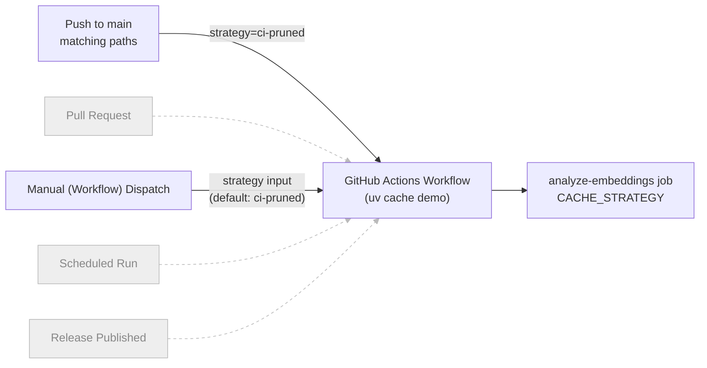
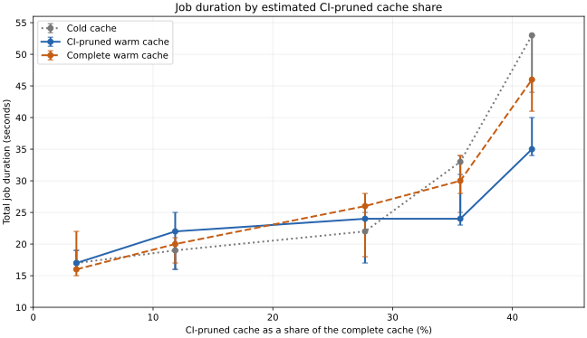

# Using uv's Cache in CI Environments

Aggressive caching helps make `uv` fast by avoiding repeated downloads and builds of dependencies. In CI, however, transferring a cache between temporary *Hosted Runners* adds overhead, so preserving everything is not always worthwhile. [Astral's CI caching guidance](https://docs.astral.sh/uv/concepts/cache/#caching-in-continuous-integration) favors *Wheels Built from Source*, which can be costly to rebuild, over *Prebuilt Wheels*, which are usually quick to download and install. It does not cite a formal study quantifying these trade-offs; this section explains how to adopt the strategy and measure its benefits in your own *GitHub Actions* workflow. For Docker builds, see [Using uv's Cache in Docker Builds](./bonus-05.md#using-uvs-cache-in-docker-builds).

## Used Project

This table lists the workflow and project files used in the examples.

| Component | Description |
| --- | --- |
| [`.github/workflows/uv-cache.yml`](https://github.com/ValentinTwin1206/modern-python-devops-egineering/blob/main/.github/workflows/uv-cache.yml) | GitHub Actions workflow that compares cold, complete, and CI-pruned caches and records install time and local cache size. |
| [`notebooks/nb5_uv_cache_lab/pyproject.toml`](https://github.com/ValentinTwin1206/modern-python-devops-egineering/blob/main/notebooks/nb5_uv_cache_lab/pyproject.toml) and [`uv.lock`](https://github.com/ValentinTwin1206/modern-python-devops-egineering/blob/main/notebooks/nb5_uv_cache_lab/uv.lock) | Define the package build configuration and locked dependencies installed by the workflow. |

## Using uv's Cache in GitHub Actions

### GitHub Actions Remote Cache Service

GitHub Actions provides an [***Integrated Remote Cache Service***](https://docs.github.com/en/actions/reference/dependency-caching-reference) for storing and restoring files across workflow runs; this is particularly useful for ephemeral *(GitHub) Hosted Runners*, where each job starts on a fresh machine. A typical workflow setup consists of three layers:

1. **The GitHub Actions Cache** - Stores cache archives between workflow runs. Cache keys and GitHub's access rules determine which runs can restore an archive.
2. **The Package-Manager Cache** - A local cache used by tools such as Python's `uv`, Rust's `cargo`, and Node.js's `npm` to reuse downloads and build artifacts. The CI service can archive and restore this local data between runs; it is not a second remote cache.
3. **The Project Environment** - Contains dependencies installed for running the project's application and tests. Ephemeral runners typically create it fresh for each job; this workflow does not cache it.

### Cache Lifecycle on Temporary Runners

**Persistent Runners** are typically self-hosted *GitHub Actions* machines that remain available between jobs, allowing local data to persist. **Temporary Runners**, usually GitHub-hosted, start with a clean environment and are discarded after each job, including their local data. While persistent runners can reuse local caches, temporary runners rely on *GitHub Actions*' remote caching service to preserve and restore cached data across jobs. In both cases, remote caches are subject to *GitHub's* retention and eviction policies. Caches expire after seven days without access and may be evicted earlier when storage limits are reached ([retention and eviction policies](https://docs.github.com/en/actions/reference/dependency-caching-reference#usage-limits-and-eviction-policy)). A well-designed caching strategy is particularly important for temporary runners to balance storage costs, cache transfer overhead, and overall job duration.

Astral's `uv` provides a sophisticated caching approach with several strategies:

- **Warm Caching:** Restore the complete existing cache before dependency installation and reuse all cached packages and build artifacts. Unlike CI-pruned caching, retain all cache contents when saving it for subsequent runs.
- **Cold Caching:** Skip cache restoration and saving, forcing dependencies to be downloaded or built again. Useful as a baseline for measuring caching benefits.
- **CI-Pruned Caching:** Restore the cache while removing downloaded *Pre-Built Wheels* and *Unpacked Source Distributions* before saving. Retain *Source-Built Wheels* to reduce cache size while preserving potentially expensive build artifacts.

## Benchmarking uv's Cache in GitHub Actions

The `uv cache demo` workflow in [`.github/workflows/uv-cache.yml`](https://github.com/ValentinTwin1206/modern-python-devops-egineering/blob/main/.github/workflows/uv-cache.yml) demonstrates using `uv`'s package cache in CI by comparing cold, complete, and CI-pruned caches to measure potential installation-time savings. GitHub Actions supports triggers such as pushes, pull requests, manual dispatches, scheduled runs, and published releases; this workflow runs on path-filtered pushes to `main` or manual dispatch from the **Actions** tab, with either event starting a fresh GitHub-hosted Ubuntu runner. Manual runs select `cold`, `warm`, or `ci-pruned` through the `strategy` input (default: `ci-pruned`); pushes use `ci-pruned`.



> Grayed-out triggers indicate events not configured in this workflow.

#### Triggers: Analysis Job and Steps

The `analyze-embeddings` job checks out the repository and sets up Python 3.12. The manual `fixture_size` choice selects a 16, 64, 256, 512, or 1024 MiB synthetic embedding matrix; it defaults to 256 MiB, as do push-triggered runs. The job generates the matrix, fingerprints the project's build inputs, and installs `uv` with optional package-cache restoration. After recording the pre-install cache size, it creates a fresh environment from the lockfile and times `uv sync`. Finally, it analyzes the installed embeddings and summarizes the selected size, cache sizes, restoration status, and installation time. The YAML below shows the workflow triggers and job configuration.

```yaml
name: uv cache demo

on:
  push:
    branches:
      - main
    paths:
      - "notebooks/nb5_uv_cache_lab/**"
      - ".github/workflows/uv-cache.yml"
  workflow_dispatch:
    inputs:
      strategy:
        description: "uv cache strategy"
        type: choice
        default: ci-pruned
        options:
          - cold
          - warm
          - ci-pruned
      fixture_size:
        description: "Embedding matrix size (MiB)"
        type: choice
        default: "256"
        options:
          - "16"
          - "64"
          - "256"
          - "512"
          - "1024"

permissions:
  contents: read

jobs:
  analyze-embeddings:
    runs-on: ubuntu-latest
    env:
      CACHE_STRATEGY: ${{ inputs.strategy || 'ci-pruned' }}
      fixture_size: ${{ inputs.fixture_size || '256' }}
```

### Step: Set up uv and Optionally Restore its Package Cache

The [`astral-sh/setup-uv`](https://github.com/astral-sh/setup-uv) GitHub Action is developed, released, and maintained by Astral, the company behind `uv`. It installs `uv`, adds it to the runner's `PATH`, and provides options to configure its setup and package-cache behavior, including cache restoration, pruning, and saving. Its remote cache key incorporates an internal cache version, architecture, platform, and detected Python version, along with a hash of matching files; the explicit patterns in this workflow cover dependencies and local build inputs, including generated data, so changes invalidate the remote cache.

After a successful job, the [post-action](https://github.com/astral-sh/setup-uv/blob/07a047e608db84b3d8c06cd9a7c7dcc9c355c18e/src/save-cache.ts) of `astral-sh/setup-uv` saves the remote cache when needed. An exact key hit skips pruning and saving; otherwise, the `ci-pruned` strategy runs `uv cache prune --ci` before saving, while `warm` saves without pruning. Because GitHub cache entries are immutable, the action creates a new entry instead of overwriting one. Cold experiments disable saving.

```yaml
- name: Set up uv and optionally restore its package cache
  id: uv
  uses: astral-sh/setup-uv@07a047e608db84b3d8c06cd9a7c7dcc9c355c18e # v10.3.2
  with:
    version: "0.11.1"
    enable-cache: true
    restore-cache: ${{ env.CACHE_STRATEGY != 'cold' }}
    save-cache: ${{ env.CACHE_STRATEGY == 'cold' && 'false' || 'auto' }}
    prune-cache: ${{ env.CACHE_STRATEGY == 'ci-pruned' }}
    cache-suffix: ${{ env.CACHE_STRATEGY == 'warm' && 'full-cache-demo' || '' }}
    cache-dependency-glob: |
      notebooks/nb5_uv_cache_lab/pyproject.toml
      notebooks/nb5_uv_cache_lab/uv.lock
      notebooks/nb5_uv_cache_lab/scripts/*.py
      notebooks/nb5_uv_cache_lab/src/**/*.py
      notebooks/nb5_uv_cache_lab/src/**/*.json
      notebooks/nb5_uv_cache_lab/src/**/*.bin
```

**Inputs**: (*excerpt*)

- `enable-cache` - Explicitly enables GitHub Actions caching; its `auto` default enables caching on GitHub-hosted runners for supported events.
- `restore-cache` - Restores matching artifacts for `warm` and `ci-pruned`. Selecting `cold` disables restoration, giving a cold installation without `uv cache clean`. This relies on fresh hosted runners. The action defaults to `"true"`.
- `save-cache` - Uses `"auto"` during normal runs and `"false"` during cold experiments, leaving remote archives unchanged. The `"auto"` default allows eligible saving except for `merge_group` events; it does not make installation cold.
- `prune-cache` - Enables `uv cache prune --ci` before a new cache is saved after a cache miss for the `ci-pruned` strategy; in v10.3.2, the default is `false`.
- `cache-suffix` - Separates the `warm` complete cache from the CI-pruned cache.
- `cache-dependency-glob` - Replaces the default lockfile and requirements patterns with the listed repository-relative paths, which are used to generate the remote cache key.

**Outputs**: (*excerpt*)

- `cache-hit` - Indicates whether restoration found an archive. When restoration is disabled, v10.3.2 leaves this output unset, so the summary explicitly reports `Skipped`.

=== "CI-pruned Cache"

    Select `ci-pruned` to enable restoration and automatic saving with pruning. On a cache miss, the action prunes before saving. Run once to populate the CI-pruned cache, then repeat with the same cache key to measure a warm restore.

    ```yaml
    with:
      enable-cache: true
      restore-cache: true
      save-cache: auto
      prune-cache: true
    ```

=== "Warm Cache"

    Select `warm` to enable restoration and automatic saving without pruning, using a separate cache suffix. Run once to populate this cache, then repeat with the same cache key.

    ```yaml
    with:
      enable-cache: true
      restore-cache: true
      save-cache: auto
      prune-cache: false
      cache-suffix: full-cache-demo
    ```

=== "Cold Cache"

    Select `cold` on a fresh GitHub-hosted runner to disable restoration and saving. The installation starts without a restored package cache, and the run leaves remote archives unchanged.

    ```yaml
    with:
      enable-cache: true
      restore-cache: false
      save-cache: false
    ```

### Step: Measure Restored Package Cache Size

Before installing dependencies, the workflow measures the package cache available on the runner so the report shows what was ready for reuse. It records the size in bytes and a readable unit such as MiB or GiB. It then exposes both values through `GITHUB_ENV` so the [final step](#step-show-cache-and-installation-time) can reuse them.

```yaml
- name: Measure restored package cache size
  run: |
    mkdir -p "$UV_CACHE_DIR"
    bytes=$(du -sb "$UV_CACHE_DIR" | cut -f1)
    echo "RESTORED_CACHE_BYTES=$bytes" >> "$GITHUB_ENV"
    echo "RESTORED_CACHE_SIZE=$(numfmt --to=iec-i --suffix=B "$bytes")" >> "$GITHUB_ENV"
```

### Step: Create a Fresh Environment from Locked Dependencies

As explained above, *GitHub Actions* can restore a remote package cache on a fresh *(Github-) Hosted Runner* and save cache updates after a run. Additionally, `uv` supports project-specific cache keys, that can be defined as `tool.uv.cache-keys` in `pyproject.toml` to fingerprint local wheel-cache entries, complementing the remote cache key.

```toml
[tool.uv]
cache-keys = [{ env = "CACHE_DEMO_KEY" }]
```

Earlier, the workflow generates a synthetic embedding matrix of the selected size (256 MiB by default) and exposes a fingerprint of the build inputs as `CACHE_DEMO_KEY`. With Python 3.12, `uv sync` creates the `.venv` and uses `--locked` to follow the committed `uv.lock` (and fail if it needs updating). The `--no-editable` option installs a regular project wheel containing the matrix rather than linking the source; the fingerprint lets `uv` reuse a cached wheel or rebuild it when inputs change. The step exposes the `uv sync` duration in milliseconds as `milliseconds` through *GitHub Outputs*, excluding fixture generation, cache transfers, pruning, and report execution.

```yaml
- name: Create a fresh environment from locked dependencies
  id: install
  shell: bash
  run: |
    start_ms=$(date +%s%3N)
    uv sync \
      --directory notebooks/nb5_uv_cache_lab \
      --locked \
      --no-editable \
      --python 3.12
    end_ms=$(date +%s%3N)
    echo "milliseconds=$((end_ms - start_ms))" >> "$GITHUB_OUTPUT"
```

### Step: Show Cache and Installation Time

The final job summary shows the selected strategy, whether a cache was restored, the cache sizes before and after installation, and the installation time. The previous step recorded the install duration of `uv sync` in milliseconds and exposed the value as `milliseconds` output, which the summary uses as `INSTALL_MS`. Cache sizes are measured on the *(GitHub-) Hosted Runner*, not from compressed remote archives; if restoration is skipped or misses, the pre-install size does not represent a restored cache.

```yaml
- name: Show cache and installation time
  env:
    RESTORE_STATUS: ${{ env.CACHE_STRATEGY == 'cold' && 'Skipped' || (steps.uv.outputs.cache-hit == 'true' && 'Restored' || 'Not restored') }}
    INSTALL_MS: ${{ steps.install.outputs.milliseconds }}
  run: |
    cache_bytes=$(du -sb "$UV_CACHE_DIR" | cut -f1)
    cache_size=$(numfmt --to=iec-i --suffix=B "$cache_bytes")
    echo "RESTORED_CACHE_SIZE=$RESTORED_CACHE_SIZE ($RESTORED_CACHE_BYTES bytes)"
    echo "CACHE_SIZE_AFTER_SYNC=$cache_size ($cache_bytes bytes; before setup-uv post-action pruning)"
    {
      echo '## uv cache demo'
      echo ''
      echo '| Measurement | Result |'
      echo '| --- | --- |'
      echo "| Embedding matrix size | ${fixture_size} MiB |"
      echo "| setup-uv cache restoration | $RESTORE_STATUS |"
      echo "| Cache strategy | $CACHE_STRATEGY |"
      echo "| Restored local uv cache | $RESTORED_CACHE_SIZE |"
      echo "| uv sync duration | ${INSTALL_MS} ms |"
      echo "| Local uv cache after sync, before post-action pruning | $cache_size |"
      echo ''
      echo 'Duration measures only uv sync; it excludes GitHub cache restoration and saving time.'
      echo 'Cold experiments skip cache restoration and saving; remote archives remain unchanged.'
      echo 'Only runs reporting Restored qualify as warm-cache measurements.'
      echo 'Compare multiple runs with unchanged dependencies and build inputs; no speedup is guaranteed.'
    } >> "$GITHUB_STEP_SUMMARY"
```

## Run the Workflow and Compare Cache Performance

### Execute the Cache Strategy Comparison

To test [uv's recommendation for caching in CI](https://docs.astral.sh/uv/concepts/cache/#caching-in-continuous-integration), the workflow was executed with different caching strategies and embedding-matrix sizes. The comparison examined whether retaining only costly source-built wheels could reduce cache size and overall job duration compared with keeping the complete cache or starting without one. The following conditions were varied:

- **Caching strategy:** The `setup-uv` input `prune-cache` controlled which artifacts were saved: `true` retained costly *Source-built Wheels* but removed *Downloaded Prebuilt Wheels* for the ***CI-pruned Cache***, while `false` retained both for the ***Warm (complete) cache***. The ***Cold (empty) cache*** baseline used `restore-cache: false` and `save-cache: false` on a fresh runner, skipping restoration and leaving remote archives unchanged.
- **Source-built wheel share:** Packaging matrices from 16 to 1,024 MiB into the source-built wheel changed its contribution to the overall cache. Each size used a distinct cache key; larger matrices also increased generation and analysis time.

The following table shows the runs for each estimated *source-built wheel share* and *caching strategy*, for **45 measurements** in total. Each combination was run three times because timings can vary; the middle result (the median) helps reduce the influence of an unusually fast or slow run.

| Estimated share of complete cache | Empty cache | CI-pruned cache | Complete cache |
| ---: | ---: | ---: | ---: |
| 3.60% | 3 runs | 3 runs | 3 runs |
| 11.85% | 3 runs | 3 runs | 3 runs |
| 27.70% | 3 runs | 3 runs | 3 runs |
| 35.65% | 3 runs | 3 runs | 3 runs |
| 41.63% | 3 runs | 3 runs | 3 runs |

### Results

The experiment described above ran on GitHub-hosted `ubuntu-latest` runners using Python 3.12 and `uv` 0.11.1. Results and links to the individual runs were gathered in the [benchmark CSV](https://github.com/ValentinTwin1206/modern-python-devops-egineering/blob/main/notebooks/nb5_uv_cache_lab/cache_benchmark_results.csv). It records median durations from three successful runs per workload and strategy; total job time includes cache transfers and other workflow steps, while `uv sync` time measures installation alone.

The graph compares all three caching strategies. Its x-axis shows the median restored CI-pruned cache size as a percentage of the median restored complete cache size, an estimate of the source-built wheel's contribution rather than the matrix's exact share. The same reference percentage applies to every strategy for a given workload. The y-axis shows total job duration in seconds, including post-actions but excluding queue time; lower values mean faster jobs. Lines connect the medians, and error bars show the minimum and maximum durations across the three measured runs.



### Key Findings and Conclusions

These results illustrate the trade-offs described in [Astral's CI caching guidance](https://docs.astral.sh/uv/concepts/cache/#caching-in-continuous-integration). A larger cache can accelerate dependency installation, but its transfer overhead may outweigh the savings in total job duration.

- **Cache strategy matters:** The CI-pruned cache delivered the shortest median job duration in most larger workload scenarios, while the complete cache consistently provided the fastest `uv sync`.
- **Cache size vs. performance:** The complete cache restored substantially more data (up to 2,461 MiB), but faster dependency installation did not necessarily translate into faster overall jobs.
- **Workload dependency:** The complete cache was competitive at smaller estimated shares, where measurement ranges often overlapped. At the two largest estimated shares, the CI-pruned cache delivered the shortest median job duration.
- **Cache validation:** A restored archive did not always prevent a project rebuild. Stale caches were refreshed, and warm runs that rebuilt the project were excluded from the comparison.
- **Measurement limitations:** Each scenario includes only three runs. Runner performance, cache transfer, and workload execution introduce variability.

**Overall conclusion:** These findings provide a useful indication of how cache strategies can affect CI performance, but they are specific to this project, its dependencies, and the tested GitHub Actions environment. They should not be generalized into a universal ranking. Validate the results against your own workload before choosing a caching strategy.

*Note: Warm-cache measurements reused existing archives without saving new ones; the cold baseline skipped both cache restoration and saving.*
