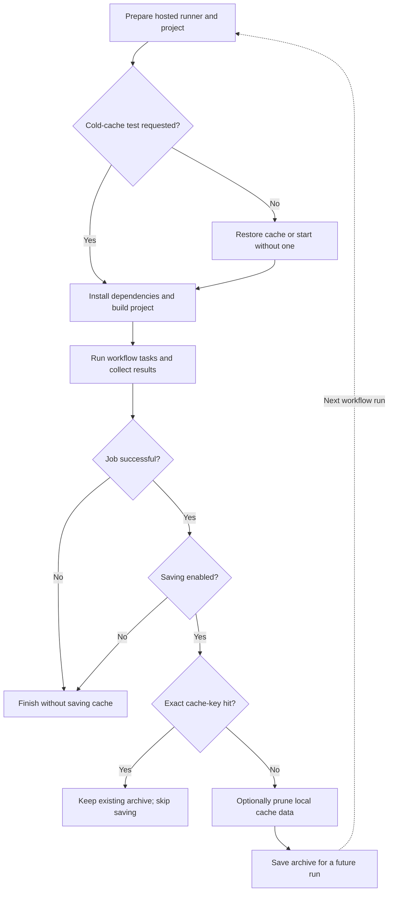
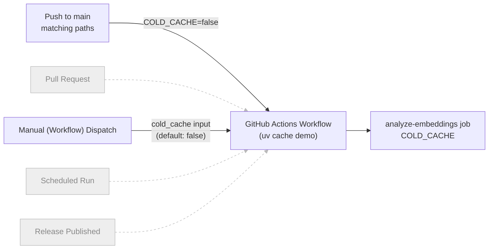

# Using uv's Cache in CI Environments

Aggressive caching helps make `uv` fast by avoiding repeated downloads and builds of dependencies. In CI, however, transferring a cache between temporary *Hosted Runners* adds overhead, so preserving everything is not always worthwhile. [Astral's CI caching guidance](https://docs.astral.sh/uv/concepts/cache/#caching-in-continuous-integration) favors *Wheels Built from Source*, which can be costly to rebuild, over *Prebuilt Wheels*, which are usually quick to download and install. It does not cite a formal study quantifying these trade-offs; this section explains how to adopt the strategy and measure its benefits in your own CI workflow rather than assume a speedup.

## Used Project

This table lists the workflow and project files used in the examples.

| Component | Description |
| --- | --- |
| [`.github/workflows/uv-cache.yml`](https://github.com/ValentinTwin1206/modern-python-devops-egineering/blob/main/.github/workflows/uv-cache.yml) | GitHub Actions workflow that compares an *empty cache* against a *CI-pruned cache* and records install time and local cache size. |
| [`.github/workflows/uv-cache-compare.yml`](https://github.com/ValentinTwin1206/modern-python-devops-egineering/blob/main/.github/workflows/uv-cache-compare.yml) | Manually run comparison workflow that retains downloaded prebuilt wheels and records install time and local cache size. |
| [`notebooks/nb5_uv_cache_lab/pyproject.toml`](https://github.com/ValentinTwin1206/modern-python-devops-egineering/blob/main/notebooks/nb5_uv_cache_lab/pyproject.toml) and [`uv.lock`](https://github.com/ValentinTwin1206/modern-python-devops-egineering/blob/main/notebooks/nb5_uv_cache_lab/uv.lock) | Define the package build configuration and locked dependencies installed by the workflow. |

## GitHub Actions Caching Pattern

### Cache Layers

GitHub Actions provides an [***Integrated Cache Service***](https://docs.github.com/en/actions/reference/dependency-caching-reference) for storing and restoring files across workflow runs. It works alongside tools' own caches and the project's environment, so understanding the separate layers helps explain what persists and when it can be reused. Three distinct layers participate in this example.

1. **The GitHub Actions cache** stores a remote archive selected by an action-generated key and GitHub's access rules.
2. **Language and package-manager caches** hold tool-managed downloads and build artifacts on the runner. This pattern applies to tools such as Python's `uv`, Rust's `cargo`, and Node.js's `npm`
3. **The project `.venv`** contains installed packages. Each hosted runner creates it fresh, and it is not cached.

### Hosted Runner Cache Lifecycle

GitHub Actions offers long-lived self-hosted ***Persistent Runners*** and temporary ***(GitHub) Hosted Runners***. Hosted runners can reuse remote caches by restoring an archive at job start, using it during installs or builds, and saving an updated archive after success. Cache keys combine environment and project inputs; exact-key hits need no save because entries are immutable. Caches expire after seven days without access or sooner under storage pressure, and runs can generally restore caches only from their current or default branch ([retention](https://docs.github.com/en/actions/reference/dependency-caching-reference#usage-limits-and-eviction-policy) and [access rules](https://docs.github.com/en/actions/reference/dependency-caching-reference#restrictions-for-accessing-a-cache)). Use the same branch and revision for manual comparisons. After a cache miss, optionally prune local data before saving. A cold test skips restoration and saving without deleting the remote archive. The chart shows this workflow.



## Using uv's Cache in GitHub Actions

The `uv cache demo` workflow in [`.github/workflows/uv-cache.yml`](https://github.com/ValentinTwin1206/modern-python-devops-egineering/blob/main/.github/workflows/uv-cache.yml) is a streamlined example of using `uv`'s package cache in CI. It compares warm and cold installations to measure the potential installation-time savings from cache reuse.

### Workflow Triggers and Job Configuration

#### Workflow Triggers

GitHub Actions starts workflows from configured events, including *Pushes*, *Pull Requests*, *Manual (Workflow) Dispatches*, *Scheduled Runs*, and *Published Releases*. This workflow runs on pushes to `main` that match either listed path or manual dispatch from the **Actions** tab; both start the same job on a fresh *(GitHub-) Hosted (Ubuntu) Runner*. Manual runs accept the boolean `cold_cache` input (default `false`), exposed as `COLD_CACHE`; when `true`, it skips cache restoration and saving. Pushes set `COLD_CACHE` to `false`.



> Grayed-out triggers indicate events not configured in this workflow.

#### Analysis Job and Steps

The `analyze-embeddings` job checks out the repository and sets up Python 3.12. The manual `fixture_size` choice selects a 16, 64, 256, 512, or 1024 MiB synthetic embedding matrix; it defaults to 256 MiB, as do push-triggered runs. The job generates the matrix, fingerprints the project's build inputs, and installs `uv` with optional package-cache restoration. After recording the pre-install cache size, it creates a fresh environment from the lockfile and times `uv sync`. Finally, it analyzes the installed embeddings and summarizes the selected size, cache sizes, restoration status, and installation time. The YAML below shows the workflow triggers and job configuration.

```yaml
name: uv cache demo

on:
  push:
    branches:
      - main
    paths:
      - "notebooks/nb5_uv_cache_lab/**"
      - ".github/workflows/uv-cache.yml"
  workflow_dispatch:
    inputs:
      cold_cache:
        description: "Skip uv cache restoration for a cold installation"
        type: boolean
        default: false
      fixture_size:
        description: "Embedding matrix size (MiB)"
        type: choice
        default: "256"
        options:
          - "16"
          - "64"
          - "256"
          - "512"
          - "1024"

permissions:
  contents: read

jobs:
  analyze-embeddings:
    runs-on: ubuntu-latest
    env:
      COLD_CACHE: ${{ github.event_name == 'workflow_dispatch' && inputs.cold_cache }}
      fixture_size: ${{ inputs.fixture_size || '256' }}
```

### Step: Set up uv and Optionally Restore its Package Cache

The [`astral-sh/setup-uv`](https://github.com/astral-sh/setup-uv) GitHub Action is developed, released, and maintained by Astral, the company behind `uv`. It installs `uv`, adds it to the runner's `PATH`, and provides options to configure its setup and package-cache behavior, including cache restoration, pruning, and saving. Its remote cache key incorporates an internal cache version, architecture, platform, and detected Python version, along with a hash of matching files; the explicit patterns in this workflow cover dependencies and local build inputs, including generated data, so changes invalidate the remote cache.

After a successful job, the [post-action](https://github.com/astral-sh/setup-uv/blob/07a047e608db84b3d8c06cd9a7c7dcc9c355c18e/src/save-cache.ts) of `astral-sh/setup-uv` saves the remote cache when needed. An exact key hit skips pruning and saving; otherwise, this workflow prunes the local cache with `uv cache prune --ci` before saving it under the current key. Because GitHub cache entries are immutable, the action creates a new entry instead of overwriting one. Cold experiments disable saving.

```yaml
- name: Set up uv and optionally restore its package cache
  id: uv
  uses: astral-sh/setup-uv@07a047e608db84b3d8c06cd9a7c7dcc9c355c18e # v10.3.2
  with:
    version: "0.11.1"
    enable-cache: true
    restore-cache: ${{ env.COLD_CACHE != 'true' }}
    save-cache: ${{ env.COLD_CACHE == 'true' && 'false' || 'auto' }}
    prune-cache: true
    cache-dependency-glob: |
      notebooks/nb5_uv_cache_lab/pyproject.toml
      notebooks/nb5_uv_cache_lab/uv.lock
      notebooks/nb5_uv_cache_lab/scripts/*.py
      notebooks/nb5_uv_cache_lab/src/**/*.py
      notebooks/nb5_uv_cache_lab/src/**/*.json
      notebooks/nb5_uv_cache_lab/src/**/*.bin
```

**Inputs**: (*excerpt*)

- `enable-cache` - Explicitly enables GitHub Actions caching; its `auto` default enables caching on GitHub-hosted runners for supported events.
- `restore-cache` - Restores matching artifacts during normal runs. Selecting `cold_cache` disables restoration, giving a cold installation without `uv cache clean`. This relies on fresh hosted runners. The action defaults to `"true"`.
- `save-cache` - Uses `"auto"` during normal runs and `"false"` during cold experiments, leaving remote archives unchanged. The `"auto"` default allows eligible saving except for `merge_group` events; it does not make installation cold.
- `prune-cache` - Enables `uv cache prune --ci` before a new cache is saved after a cache miss; in v10.3.2, the default is `false`.
- `cache-dependency-glob` - Replaces the default lockfile and requirements patterns with the listed repository-relative paths, which are used to generate the remote cache key.

**Outputs**: (*excerpt*)

- `cache-hit` - Indicates whether restoration found an archive. When restoration is disabled, v10.3.2 leaves this output unset, so the summary explicitly reports `Skipped`.

!!! info "Cold Runs Leave the Remote Cache Unchanged"

    When a *Cold Cache* run is triggered, both `restore-cache` and `save-cache` resolve to `false`. Each fresh *GitHub-hosted Runner* starts without the project's package cache, so skipping restoration produces a cold installation; skipping saving leaves remote archives available for later *Warm Cache* runs.

    ```yaml
    with:
      restore-cache: false
      save-cache: false
    ```

### Step: Measure Restored Package Cache Size

Before installing dependencies, the workflow measures the package cache available on the runner so the report shows what was ready for reuse. It records the size in bytes and a readable unit such as MiB or GiB. It then exposes both values through `GITHUB_ENV` so the [final step](#step-show-cache-and-installation-time) can reuse them.

```yaml
- name: Measure restored package cache size
  run: |
    mkdir -p "$UV_CACHE_DIR"
    bytes=$(du -sb "$UV_CACHE_DIR" | cut -f1)
    echo "RESTORED_CACHE_BYTES=$bytes" >> "$GITHUB_ENV"
    echo "RESTORED_CACHE_SIZE=$(numfmt --to=iec-i --suffix=B "$bytes")" >> "$GITHUB_ENV"
```

### Step: Create a Fresh Environment from Locked Dependencies

As explained above, *GitHub Actions* can restore a remote package cache on a fresh *(Github-) Hosted Runner* and save cache updates after a run. Additionally, `uv` supports project-specific cache keys, that can be defined as `tool.uv.cache-keys` in `pyproject.toml` to fingerprint local wheel-cache entries, complementing the remote cache key.

```toml
[tool.uv]
cache-keys = [{ env = "CACHE_DEMO_KEY" }]
```

Earlier, the workflow generates a synthetic embedding matrix of the selected size (256 MiB by default) and exposes a fingerprint of the build inputs as `CACHE_DEMO_KEY`. With Python 3.12, `uv sync` creates the `.venv` and uses `--locked` to follow the committed `uv.lock` (and fail if it needs updating). The `--no-editable` option installs a regular project wheel containing the matrix rather than linking the source; the fingerprint lets `uv` reuse a cached wheel or rebuild it when inputs change. The step exposes the `uv sync` duration in milliseconds as `milliseconds` through *GitHub Outputs*, excluding fixture generation, cache transfers, pruning, and report execution.

```yaml
- name: Create a fresh environment from locked dependencies
  id: install
  shell: bash
  run: |
    start_ms=$(date +%s%3N)
    uv sync \
      --directory notebooks/nb5_uv_cache_lab \
      --locked \
      --no-editable \
      --python 3.12
    end_ms=$(date +%s%3N)
    echo "milliseconds=$((end_ms - start_ms))" >> "$GITHUB_OUTPUT"
```

### Step: Show Cache and Installation Time

The final job summary shows whether a cache was restored, whether a cold-cache experiment was requested, the cache sizes before and after installation, and the installation time. The previous step recorded the install duration of `uv sync` in milliseconds and exposed the value as `milliseconds` output, which the summary uses as `INSTALL_MS`. Cache sizes are measured on the *(GitHub-) Hosted Runner*, not from compressed remote archives; if restoration is skipped or misses, the pre-install size does not represent a restored cache.

```yaml
- name: Show cache and installation time
  env:
    RESTORE_STATUS: ${{ env.COLD_CACHE == 'true' && 'Skipped' || (steps.uv.outputs.cache-hit == 'true' && 'Restored' || 'Not restored') }}
    INSTALL_MS: ${{ steps.install.outputs.milliseconds }}
  run: |
    cache_bytes=$(du -sb "$UV_CACHE_DIR" | cut -f1)
    cache_size=$(numfmt --to=iec-i --suffix=B "$cache_bytes")
    echo "RESTORED_CACHE_SIZE=$RESTORED_CACHE_SIZE ($RESTORED_CACHE_BYTES bytes)"
    echo "CACHE_SIZE_AFTER_SYNC=$cache_size ($cache_bytes bytes; before setup-uv post-action pruning)"
    {
      echo '## uv cache demo'
      echo ''
            echo '| Measurement | Result |'
            echo '| --- | --- |'
            echo "| Embedding matrix size | ${fixture_size} MiB |"
      echo "| setup-uv cache restoration | $RESTORE_STATUS |"
      echo "| Cold-cache experiment requested | $COLD_CACHE |"
      echo "| Restored local uv cache | $RESTORED_CACHE_SIZE |"
      echo "| uv sync duration | ${INSTALL_MS} ms |"
      echo "| Local uv cache after sync, before post-action pruning | $cache_size |"
      echo ''
      echo 'Duration measures only uv sync; it excludes GitHub cache restoration and saving time.'
      echo 'Cold experiments skip cache restoration and saving; remote archives remain unchanged.'
      echo 'Compare multiple runs with unchanged dependencies and build inputs; no speedup is guaranteed.'
    } >> "$GITHUB_STEP_SUMMARY"
```

## Run the Workflow and Compare Cache Performance

### Execute the Cache Strategy Comparison

To test `uv`'s caching guidance in a CI environment, the workflows `uv-cache.yml` and `uv-cache-compare.yml` measure both the overall job duration and the time spent installing with `uv sync` under three conditions:

- ***CI-Pruned Cache***: Retains costly *Source-built Wheels* but removes (downloaded) *Prebuilt Wheels*.
- ***Complete Cache***: Retains (downloaded) *Prebuilt Wheels*.
- ***Empty Cache***: Starts without a restored package cache. 

Comparing both timings shows whether faster installation offsets the time spent transferring the cache. For each of the five matrix size choices, run the workflows from the **Actions** tab on the same `main` revision, waiting for each run to finish before starting the next. The input is named `fixture_size` in **uv cache demo** and `fixture_size_mib` in **uv full cache demo**:

1. Run **uv cache demo** with `cold_cache: false` to populate the CI-pruned cache for that size.
2. Run **uv full cache demo** to populate the complete cache for that size. The same size choice is available in both workflows.
3. Measure three runs for each strategy: **uv cache demo** with `cold_cache: true` for the empty baseline, **uv cache demo** with `cold_cache: false` for the CI-pruned cache, and **uv full cache demo** for the complete cache. Interleave the strategies and rotate their order between repetitions.
4. Confirm that each measured warm run reports `Restored`, that its `uv sync` log does not rebuild `uv-cache-demo`, and that each cold run reports `Skipped`. Exclude failed, missed-cache, or rebuilt-project warm runs, repopulate if needed, and repeat them. Verify the same revision and size for every run.

This gives 45 measurement runs, plus up to 10 cache-population runs. Each matrix size changes the generated build inputs and therefore the cache key. Cache entries can be evicted under storage pressure, so verify restoration for every warm measurement.

Record each run link, total job duration, `uv sync` duration, and restored local cache size. Total job duration runs from the job's start to completion, including post-actions but excluding queue time; `uv sync` excludes cache transfers and the rest of the job. The matrix is intentionally difficult to compress, so its size is a useful proxy for the source-built wheel's size, but it is not a measurement of the wheel itself. Generation and analysis also grow with matrix size and are included in total duration.

### Results

The following measurements were taken on GitHub-hosted Ubuntu runners using Python 3.12 and `uv` 0.11.1 at revision [`83cd32e`](https://github.com/ValentinTwin1206/modern-python-devops-egineering/commit/83cd32ea44bffdecd298463261b457af570d772d), where both workflows named the size input `fixture_size_mib`. Each point is the median of three successful runs; error bars show the minimum and maximum. Lines connect the observed sizes and are not predictions for other sizes.


The table gives median job duration with its range, median `uv sync` duration, and median restored local cache size. Job durations use the GitHub jobs API's start and completion timestamps, with one-second resolution. Cache sizes are uncompressed local files before `uv sync`, not the compressed remote archives; the cold cache contained approximately 1.4 KiB and rounds to 0.00 MiB. The numbered links lead to the individual measured runs.

| Matrix (MiB) | Cache strategy | Job, median (range), s | `uv sync`, median, s | Restored cache, median, MiB | Runs |
| ---: | --- | ---: | ---: | ---: | --- |
| 16 | Cold | 17 (16–19) | 1.784 | 0.00 | [1](https://github.com/ValentinTwin1206/modern-python-devops-egineering/actions/runs/41587076794), [2](https://github.com/ValentinTwin1206/modern-python-devops-egineering/actions/runs/41587301976), [3](https://github.com/ValentinTwin1206/modern-python-devops-egineering/actions/runs/41587396124) |
| 16 | CI-pruned | 17 (16–19) | 1.759 | 16.01 | [1](https://github.com/ValentinTwin1206/modern-python-devops-egineering/actions/runs/41587117843), [2](https://github.com/ValentinTwin1206/modern-python-devops-egineering/actions/runs/41587208503), [3](https://github.com/ValentinTwin1206/modern-python-devops-egineering/actions/runs/41587443787) |
| 16 | Complete | 16 (15–22) | 0.102 | 444.31 | [1](https://github.com/ValentinTwin1206/modern-python-devops-egineering/actions/runs/41587161932), [2](https://github.com/ValentinTwin1206/modern-python-devops-egineering/actions/runs/41587256827), [3](https://github.com/ValentinTwin1206/modern-python-devops-egineering/actions/runs/41587343861) |
| 64 | Cold | 19 (16–20) | 1.736 | 0.00 | [1](https://github.com/ValentinTwin1206/modern-python-devops-egineering/actions/runs/41587588912), [2](https://github.com/ValentinTwin1206/modern-python-devops-egineering/actions/runs/41587863268), [3](https://github.com/ValentinTwin1206/modern-python-devops-egineering/actions/runs/41587984503) |
| 64 | CI-pruned | 22 (16–25) | 1.727 | 64.03 | [1](https://github.com/ValentinTwin1206/modern-python-devops-egineering/actions/runs/41587638482), [2](https://github.com/ValentinTwin1206/modern-python-devops-egineering/actions/runs/41587753548), [3](https://github.com/ValentinTwin1206/modern-python-devops-egineering/actions/runs/41588026558) |
| 64 | Complete | 20 (17–21) | 0.109 | 540.32 | [1](https://github.com/ValentinTwin1206/modern-python-devops-egineering/actions/runs/41587700856), [2](https://github.com/ValentinTwin1206/modern-python-devops-egineering/actions/runs/41587815095), [3](https://github.com/ValentinTwin1206/modern-python-devops-egineering/actions/runs/41587915906) |
| 256 | Cold | 22 (22–25) | 6.684 | 0.00 | [1](https://github.com/ValentinTwin1206/modern-python-devops-egineering/actions/runs/41588197126), [2](https://github.com/ValentinTwin1206/modern-python-devops-egineering/actions/runs/41588488965), [3](https://github.com/ValentinTwin1206/modern-python-devops-egineering/actions/runs/41588810339) |
| 256 | CI-pruned | 24 (17–24) | 1.578 | 256.09 | [1](https://github.com/ValentinTwin1206/modern-python-devops-egineering/actions/runs/41588547744), [2](https://github.com/ValentinTwin1206/modern-python-devops-egineering/actions/runs/41588676917), [3](https://github.com/ValentinTwin1206/modern-python-devops-egineering/actions/runs/41588934152) |
| 256 | Complete | 26 (18–28) | 0.096 | 924.38 | [1](https://github.com/ValentinTwin1206/modern-python-devops-egineering/actions/runs/41588607935), [2](https://github.com/ValentinTwin1206/modern-python-devops-egineering/actions/runs/41588743582), [3](https://github.com/ValentinTwin1206/modern-python-devops-egineering/actions/runs/41588870322) |
| 512 | Cold | 33 (25–34) | 10.883 | 0.00 | [1](https://github.com/ValentinTwin1206/modern-python-devops-egineering/actions/runs/41589180424), [2](https://github.com/ValentinTwin1206/modern-python-devops-egineering/actions/runs/41589521904), [3](https://github.com/ValentinTwin1206/modern-python-devops-egineering/actions/runs/41589678232) |
| 512 | CI-pruned | 24 (23–31) | 1.791 | 512.16 | [1](https://github.com/ValentinTwin1206/modern-python-devops-egineering/actions/runs/41589262117), [2](https://github.com/ValentinTwin1206/modern-python-devops-egineering/actions/runs/41589387869), [3](https://github.com/ValentinTwin1206/modern-python-devops-egineering/actions/runs/41589753895) |
| 512 | Complete | 30 (28–34) | 0.116 | 1436.46 | [1](https://github.com/ValentinTwin1206/modern-python-devops-egineering/actions/runs/41589319569), [2](https://github.com/ValentinTwin1206/modern-python-devops-egineering/actions/runs/41589448088), [3](https://github.com/ValentinTwin1206/modern-python-devops-egineering/actions/runs/41589604213) |
| 1024 | Cold | 53 (44–53) | 26.213 | 0.00 | [1](https://github.com/ValentinTwin1206/modern-python-devops-egineering/actions/runs/41590062409), [2](https://github.com/ValentinTwin1206/modern-python-devops-egineering/actions/runs/41592790887), [3](https://github.com/ValentinTwin1206/modern-python-devops-egineering/actions/runs/41592996341) |
| 1024 | CI-pruned | 35 (34–40) | 2.996 | 1024.32 | [1](https://github.com/ValentinTwin1206/modern-python-devops-egineering/actions/runs/41592412779), [2](https://github.com/ValentinTwin1206/modern-python-devops-egineering/actions/runs/41592604202), [3](https://github.com/ValentinTwin1206/modern-python-devops-egineering/actions/runs/41593095918) |
| 1024 | Complete | 46 (41–46) | 0.259 | 2460.61 | [1](https://github.com/ValentinTwin1206/modern-python-devops-egineering/actions/runs/41592493754), [2](https://github.com/ValentinTwin1206/modern-python-devops-egineering/actions/runs/41592694522), [3](https://github.com/ValentinTwin1206/modern-python-devops-egineering/actions/runs/41592902726) |

The two pre-existing 256 MiB cache archives were populated before the project directory was renamed. Although GitHub restored them, `uv` rebuilt the local project. They were refreshed before the warm measurements; the warm run logs were checked for project rebuilds as well as cache restoration. Cache-population runs are excluded from the table. At 256 MiB, one valid cold measurement was taken before the refresh and two afterward.

### Conclusion

At 1024 MiB, the CI-pruned cache had the lowest median job duration: **35 s**, compared with **46 s** for the complete cache and **53 s** cold. Although the complete cache had the fastest median `uv sync` at **0.259 s**, it restored roughly **2,461 MiB** of local cache versus **1,024 MiB** for the CI-pruned cache. At 512 MiB, the CI-pruned median was also lowest; at smaller sizes the rankings varied and the observed ranges overlapped.

These results illustrate the trade-off in [Astral's CI caching guidance](https://docs.astral.sh/uv/concepts/cache/#caching-in-continuous-integration): avoiding builds can help, but restoring more cache can offset a faster install. Three runs per condition are a small sample, and runner, download, cache-transfer, generation, and analysis times vary. Warm measurements used existing archives and did not save new ones; the cold baseline skips both restoration and saving. Repeat the experiment with your own dependencies and CI workload before generalizing.
