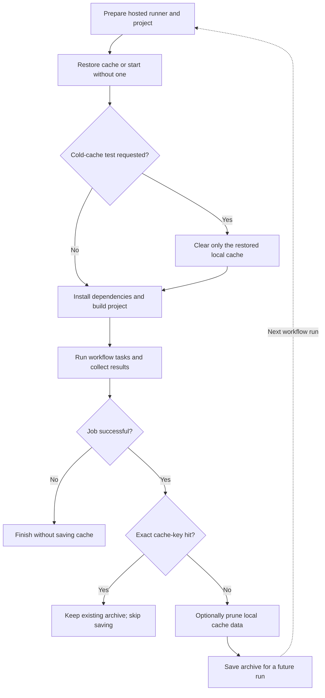
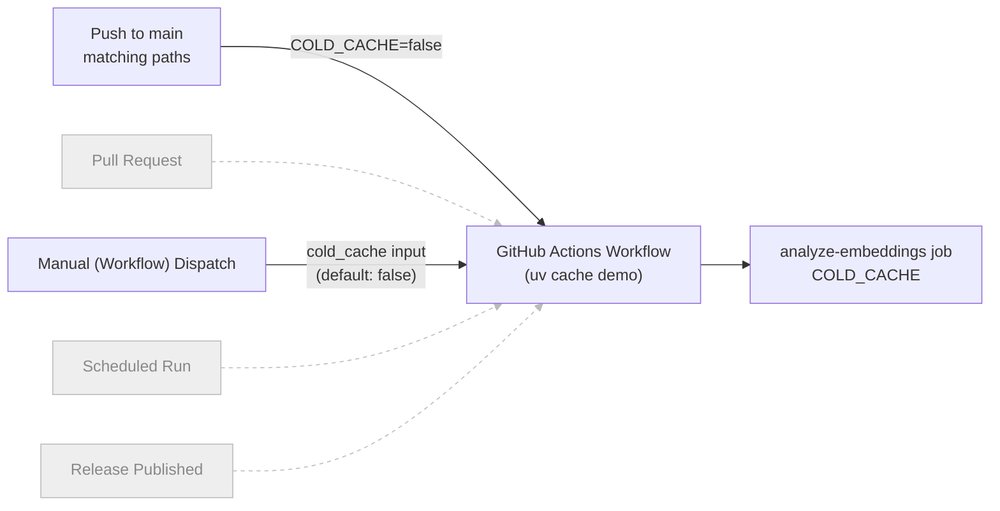

# Using uv's Cache in CI Environments

Aggressive caching helps make `uv` fast by avoiding repeated downloads and builds of dependencies. In CI, however, transferring a cache between temporary *Hosted Runners* adds overhead, so preserving everything is not always worthwhile. [Astral's CI caching guidance](https://docs.astral.sh/uv/concepts/cache/#caching-in-continuous-integration) favors *Wheels Built from Source*, which can be costly to rebuild, over *Prebuilt Wheels*, which are usually quick to download and install. It does not cite a formal study quantifying these trade-offs; this section explains how to adopt the strategy and measure its benefits in your own CI workflow rather than assume a speedup.

## Used Project

This table lists the workflow and project files used in the examples.

| Component | Description |
| --- | --- |
| [`.github/workflows/uv-cache.yml`](https://github.com/ValentinTwin1206/modern-python-devops-egineering/blob/main/.github/workflows/uv-cache.yml) | GitHub Actions workflow that compares an *empty cache* against a *CI-pruned cache* and records install time and local cache size. |
| [`.github/workflows/uv-cache-compare.yml`](https://github.com/ValentinTwin1206/modern-python-devops-egineering/blob/main/.github/workflows/uv-cache-compare.yml) | Manually run comparison workflow that retains downloaded prebuilt wheels and records install time and local cache size. |
| [`notebooks/uv_cache_lab/pyproject.toml`](https://github.com/ValentinTwin1206/modern-python-devops-egineering/blob/main/notebooks/uv_cache_lab/pyproject.toml) and [`uv.lock`](https://github.com/ValentinTwin1206/modern-python-devops-egineering/blob/main/notebooks/uv_cache_lab/uv.lock) | Define the package build configuration and locked dependencies installed by the workflow. |

## GitHub Actions Caching Pattern

### Cache Layers

GitHub Actions provides an [***Integrated Cache Service***](https://docs.github.com/en/actions/reference/dependency-caching-reference) for storing and restoring files across workflow runs. It works alongside tools' own caches and the project's environment, so understanding the separate layers helps explain what persists and when it can be reused. Three distinct layers participate in this example.

1. **The GitHub Actions cache** stores a remote archive selected by an action-generated key and GitHub's access rules.
2. **Language and package-manager caches** hold tool-managed downloads and build artifacts on the runner. This pattern applies to tools such as Python's `uv`, Rust's `cargo`, and Node.js's `npm`
3. **The project `.venv`** contains installed packages. Each hosted runner creates it fresh, and it is not cached.

### Hosted Runner Cache Lifecycle

GitHub Actions offers long-lived self-hosted ***Persistent Runners*** and temporary ***(GitHub) Hosted Runners***. Hosted runners can reuse remote caches by restoring an archive at job start, using it during installs or builds, and saving an updated archive after success. Cache keys combine environment and project inputs; exact-key hits need no save because entries are immutable. Caches expire after seven days without access or sooner under storage pressure, and runs can generally restore caches only from their current or default branch ([retention](https://docs.github.com/en/actions/reference/dependency-caching-reference#usage-limits-and-eviction-policy) and [access rules](https://docs.github.com/en/actions/reference/dependency-caching-reference#restrictions-for-accessing-a-cache)). Use the same branch and revision for manual comparisons. After a cache miss, prune local data before saving. To test a cold cache, clear the runner's restored copy without deleting the remote archive. The chart shows this workflow.



## Using uv's Cache in GitHub Actions

The `uv cache demo` workflow in [`.github/workflows/uv-cache.yml`](https://github.com/ValentinTwin1206/modern-python-devops-egineering/blob/main/.github/workflows/uv-cache.yml) is a streamlined example of using `uv`'s package cache in CI. It compares warm and cold installations to measure the potential installation-time savings from cache reuse.

### Workflow Triggers and Job Configuration

#### Workflow Triggers

GitHub Actions starts workflows from configured events, including *Pushes*, *Pull Requests*, *Manual (Workflow) Dispatches*, *Scheduled Runs*, and *Published Releases*. This workflow runs on pushes to `main` that match either listed path or manual dispatch from the **Actions** tab; both start the same job on a fresh *(GitHub-) Hosted (Ubuntu) Runner*. Manual runs accept the boolean `cold_cache` input (default `false`), exposed as `COLD_CACHE`; when `true`, it skips cache restoration and saving. Pushes set `COLD_CACHE` to `false`.



> Grayed-out triggers indicate events not configured in this workflow.

#### Analysis Job and Steps

The `analyze-embeddings` job checks out the repository and sets up Python 3.12. It then generates a synthetic embedding matrix, fingerprints the project's build inputs, and installs `uv` with optional package-cache restoration. After recording the pre-install cache size, it creates a fresh environment from the lockfile and times `uv sync`. Finally, it analyzes the installed embeddings and summarizes cache sizes, restoration status, and installation time. The YAML below shows the workflow triggers and job configuration.

```yaml
name: uv cache demo

on:
  push:
    branches:
      - main
    paths:
      - "notebooks/uv_cache_lab/**"
      - ".github/workflows/uv-cache.yml"
  workflow_dispatch:
    inputs:
      cold_cache:
        description: "Skip uv cache restoration and saving for a cold installation"
        type: boolean
        default: false

permissions:
  contents: read

jobs:
  analyze-embeddings:
    runs-on: ubuntu-latest
    env:
      COLD_CACHE: ${{ github.event_name == 'workflow_dispatch' && inputs.cold_cache }}
```

### Step: Set up uv and Optionally Restore its Package Cache

The [`astral-sh/setup-uv`](https://github.com/astral-sh/setup-uv) GitHub Action is developed, released, and maintained by Astral, the company behind `uv`. It installs `uv`, adds it to the runner's `PATH`, and provides options to configure its setup and package-cache behavior, including cache restoration, pruning, and saving. Its remote cache key incorporates an internal cache version, architecture, platform, and detected Python version, along with a hash of matching files; the explicit patterns in this workflow cover dependencies and local build inputs, including generated data, so changes invalidate the remote cache.

After a successful job, the [post-action](https://github.com/astral-sh/setup-uv/blob/07a047e608db84b3d8c06cd9a7c7dcc9c355c18e/src/save-cache.ts) of `astral-sh/setup-uv` saves the remote cache when needed. An exact key hit skips pruning and saving; otherwise, this workflow prunes the local cache with `uv cache prune --ci` before saving it under the current key. Because GitHub cache entries are immutable, the action creates a new entry instead of overwriting one. Cold experiments disable saving.

```yaml
- name: Set up uv and optionally restore its package cache
  id: uv
  uses: astral-sh/setup-uv@07a047e608db84b3d8c06cd9a7c7dcc9c355c18e # v10.3.2
  with:
    version: "0.11.1"
    enable-cache: true
    restore-cache: ${{ env.COLD_CACHE != 'true' }}
    save-cache: ${{ env.COLD_CACHE == 'true' && 'false' || 'auto' }}
    prune-cache: true
    cache-dependency-glob: |
      notebooks/uv_cache_lab/pyproject.toml
      notebooks/uv_cache_lab/uv.lock
      notebooks/uv_cache_lab/scripts/*.py
      notebooks/uv_cache_lab/src/**/*.py
      notebooks/uv_cache_lab/src/**/*.json
      notebooks/uv_cache_lab/src/**/*.bin
```

**Inputs**: (*excerpt*)

- `enable-cache` - Explicitly enables GitHub Actions caching; its `auto` default enables caching on GitHub-hosted runners for supported events.
- `restore-cache` - Restores matching artifacts during normal runs. Selecting `cold_cache` disables restoration, giving a cold installation without `uv cache clean`. This relies on fresh hosted runners. The action defaults to `"true"`.
- `save-cache` - Uses `"auto"` during normal runs and `"false"` during cold experiments, leaving remote archives unchanged. The `"auto"` default allows eligible saving except for `merge_group` events; it does not make installation cold.
- `prune-cache` - Enables `uv cache prune --ci` before a new cache is saved after a cache miss; in v10.3.2, the default is `false`.
- `cache-dependency-glob` - Replaces the default lockfile and requirements patterns with the listed repository-relative paths, which are used to generate the remote cache key.

**Outputs**: (*excerpt*)

- `cache-hit` - Indicates whether restoration found an archive. When restoration is disabled, v10.3.2 leaves this output unset, so the summary explicitly reports `Skipped`.

!!! info "Cold Runs Leave the Remote Cache Unchanged"

    When a *Cold Cache* run is triggered, both `restore-cache` and `save-cache` resolve to `false`. Each fresh *GitHub-hosted Runner* starts without the project's package cache, so skipping restoration produces a cold installation; skipping saving leaves remote archives available for later *Warm Cache* runs.

    ```yaml
    with:
      restore-cache: false
      save-cache: false
    ```

### Step: Measure Restored Package Cache Size

Before installing dependencies, the workflow measures the package cache available on the runner so the report shows what was ready for reuse. It records the size in bytes and a readable unit such as MiB or GiB. It then exposes both values to *GitHub Outputs* so [final step](#step-show-cache-and-installation-time) can reuse them.

```yaml
- name: Measure restored package cache size
  run: |
    mkdir -p "$UV_CACHE_DIR"
    bytes=$(du -sb "$UV_CACHE_DIR" | cut -f1)
    echo "RESTORED_CACHE_BYTES=$bytes" >> "$GITHUB_ENV"
    echo "RESTORED_CACHE_SIZE=$(numfmt --to=iec-i --suffix=B "$bytes")" >> "$GITHUB_ENV"
```

### Step: Create a Fresh Environment from Locked Dependencies

As explained above, *GitHub Actions* can restore a remote package cache on a fresh *(Github-) Hosted Runner* and save cache updates after a run. Additionally, `uv` supports project-specific cache keys, that can be defined as `tool.uv.cache-keys` in `pyproject.toml` to fingerprint local wheel-cache entries, complementing the remote cache key.

```toml
[tool.uv]
cache-keys = [{ env = "CACHE_DEMO_KEY" }]
```

Earlier, the workflow generates a 0.25 GiB (256 MiB) synthetic embedding matrix and exposes a fingerprint of the build inputs as `CACHE_DEMO_KEY`. With Python 3.12, `uv sync` creates the `.venv` and uses `--locked` to follow the committed `uv.lock` (and fail if it needs updating). The `--no-editable` option installs a regular project wheel containing the matrix rather than linking the source; the fingerprint lets `uv` reuse a cached wheel or rebuild it when inputs change. The step exposes the `uv sync` duration in milliseconds as `milliseconds` through *GitHub Outputs*, excluding fixture generation, cache transfers, pruning, and report execution.

```yaml
- name: Create a fresh environment from locked dependencies
  id: install
  shell: bash
  run: |
    start_ms=$(date +%s%3N)
    uv sync \
      --directory notebooks/uv_cache_lab \
      --locked \
      --no-editable \
      --python 3.12
    end_ms=$(date +%s%3N)
    echo "milliseconds=$((end_ms - start_ms))" >> "$GITHUB_OUTPUT"
```

### Step: Show Cache and Installation Time

The final job summary shows whether a cache was restored, whether a cold-cache experiment was requested, the cache sizes before and after installation, and the installation time. The previous step recorded the install duration of `uv sync` in milliseconds and exposed the value as `milliseconds` output, which the summary uses as `INSTALL_MS`. Cache sizes are measured on the *(GitHub-) Hosted Runner*, not from compressed remote archives; if restoration is skipped or misses, the pre-install size does not represent a restored cache.

```yaml
- name: Show cache and installation time
  env:
    RESTORE_STATUS: ${{ env.COLD_CACHE == 'true' && 'Skipped' || (steps.uv.outputs.cache-hit == 'true' && 'Restored' || 'Not restored') }}
    INSTALL_MS: ${{ steps.install.outputs.milliseconds }}
  run: |
    cache_bytes=$(du -sb "$UV_CACHE_DIR" | cut -f1)
    cache_size=$(numfmt --to=iec-i --suffix=B "$cache_bytes")
    echo "RESTORED_CACHE_SIZE=$RESTORED_CACHE_SIZE ($RESTORED_CACHE_BYTES bytes)"
    echo "CACHE_SIZE_AFTER_SYNC=$cache_size ($cache_bytes bytes; before setup-uv post-action pruning)"
    {
      echo '## uv cache demo'
      echo ''
      echo '| Measurement | Result |'
      echo '| --- | --- |'
      echo "| setup-uv cache restoration | $RESTORE_STATUS |"
      echo "| Cold-cache experiment requested | $COLD_CACHE |"
      echo "| Restored local uv cache | $RESTORED_CACHE_SIZE |"
      echo "| uv sync duration | ${INSTALL_MS} ms |"
      echo "| Local uv cache after sync, before post-action pruning | $cache_size |"
      echo ''
      echo 'Duration measures only uv sync; it excludes GitHub cache restoration and saving time.'
      echo 'Cold experiments skip cache restoration and saving; remote archives remain unchanged.'
      echo 'Compare multiple runs with unchanged dependencies and build inputs; no speedup is guaranteed.'
    } >> "$GITHUB_STEP_SUMMARY"
```

## Run the Workflow and Compare Cache Performance

### Execute the Cache Strategy Comparison

To test `uv`'s caching guidance in a CI environment, the workflows `uv-cache.yml` and `uv-cache-compare.yml` measure both the overall job duration and the time spent installing with `uv sync` under three conditions:

- ***CI-Pruned Cache***: Retains costly *Source-built Wheels* but removes (downloaded) *Prebuilt Wheels*.
- ***Complete Cache***: Retains (downloaded) *Prebuilt Wheels*.
- ***Empty Cache***: Starts without a restored package cache. 

Comparing both timings shows whether faster installation offsets the time spent transferring the cache. Run the workflows from the **Actions** tab on the same `main` revision, waiting for each run to succeed before starting the next. Confirm that both warm measurement runs report a restored cache, and repeat measurements with unchanged inputs before generalizing:

1. Run **uv cache demo** with `cold_cache` set to `false` to populate the CI-pruned cache.
2. Run **uv full cache demo** to populate the complete cache.
3. Run **uv cache demo** again with `cold_cache` set to `false` to measure the CI-pruned cache.
4. Run **uv full cache demo** again to measure the complete cache.
5. Run **uv cache demo** with `cold_cache` set to `true` to measure the empty-cache baseline.

### Conclusion

**The CI-optimized warm cache had the shortest job duration in these runs.** It completed in 16 s, compared with 30 s for full cache and 23 s for the cold baseline. Its restored local cache was 257 MiB rather than 925 MiB, approximately 72% smaller than full cache. It also reduced `uv sync` time from 6.507 s for cold to 1.241 s, an 81% reduction. Full cache achieved the fastest installation at 0.100 s, but that advantage did not translate into the shortest overall job.

| Cache Strategy | Workflow | Run | Cache Size (before sync) | `uv sync` (duration) | Total Job (duration) |
| --- | --- | --- | --- | --- | --- |
| CI-Pruned Cache | `uv-cache.yml` | [40477587054](https://github.com/ValentinTwin1206/modern-python-devops-egineering/actions/runs/40477587054) | 257 MiB | 1.241 s | 16 s |
| Complete Cache | `uv-cache-compare.yml` | [40477673592](https://github.com/ValentinTwin1206/modern-python-devops-egineering/actions/runs/40477673592) | 925 MiB | 0.100 s | 30 s |
| Empty Cache | `uv-cache.yml` | [40477788176](https://github.com/ValentinTwin1206/modern-python-devops-egineering/actions/runs/40477788176) | 1.4 KiB | 6.507 s | 23 s |

> Cache sizes describe the uncompressed local cache before `uv sync`, not the compressed archives transferred by GitHub Actions.

The chart compares *Total Job (duration)* (blue) and *`uv sync` (duration)* time (orange) for one run per *Cache Strategy*. The orange bar overlays part of the blue bar because *`uv sync` (duration)* is included in the *Total Job (duration)*. *Total Job (duration)* includes all steps and post-actions but excludes queue time; lower values are better.

```mermaid
%%{init: {"themeVariables": {"xyChart": {"plotColorPalette": "#3569a8, #e98a15"}}}}%%
xychart-beta
    title "Observed Job and Installation Duration (Lower Is Better)"
    x-axis ["CI-Pruned Cache", "Complete Cache", "Empty Cache"]
    y-axis "Total Job (duration) in s" 0 --> 35
    bar [16, 30, 23]
    bar [1.241, 0.100, 6.507]
```



!!! tip "Takeaways"

    - Faster installation does not guarantee a faster job: Full cache saved another 1.141 s during `uv sync` but restored 668 MiB more local cache data.
    - These observations align with [Astral's CI caching strategy](https://docs.astral.sh/uv/concepts/cache/#caching-in-continuous-integration): Retain costly source-built wheels rather than prebuilt wheels that download quickly.
    - These measurements come from one run per condition, not a rigorous study, so they do not prove which strategy is best for every project. Results depend on the project's dependencies and build costs. Setup and report-generation times also varied, and neither warm run saved a cache. Repeat the comparison for your own project before drawing conclusions.
