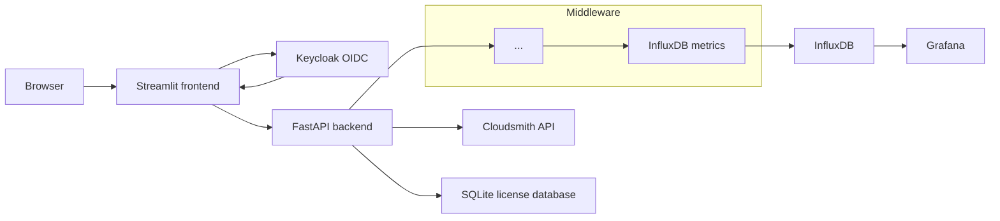

# Monitoring

## Applied Project

Section 02 extends the project introduced in [section-01](section-01.md) with a monitoring stack for collecting and visualizing API metrics.

The monitoring stack consists of two main components:

* [InfluxDB](https://www.influxdata.com/) stores the API metrics as time-series data.
* [Grafana](https://grafana.com/) visualizes the metrics in dashboards.



### Project Setup

The compose setup is extended with the two new members and looks like the following

```yaml
services:
  
  ...

  influxdb:
    image: influxdb:2.7
    container_name: influxdb
    env_file:
      - .env
    healthcheck:
      test: ["CMD", "curl", "-f", "http://localhost:8086/ping"]
      interval: 5s
      timeout: 3s
      retries: 10
    networks:
      license_service_network:
        ipv4_address: ${INFLUXDB_IP:-172.30.0.40}
    ports:
      - "8086:8086"
    volumes:
      - influxdb_data:/var/lib/influxdb2

  grafana:
    image: grafana/grafana:10.4.0
    container_name: grafana
    env_file:
      - .env
    depends_on:
      influxdb:
        condition: service_healthy
    networks:
      license_service_network:
        ipv4_address: ${GRAFANA_IP:-172.30.0.50}
    ports:
      - "3001:3000"
    volumes:
      - grafana_data:/var/lib/grafana

networks:
  license_service_network:
    ipam:
      config:
        - subnet: 172.30.0.0/24

volumes:
  license_service_data:
  influxdb_data:
  grafana_data:
```

Compared to the previous section, the most important monitoring-related
differences are:

| Key | Purpose |
| --- | --- |
| `influxdb` service | Runs InfluxDB 2.7 as the time-series database for API metrics. |
| `grafana` service | Runs Grafana and provides dashboards for the metrics stored in InfluxDB. |
| `healthcheck` | Checks the InfluxDB `/ping` endpoint so Grafana starts only after InfluxDB is ready. |
| `influxdb_data` | Persists InfluxDB data when the container is recreated. |
| `grafana_data` | Persists Grafana dashboards, users, and data-source configuration. |

## Monitoring
### InfluxDB

To showcase the integration with InfluxDB, the backend writes every HTTP requests through it's middleware stack towards the database. 

The backend uses one measurement, `api_requests`, for all HTTP request and writes the HTTP method and the endpoint as tags and the returned status code as an measured field to the database. Writing to an influx datasource in Python can easily be done with the `influxdb-client` and the usage of the [Point](https://docs.influxdata.com/influxdb/v2/reference/glossary/#point) constructor as the following code snippet of the `middleware.py` showcases.

```python
import os

from influxdb_client import InfluxDBClient, Point
from influxdb_client.client.write_api import SYNCHRONOUS

client = InfluxDBClient(
    url=os.getenv("INFLUXDB_URL"),
    token=os.environ["INFLUXDB_TOKEN"],
    org=os.getenv("INFLUXDB_ORG"),
)
write_api = client.write_api(write_options=SYNCHRONOUS)

point = (
  Point("api_requests")
    .tag("method", method)
    .tag("path", path)
    .field("status_code", status_code)
)

write_api.write( bucket=os.environ["INFLUXDB_BUCKET"], org=os.environ["INFLUXDB_ORG"], record=point, )
```

!!! info "Connect with InfluxDB"
	Open <http://localhost:8086>, sign in with the InfluxDB credentials from
	`.env`, and open **Explore**. Select the `oidc_license_service` organization
	and `api_metrics` bucket. Choose the `api_requests` measurement and a recent
	time range to verify that request points have been stored.

### Grafana

Grafana is used as an visualization layer for the tracked metrics information and must be configured with the InfluxDB data source.

!!! info "Connect Grafana with InfluxDB"
    In Grafana, open **Connections** → **Data sources** → **Add new data source**, select **InfluxDB**, and use these settings:

    * URL: `http://influxdb:8086`
    * Organization: `oidc_license_service`
    * Bucket: `api_metrics`
    * Token: `INFLUXDB_TOKEN` from `.env`

    Click **Save & test**. 
    
The project uses two visualizations to show the incoming http traffic.

* a table view that lists incoming http requests 
* a visualization showing the http traffic over time. 

Check the [README.md](./../../projects/bonus1_license_service_oidc/grafana/README.md) for more information about the technical implementation. 

## Development Workflow

### Create the Environment

Start the complete application and monitoring stack from the project
directory:

```shell
cd projects/bonus1_license_service_oidc
docker compose up --build -d
docker compose ps
```

The `--build` option rebuilds the backend and frontend images. The `-d`
option starts the services in the background. Compose waits for the InfluxDB
health check before starting Grafana.

### Inspect the Environment

Inspect the monitoring service status and logs with:

```shell
docker compose ps influxdb grafana
docker compose logs -f influxdb
docker compose logs -f grafana
```

Stop the complete stack while preserving the named volumes with:

```shell
docker compose down
```

To remove the persisted InfluxDB and Grafana data as well, use:

```shell
docker compose down -v
```

