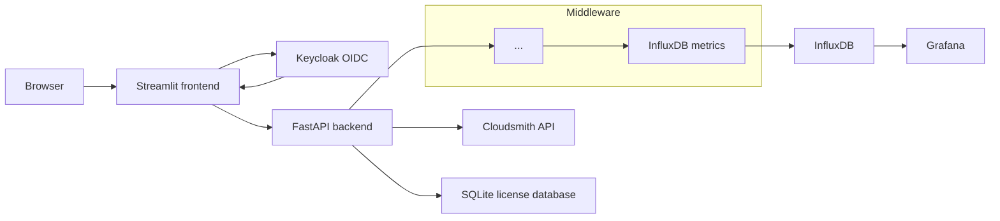

# Monitoring

## Applied Project

Section 02 extends the project introduced in [Section 01](section-01.md) with a monitoring stack for collecting and visualizing API metrics.

The monitoring stack consists of two main components:

* [InfluxDB](https://www.influxdata.com/) stores the API metrics as time-series data.
* [Grafana](https://grafana.com/) visualizes the metrics in dashboards.



### Project Setup

The compose setup is extended with the two new members and looks like the following

```yaml
services:
  
  ...

  influxdb:
    image: influxdb:2.7
    container_name: influxdb
    env_file:
      - .env
    healthcheck:
      test: ["CMD", "curl", "-f", "http://localhost:8086/ping"]
      interval: 5s
      timeout: 3s

    networks:
      license_service_network:
        ipv4_address: ${INFLUXDB_IP:-172.30.0.40}
    ports:
      - "8086:8086"
    volumes:
      - influxdb_data:/var/lib/influxdb2

  grafana:
    image: grafana/grafana:10.4.0
    container_name: grafana
    env_file:
      - .env
    depends_on:
      influxdb:
        condition: service_healthy
    networks:
        ipv4_address: ${GRAFANA_IP:-172.30.0.50}
    ports:
      - "3001:3000"
    volumes:
      - grafana_data:/var/lib/grafana

networks:
  license_service_network:
    ipam:
      config:
        - subnet: 172.30.0.0/24

volumes:
  license_service_data:
  influxdb_data:
  grafana_data:
```

Compared to the previous section, the most important monitoring-related
differences are:

| Key | Purpose |
| --- | --- |
| `influxdb` service | Runs InfluxDB 2.7 as the time-series database for API metrics. |
| `grafana` service | Runs Grafana and provides dashboards for the metrics stored in InfluxDB. |
| `healthcheck` | Checks the InfluxDB `/ping` endpoint so Grafana starts only after InfluxDB is ready. |
| `influxdb_data` | Persists InfluxDB data when the container is recreated. |
| `grafana_data` | Persists Grafana dashboards, users, and data-source configuration. |

## Monitoring
### InfluxDB

**Integrating the influx client in the middleware**

The backend writes each incoming request through its middleware stack to the Influx database. Therefore, it uses one measurement, `api_requests`, for all requests. It records `method`, `endpoint`, and `client_ip` as tags, and `status_code` and `duration_ms` as fields. Duration is measured in milliseconds around request handling. The [Point](https://docs.influxdata.com/influxdb/v2/reference/glossary/#point) constructor from `influxdb-client` is used to create each InfluxDB record:

```python
# middleware.py
import os

from influxdb_client import InfluxDBClient, Point
from influxdb_client.client.write_api import SYNCHRONOUS

client = InfluxDBClient(
    url=os.getenv("INFLUXDB_URL"),
    token=os.environ["INFLUXDB_TOKEN"],
    org=os.getenv("INFLUXDB_ORG"),
)
write_api = client.write_api(write_options=SYNCHRONOUS)

point = (
  Point("api_requests")
    .tag("method", method)
    .tag("endpoint", endpoint)
    .tag("client_ip", client_ip)
    .field("duration_ms", duration_ms)
    .field("status_code", status_code)
)

write_api.write( bucket=os.environ["INFLUXDB_BUCKET"], org=os.environ["INFLUXDB_ORG"], record=point, )
```

**Exploring metrics in influx**

Open [http://localhost:8086](http://localhost:8086) in your browser and sign in with the InfluxDB credentials from the `.env` file. Open **Data Explorer** and select the `api_metrics` buckets.

**Data Explorer** lets you explore the data stored in InfluxDB without building a dashboard first. You can choose a time range, focus on particular metrics, and display the results as a graph or table. Within the **Data Explorer** you can choose between the visual query builder or switch to **Script Editor** to enter a query directly.

!!! info "api counts per minute"
    For a first example, select **Script Editor** and paste the following query. It uses Flux, InfluxDB's query language, to count API requests in one-minute intervals. Choose a time range that includes recent requests, then click **Submit**. If no data appears, send a few requests through the application and run the query again:

    ```flux
    from(bucket: "api_metrics")
      |> range(start: v.timeRangeStart, stop: v.timeRangeStop)
      |> filter(fn: (r) => r._measurement == "api_requests")
      |> filter(fn: (r) => r._field == "status_code")
      |> aggregateWindow(every: 1m, fn: count, createEmpty: true)
      |> yield(name: "api_calls")
    ```

    * `aggregateWindow` counts the records in each one-minute interval and includes empty intervals with a count of zero. 
    * `yield` names the result `api_calls`


### Grafana

Grafana is used as an visualization layer for the tracked metrics information and must be configured with the InfluxDB data source.

Open [http://localhost:3001](http://localhost:3001) in your browser and sign with the Grafana credentials from the `.env` file. 

**Connection Grafana with the Influx Database**

To forward the metrics to Grafana, the Influx database has to be actively connected with the Grafana instance. Open *Connections* > *Add new data source*. Select *InfluxDB* and set *Flux* as the query language and use the following settings and confirm the with clicking on *Save & test*:

    * URL: `http://influxdb:8086`
    * Organization: `oidc_license_service`
    * Bucket: `api_metrics`
    * Token: `INFLUXDB_TOKEN` from `.env`

**Exploring metrics with Grafana**

Once the influx database is connected, navigate to *Explore*, set *influxdb* as the query language and provide the query from above into the code editor and run the query. The result should be the same as explored within InfluxDB.

**Configuring Dashboards and alerts**

Grafana provides the possibility to visualize metrics in configurable dashboards or configuring alerts when certain kind of thresholds are activated. Check the [README](./../../projects/bonus1_license_service_oidc/grafana/README.md) of the grafana folder that provides detailed information about the used visualizations of the course:

  * a table view that lists incoming HTTP requests
  * a visualization showing HTTP traffic over time
  * a visualization showing average request latency over time
  * an alert for brute-force blocks, based on HTTP 429 responses

!!! info "For more information"
    The individual dashboard and alert configuration are documented in the [README](./../../projects/bonus1_license_service_oidc/grafana/README.md)

## Development Workflow

### Create the Environment

Start the complete application and monitoring stack from the project
directory:

```shell
cd projects/bonus1_license_service_oidc
docker compose up --build -d
docker compose ps
```

The `--build` option rebuilds the backend and frontend images. The `-d`
option starts the services in the background. Compose waits for the InfluxDB
health check before starting Grafana.

### Inspect the Environment

Inspect the monitoring service status and logs with:

```shell
docker compose ps influxdb grafana
docker compose logs -f influxdb
docker compose logs -f grafana
```

Stop the complete stack while preserving the named volumes with:

```shell
docker compose down
```

To remove the persisted InfluxDB and Grafana data as well, use:

```shell
docker compose down -v
```

