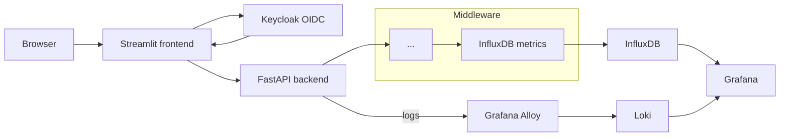

# Monitoring

## Applied Project

Section 02 extends the project introduced in [Section 01](section-01.md) with a monitoring stack for API metrics and backend logs.

The monitoring stack consists of these components:

* [InfluxDB](https://www.influxdata.com/) stores the API metrics as time-series data.
* [Grafana](https://grafana.com/) visualizes the metrics in dashboards.
* [Grafana Alloy](https://grafana.com/docs/alloy/latest/) collects backend container logs and forwards them to Loki.
* [Loki](https://grafana.com/oss/loki/) stores the logs for querying and visualization in Grafana.



### Project Setup

The Compose setup includes the monitoring services shown below:

```yaml
services:

  loki:
    image: grafana/loki:3.4.2
    command: -config.file=/etc/loki/config.yaml
    volumes:
      - ./logging/loki/config.yaml:/etc/loki/config.yaml:ro
      - loki_data:/loki
    networks:
      - license_service_network

  alloy:
    image: grafana/alloy:v1.8.3
    command:
      - run
      - --server.http.listen-addr=0.0.0.0:12345
      - --storage.path=/var/lib/alloy/data
      - /etc/alloy/config.alloy
    depends_on:
      - loki
    volumes:
      - ./logging/alloy/config.alloy:/etc/alloy/config.alloy:ro
      - /var/run/docker.sock:/var/run/docker.sock:ro
      - alloy_data:/var/lib/alloy/data
    networks:
      - license_service_network

  influxdb:
    image: influxdb:2.7
    container_name: influxdb
    env_file:
      - .env
    healthcheck:
      test: ["CMD", "curl", "-f", "http://localhost:8086/ping"]
      interval: 5s
      timeout: 3s

    networks:
      license_service_network:
        ipv4_address: ${INFLUXDB_IP:-172.30.0.40}
    ports:
      - "8086:8086"
    volumes:
      - influxdb_data:/var/lib/influxdb2

  grafana:
    image: grafana/grafana:10.4.0
    container_name: grafana
    env_file:
      - .env
    depends_on:
      influxdb:
        condition: service_healthy
      loki:
        condition: service_started
    networks:
      license_service_network:
        ipv4_address: ${GRAFANA_IP:-172.30.0.50}
    ports:
      - "3001:3000"
    volumes:
      - grafana_data:/var/lib/grafana

networks:
  license_service_network:
    ipam:
      config:
        - subnet: 172.30.0.0/24

volumes:
  license_service_data:
  influxdb_data:
  grafana_data:
  loki_data:
  alloy_data:
```

Compared to the previous section, the most important monitoring-related
differences are:

| Key | Purpose |
| --- | --- |
| `influxdb` service | Runs InfluxDB 2.7 as the time-series database for API metrics. |
| `grafana` service | Runs Grafana and provides dashboards for the metrics stored in InfluxDB. |
| `loki` service | Stores backend container logs; configure Grafana's Loki data source with URL `http://loki:3100`. |
| `alloy` service | Collects backend container logs from Docker and forwards them to Loki. |
| `docker.sock` Docker socket mount | Lets Alloy discover and read container logs; it grants powerful Docker access, so use only in a trusted environment. |
| `healthcheck` | Checks the InfluxDB `/ping` endpoint so Grafana starts only after InfluxDB is ready. |
| `influxdb_data` | Persists InfluxDB data when the container is recreated. |
| `grafana_data` | Persists Grafana dashboards, users, and data-source configuration. |
| `loki_data` and `alloy_data` | Persist Loki's log data and Alloy's collection state across container recreation. |

## Monitoring
### InfluxDB

**Integrating the influx client in the middleware**

The backend writes each incoming request through its middleware stack to the Influx database. Therefore, it uses one measurement, `api_requests`, for all requests. It records `method`, `endpoint`, and `client_ip` as tags, and `status_code` and `duration_ms` as fields. Duration is measured in milliseconds around request handling. The [Point](https://docs.influxdata.com/influxdb/v2/reference/glossary/#point) constructor from `influxdb-client` is used to create each InfluxDB record:

```python
# middleware.py
import os

from influxdb_client import InfluxDBClient, Point
from influxdb_client.client.write_api import SYNCHRONOUS

client = InfluxDBClient(
    url=os.getenv("INFLUXDB_URL"),
    token=os.environ["INFLUXDB_TOKEN"],
    org=os.getenv("INFLUXDB_ORG"),
)
write_api = client.write_api(write_options=SYNCHRONOUS)

point = (
  Point("api_requests")
    .tag("method", method)
    .tag("endpoint", endpoint)
    .tag("client_ip", client_ip)
    .field("duration_ms", duration_ms)
    .field("status_code", status_code)
)

write_api.write( bucket=os.environ["INFLUXDB_BUCKET"], org=os.environ["INFLUXDB_ORG"], record=point, )
```

**Exploring metrics in influx**

Open [http://localhost:8086](http://localhost:8086) in your browser and sign in with the InfluxDB credentials from the `.env` file. Open **Data Explorer** and select the `api_metrics` buckets.

**Data Explorer** lets you explore the data stored in InfluxDB without building a dashboard first. You can choose a time range, focus on particular metrics, and display the results as a graph or table. Within the **Data Explorer** you can choose between the visual query builder or switch to **Script Editor** to enter a query directly.

!!! info "api counts per minute"
    For a first example, select **Script Editor** and paste the following query. It uses Flux, InfluxDB's query language, to count API requests in one-minute intervals. Choose a time range that includes recent requests, then click **Submit**. If no data appears, send a few requests through the application and run the query again:

    ```flux
    from(bucket: "api_metrics")
      |> range(start: v.timeRangeStart, stop: v.timeRangeStop)
      |> filter(fn: (r) => r._measurement == "api_requests")
      |> filter(fn: (r) => r._field == "status_code")
      |> aggregateWindow(every: 1m, fn: count, createEmpty: true)
      |> yield(name: "api_calls")
    ```

    * `aggregateWindow` counts the records in each one-minute interval and includes empty intervals with a count of zero. 
    * `yield` names the result `api_calls`


### Grafana

Grafana is used as an visualization layer for the tracked metrics information and must be configured with the InfluxDB data source.

Open [http://localhost:3001](http://localhost:3001) in your browser and sign with the Grafana credentials from the `.env` file. 

**Connect Grafana with the Influx Database**

To forward the metrics to Grafana, the Influx database has to be actively connected with the Grafana instance. Open *Connections* > *Add new data source*. Select *InfluxDB* and set *Flux* as the query language and use the following settings and confirm the with clicking on *Save & test*:

    * URL: `http://influxdb:8086`
    * Organization: `oidc_license_service`
    * Bucket: `api_metrics`
    * Token: `INFLUXDB_TOKEN` from `.env`

**Exploring metrics with Grafana**

Once the influx database is connected, navigate to *Explore*, set *influxdb* as the query language and provide the query from above into the code editor and run the query. The result should be the same as explored within InfluxDB.

**Configuring Dashboards and alerts**

Grafana provides the possibility to visualize metrics in configurable dashboards or configuring alerts when certain kind of thresholds are activated. Check the [README](./../../projects/bonus1_license_service_oidc/grafana/README.md) of the grafana folder that provides detailed information about the used visualizations of the course:

  * a table view that lists incoming HTTP requests
  * a visualization showing HTTP traffic over time
  * a visualization showing average request latency over time
  * an alert for brute-force blocks, based on HTTP 429 responses

!!! info "For more information"
    The individual dashboard and alert configuration are documented in the [README](./../../projects/bonus1_license_service_oidc/grafana/README.md)

### Alloy

Grafana Alloy is an agent that collects telemetry and sends it to storage systems. Here it reads the backend's Docker logs and forwards them to Loki.

**Docker socket mount**

Compose mounts `/var/run/docker.sock` into Alloy so it can discover containers and read their logs. The `:ro` mount does not limit Docker API permissions, so access to this socket is powerful and should be restricted to trusted setups.

**Log pipeline in `config.alloy`**

The pipeline starts by discovering containers through Docker and keeping only the Compose service named `backend`:

```alloy
discovery.docker "containers" {
  host = "unix:///var/run/docker.sock"
}

discovery.relabel "backend" {
  targets = discovery.docker.containers.targets

  rule {
    source_labels = ["__meta_docker_container_label_com_docker_compose_service"]
    regex         = "backend"
    action        = "keep"
  }
}
```

`loki.source.docker` reads logs from the matching containers and forwards them to `loki.write`, which sends them to Loki:

```alloy
loki.source.docker "backend" {
  host       = "unix:///var/run/docker.sock"
  targets    = discovery.relabel.backend.output
  labels     = { job = "docker/backend" }
  forward_to = [loki.write.local.receiver]
}

loki.write "local" {
  endpoint {
    url = "http://loki:3100/loki/api/v1/push"
  }
}
```

The relabel rules also add `service` and `container` labels, which make backend logs easier to filter in Grafana.

### Loki

Loki is a log storage system. Alloy sends backend logs to Loki, where Grafana can query and display them.

**Connect Grafana with Loki**

In Grafana, open **Connections > Add new data source**, select **Loki**, and enter `http://loki:3100` as the URL. Select **Save & test**. This service name works because Grafana and Loki share the Compose network.

**Key settings in `config.yaml`**

Loki listens on port `3100` and stores its data under `/loki` using the filesystem:

```yaml
server:
  http_listen_port: 3100

common:
  path_prefix: /loki
  storage:
    filesystem:
      chunks_directory: /loki/chunks
      rules_directory: /loki/rules
```

The schema describes how Loki indexes stored logs. The compactor applies the
configured retention period of `720h` (30 days):

```yaml
schema_config:
  configs:
    - store: tsdb
      from: "2024-01-01"
      object_store: filesystem
      schema: v13
      index:
        prefix: index_
        period: 24h

compactor:
  working_directory: /loki/compactor
  retention_enabled: true
  delete_request_store: filesystem

limits_config:
  retention_period: 720h
```

Authentication is disabled in this development configuration, so keep Loki on
the trusted Compose network and do not expose it publicly.

## Development Workflow

### Create the Environment

Start the complete application and monitoring stack from the project
directory:

```shell
cd projects/bonus1_license_service_oidc
docker compose up --build -d
docker compose ps
```

The `--build` option rebuilds the backend and frontend images. The `-d`
option starts the services in the background. Compose waits for the InfluxDB
health check before starting Grafana.

### Inspect the Environment

Inspect the monitoring service status and logs with:

```shell
docker compose ps influxdb grafana alloy loki
docker compose logs -f influxdb
docker compose logs -f grafana
docker compose logs -f alloy
docker compose logs -f loki
```

Stop the complete stack while preserving the named volumes with:

```shell
docker compose down
```

To remove the persisted InfluxDB and Grafana data as well, use:

```shell
docker compose down -v
```

