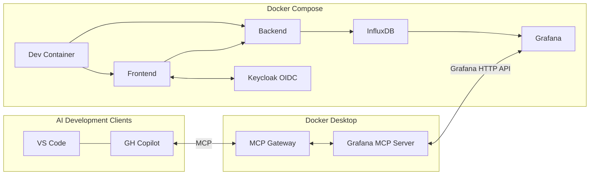

# MCP Gateway

The Docker MCP Gateway introduces an MCP integration layer between the AI development clients and Grafana. The Grafana MCP Server provides the tools required to interact with Grafana, while the existing Compose application continues to provide the backend, authentication, monitoring data, and dashboard interface.

## Applied Project
### Project Setup

This section extends the existing Docker Compose application with the [Docker Desktop MCP Gateway](https://docs.docker.com/ai/mcp-catalog-and-toolkit/mcp-gateway/) and the Grafana MCP Server. The goal is to enable AI-assisted Grafana dashboard management through Visual Studio Code with GitHub Copilot.

The existing application stack remains unchanged. The MCP integration adds a separate path through which an AI client can interact with Grafana using the Model Context Protocol (MCP).



## Components

### MCP Gateway

The [Docker MCP Gateway](https://docs.docker.com/ai/mcp-catalog-and-toolkit/mcp-gateway/) provides the connection between the AI development client and the configured MCP servers.

It manages access to the available MCP tools and forwards tool requests to the appropriate server. This allows the AI client to interact with Grafana without implementing the Grafana API integration itself.

The gateway is managed through Docker Desktop's MCP Toolkit. Depending on the client configuration, the client can communicate with the gateway through a supported MCP transport, such as standard input/output (STDIO).

### MCP Server

The Grafana MCP Server exposes Grafana functionality as MCP tools. It translates supported MCP tool calls into requests to the Grafana HTTP API.

Depending on the server implementation and enabled tools, these operations can include:

- Listing and inspecting dashboards.
- Reading dashboard configurations.
- Creating or updating dashboards.
- Inspecting data sources and executing supported queries.

The server requires an appropriate Grafana URL and authentication credentials. Dashboard modifications also require sufficient Grafana permissions.

Grafana remains part of the existing Docker Compose application. It provides the dashboards and visualizations used to monitor the application.

The Grafana MCP Server communicates with Grafana through its HTTP API. The existing InfluxDB integration remains responsible for supplying the monitoring data used by dashboard panels.

!!! info "MCP Catalog"
    Browse the [Docker MCP Catalog](https://hub.docker.com/mcp) to discover available MCP servers.

## Development Workflow

### Configuration
#### MCP Landscape

Docker Inc. offers an extended configuration [guide](https://docs.docker.com/ai/mcp-catalog-and-toolkit/get-started/) for setting up Docker Desktop an it's MCP Toolkit.

**Enable the MCP Toolkit**

1. Start Docker Desktop.
2. Open **Settings** and locate the MCP Toolkit option under the available features.
3. Enable the toolkit and apply the settings.

**Add the Grafana MCP Server**

1. Open the MCP Toolkit interface.
2. Navigate to the catalog tab.
3. Search for Grafana.
4. Add the Grafana MCP Server to a dedicated profile for this project.

**Configure the Grafana MCP Server**

1. Open the server configuration.
2. Configure the Grafana URL and service account token.
  - Grafana URL: http://host.docker.internal:3001
  - Grafana API Key: *** (can be taken from the instruction of the [README](./../../projects/bonus1_license_service_oidc/grafana/README.md) )

!!! info "Grafana Configuration"
    The Grafana MCP Server runs in a separate Docker container, so `localhost` would refer to that container—not the host running Grafana. `host.docker.internal` lets it reach the host, where Grafana is published on port `3001`. If the MCP Server joins the Compose network, use `http://grafana:3000` instead.

    The URL depends on where the MCP Server runs, e.g. when the mcp server joins the compose.

    ```text
    http://grafana:3000
    ```

**Configure the MCP Gateway**

The Docker MCP Gateway provides the connection between the AI client and the configured MCP servers. When using Docker Desktop's MCP Toolkit, the gateway runs in the background.

Create or select the project-specific profile containing the Grafana MCP Server. Note the profile identifier because the VS Code configuration can reference it explicitly.


!!! info "Launch the gateway" 
    The following command starts the gateway with that profile and is shown for understanding:
    VS Code will launch the gateway through its MCP configuration, so a separate terminal process is not normally required.

    ```bash
    docker mcp gateway run --profile <your-profile>
    ```

#### VS Code

**Configure the Gateway**

Visual Studio Code can connect to MCP servers through its agent configuration. In this setup, VS Code connects to the Docker MCP Gateway rather than configuring the Grafana MCP Server directly. Open the project in VS Code. Create or update `.vscode/mcp.json` in the project root.

```json
{
  "servers": {
    "MCP_DOCKER": {
      "type": "stdio",
      "command": "docker",
      "args": [ "mcp", "gateway", "run", "--profile", "<your-profile>" ]
    }
  }
}
```

The `servers` object defines the MCP server connection. The `command` invokes the Docker CLI. The `args` select the gateway and the configured profile. The `stdio` transport allows VS Code to communicate with the gateway through standard input and output.

!!! info ""
    This configuration assumes that the Docker CLI is available in the VS Code environment and that the configured profile exposes the Grafana MCP Server.

**Inspect the MCP Tools**

Within Docker Desktop you can open the Grafana MCP Server to view its available tools. 

In VS Code, open **Chat**, click **Configure Tools** in the chat input, then expand **MCP_DOCKER** to see the tools exposed through the gateway.

!!! info "Tool Availability"
    Tool names and availability depend on the installed server version and its configuration. Use the tools actually listed in the current MCP session.

### Bootstrapping

**Bootstrap the Services**

This section demonstrates the complete workflow. The services run in Docker Compose, Grafana displays the dashboard, and the AI agent applies changes through MCP.

Open a terminal in the project root and start the application.

```bash
# Build images when required and start the Compose services.
docker compose up -d --build

# Check service status.
docker compose ps
```

Wait until Grafana and the required application services are ready. The existing Compose configuration defines a health check for InfluxDB and makes Grafana depend on that health check.

The MCP Server is managed separately by Docker Desktop unless you have explicitly added it to the Compose project.

**Open Grafana**

Open the Grafana interface in a browser:

```text
http://localhost:3001
```

Sign in using the credentials configured for the Grafana instance. Open the dashboard you want to modify.

Keep this browser tab open while working in VS Code. It provides a direct way to verify the changes after the agent applies them.

**Ask the Agent to Modify the Dashboard**

Open the AI chat in VS Code and confirm that the Grafana MCP tools are available. Select an existing dashboard and provide a specific instruction.

For example:

```text
Inspect the existing Grafana dashboard using the available Grafana
MCP tools.

Add a time-series panel showing backend request failures over time.
Use the existing data source and follow the query conventions already
used by the dashboard.

Keep the change minimal. Do not create a new dashboard or modify
unrelated panels.

Inspect the current dashboard first. Apply the smallest supported
change, save it, and report which panel was added and which query
was used.
```

Review the proposed operation before allowing changes to a shared or production dashboard.

**Verify the Changes in Real Time**

Return to the Grafana browser tab and refresh the dashboard if the updated panel is not displayed automatically.

Verify that:

1. The new panel appears in the intended dashboard.
2. The panel uses the expected data source.
3. The query returns meaningful results for the selected time range.
4. The panel title, visualization type, and layout are correct.
5. Existing panels remain unchanged.

If the panel is empty, inspect the query, available measurements, time range, and data source configuration. An empty panel does not necessarily mean that the MCP connection failed.

Repeat the process with another targeted change once the first modification is verified.
