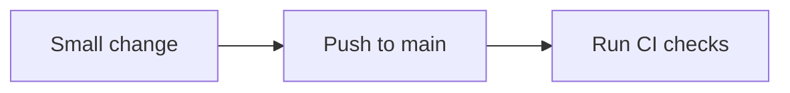
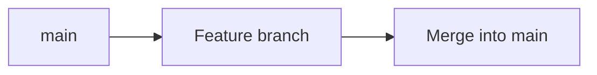
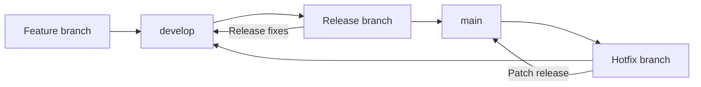
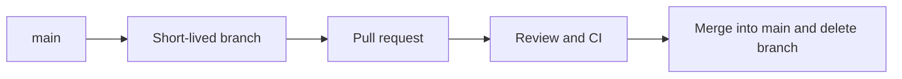
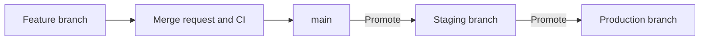

# Continuous Integration

**Continuous Integration (CI)** means integrating small changes frequently and using automated checks to catch problems early. A branching model defines how changes reach `main`; a CI workflow defines what runs along the way. This section compares common branching models and uses IrisLab to show how GitHub Flow can work with GitHub Actions and Dev Containers.

## Workflow Models

Branching models trade simplicity for control over when changes are integrated and released. Read each diagram as the path a typical change takes.

### Main-Branch Workflow

Developers integrate small changes directly into `main`. CI checks every push, and the team fixes or reverts failures quickly. This is the simplest form of trunk-based development, which can also use very short-lived branches.

### Feature-Branch Workflow

Developers work on separate branches and merge when a change is ready. This isolates work in progress, but the longer a branch lives, the more it can diverge from `main`. The model leaves review, checks, and releases up to the team.

### Git Flow

Git Flow integrates features into a long-lived `develop` branch. Release branches let the team stabilize a version while development continues; `main` holds released code. Urgent fixes branch from `main` and are merged back into both lines. This can suit planned releases, but there are more branches to keep in sync.

### GitHub Flow

[GitHub Flow](https://docs.github.com/en/get-started/using-github/github-flow) gives the feature-branch model a simple routine: branch from `main`, open a pull request, review and test the change, then merge and delete the branch. Open a draft pull request early to get CI feedback while you work. Keep `main` ready to release, and use required checks and reviews to protect it.

### GitLab Flow

[GitLab Flow](https://about.gitlab.com/topics/version-control/what-is-gitlab-flow/) also integrates changes into `main` through reviewed merge requests. One variant adds downstream environment branches so that merging code and promoting it to an environment can happen at different times. This is useful when deployment timing needs extra control. GitHub Flow can also use gated deployments without adding environment branches.

Modern code hosting brings review, required checks, hosted runners, and deployment controls together. Dev Containers let teams reuse their development tooling in CI, and environment rules can control deployment without encoding it in the branch structure. That makes a short-lived branch and a protected `main` a practical default for projects like IrisLab. The feedback still needs to be fast enough for developers to integrate frequently.

## Used Project

| Component | Purpose |
| --- | --- |
| [IrisLab Compose Project](https://github.com/ValentinTwin1206/irislab-compose-project) | Streamlit frontend, IrisLab API, and supporting services. The frontend is built from the checkout; the API is pulled as a prebuilt image. |
| [`build.yml`](https://github.com/ValentinTwin1206/irislab-compose-project/blob/main/.github/workflows/build.yml) | Defines the GitHub Actions triggers and the **Verify IrisLab** job. |
| [`devcontainers/ci`](https://github.com/devcontainers/ci) | Runs CI commands inside a Dev Container on a GitHub-hosted runner. |
| [Testing IrisLab](./section-03.md) | Explains what the Playwright and Artillery scenarios cover. |

## Applying GitHub Flow to IrisLab

The workflow uses one CI job and a temporary Compose stack for each run. Each pull request runs CI independently; changes are not batched or grouped for merging. Reviewers see whether the checks passed, and developers can run the same checks on a feature branch before opening a pull request.

### Workflow Triggers

| Trigger | What it verifies |
| --- | --- |
| `pull_request` targeting `main` | Tests the proposed merge with `main`. Draft and regular pull requests run the same checks when opened, reopened, or updated. |
| `push` to `main` | Verifies the commit that actually landed on `main`. |
| `workflow_dispatch` | Tests the selected branch tip with the same checks, including the Artillery smoke suite. |

Once the checks are green, configure **Verify IrisLab** as a required check for `main`. For an on-demand run, choose the branch under **Actions → IrisLab CI → Run workflow**. The workflow runs the same checks on each trigger; Artillery always runs the smoke suite. Use a draft pull request to test the initial workflow before it lands.

### Main Workflow Steps

1. **Scan the checkout and prepare the test stack.** Trivy checks the repository, including `frontend/` Python files for secrets and `frontend/uv.lock` for vulnerable dependencies. The scan runs before CI writes test credentials. CI also disables the optional Docker Model Runner in the runner's checkout of `docker-compose.yml`.
2. **Build and start the Dev Container.** The `devcontainers/ci` action uses the project's existing `.devcontainer/devcontainer.json`. The Dev Container CLI builds the frontend and starts the Compose services it declares.
3. **Lint and unit-test.** The `frontend:lint` and `frontend:unit` npm scripts run Ruff and pytest inside the container. Failures are reported while the workflow continues to the integration checks.
4. **Run the integration tests.** The `gui-test` npm script runs Playwright to verify sign-in and sign-out through Keycloak. The `smoke-test` npm script always runs Artillery's performance scenario with reduced load.
5. **Scan and publish the frontend image, then save results.** Trivy scans OS packages and libraries in the same local image Compose built. Both scans block on critical findings and ignore vulnerabilities with no available fix. After successful verification, pushes to `main` build and publish the frontend image to Docker Hub, tagged `latest` and with the commit SHA. Configure `DOCKERHUB_USERNAME` (login account), `IMAGE_REPO` (Docker Hub namespace), and `IMAGE_NAME` (image repository name) as Actions variables, and `DOCKERHUB_TOKEN` as a secret. Test reports are uploaded as artifacts.

### Using the `dev` Environment

Configure the `IRISLAB_CI_STACK_PASSWORD` Actions secret in repositories created from the template. Use at least 16 characters from letters, digits, and `._~-`; the workflow uses it only for the disposable CI Compose stack. Each run creates its own stack, so `deployment: false` avoids creating a deployment record. The GitHub environment is separate from the Compose `dev` profile, which starts only the Dev Container.
