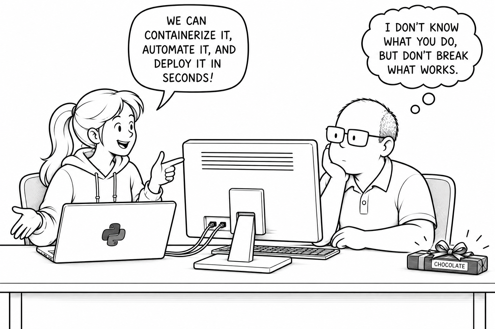

# Python System Environment — The Raise of Python

Alice and Bob work together at the same company. Alice is a young and smart software engineer, while Bob is the grumpy, old-fashioned IT administrator. One of the company's business domains is starting work on *IrisLab*, a large project spanning many tools and areas of the Python ecosystem. At its core, *IrisLab* provides a machine-learning model that detects eye color from images. Around that core, the project includes a REST API, an end-user CLI, and security middleware. Alice is part of its engineering team. She brings chocolate and ticket **IT-2048** to Bob, requesting an Ubuntu workspace. Bob opens a company Ubuntu machine and insists one shared system Python is enough. Alice demonstrates two package conflicts and solves them with virtual environments; Bob slowly admits she has a point. The hands-on experiments run in a disposable Dev Container.

## Learning Objectives

- See why shared system packages cause version conflicts.
- Learn why user-scoped installations separate users, but not projects.
- Give each project a virtual environment with independent dependencies.

## Overview

- Create three minimal projects with pinned requirements and version-checking apps: Bob's Legacy App and Alice's two FastAPI apps.
- Inspect the shared system interpreter and package paths, then demonstrate a `requests` version conflict between Bob and Alice.
- Install packages separately for each user and show why Alice's two projects can still conflict over FastAPI versions.
- Create a virtual environment for each project, inspect its interpreter and package paths, and run all three apps without conflicts.
- Compare system-wide, user-scoped, and virtual-environment installations.

## Documentation

- [Chapter 01, Section 01: Python System Environment](../../docs/chapter-01/section-01.md)
- [Open the notebook](./python_system_lab.ipynb); continue with [The Isolation Awakens](../nb2_python_venv_lab/python_venv_lab.ipynb).

## Run The Lab

1. Install Docker, VS Code, and the VS Code Dev Containers extension.
2. Open `notebooks/nb1_python_system_lab` as the folder in VS Code and select **Dev Containers: Reopen in Container**.
3. Open `python_system_lab.ipynb`, select the **Python 3 - System Lab** kernel, and run the cells in order.

Use a fresh container for the full experiment. Ubuntu 24.04 supplies Python 3.12, Jupyter, and both user accounts; package installations require network access. The system and user stages use `--break-system-packages` to override Ubuntu's externally managed Python protection inside this disposable container.

To reset, delete the notebook-generated `projects/` directory and rebuild the container; rebuilding alone preserves workspace files.
