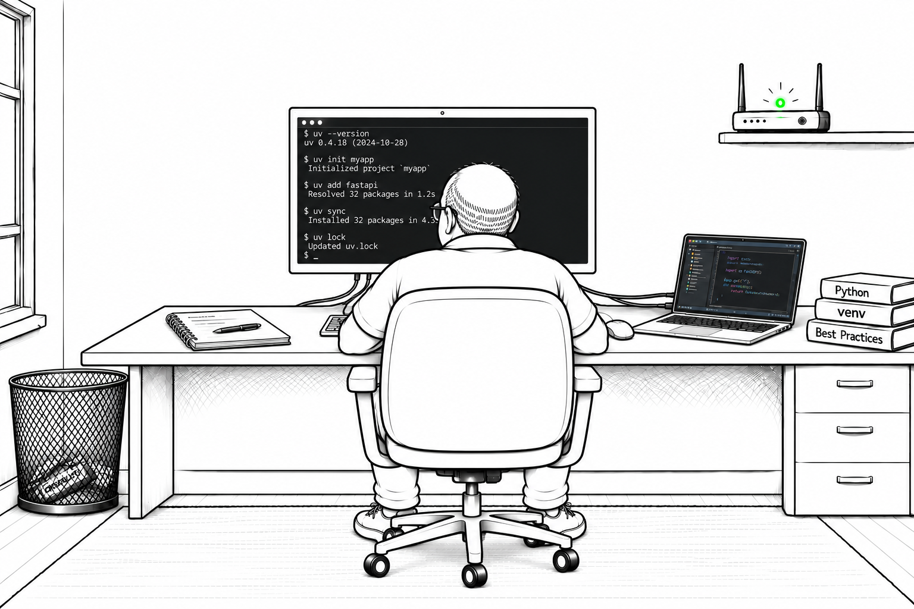

# Dependency Management with uv — Bob Discovers the Force of uv

Having scaffolded his first `uv` workspace, Bob is determined to understand how its dependencies stay under control. Alice's success had left the old-fashioned administrator feeling unused, but his experiments are giving him a new sense of purpose. He takes a small project through dependency changes, locking, and installation, checking the files at every step. By the end, Bob has a practical runbook for keeping project requirements and environments in step.

## Learning Objectives

- Distinguish declared requirements, the lockfile, and the installed environment.
- Manage dependencies, private and Git sources, groups, markers, and optional extras with `uv`.
- Control lockfile updates and synchronization, and inspect or export the resolved dependency graph.
- Explore conflicting extras and optional experiments with editable paths, constraints, and release cutoffs.

## Overview

- The roles of `pyproject.toml`, `uv.lock`, and `.venv`.
- Adding dependencies from package indexes and Git repositories, including private-index configuration.
- Version constraints, dependency groups, platform markers, optional extras, and dependency removal.
- Lockfile creation, broken pins, upgrades, and freshness checks.
- Default, frozen, and locked synchronization, including non-editable installs.
- Resolution strategies, conflicting extras, dependency trees, and exporting requirements.
- Optional independent experiments with editable paths, Git references, constraints, and release-date cutoffs.

## Documentation

- [Chapter 03, Section 02: Dependency Management with uv](../../docs/chapter-03/section-02.md)
- [Open the notebook](./uv_dependency_lab.ipynb); follow [A New Hope for Bob](../nb3_uv_proj_scaffolding_lab/uv_proj_scaffolding_lab.ipynb) and continue with [Bob Follows the Cache](../nb5_uv_cache_lab/uv_cache_lab.ipynb).

## Run The Lab

1. Install Docker, VS Code, and the VS Code Dev Containers extension.
2. Open `notebooks/nb4_uv_dependency_lab` as the folder in VS Code and select **Dev Containers: Reopen in Container**.
3. Open `uv_dependency_lab.ipynb`, select the **Python 3 - uv Dependency Resolution** kernel, and run the cells in order.

The first reset cell removes lab-generated `pyproject.toml`, `uv.lock`, `.venv`, `requirements.txt`, `installed-demo/`, `resolution-demo/`, `local-helper/`, and `advanced-demo/` from this workspace; keep unrelated work elsewhere. Dependency downloads, including a GitHub dependency, require network access. The private-index example is illustrative: Bob leaves PyGuard and its placeholder index out of the runnable project, so its project file otherwise follows the section apart from automatically selected version bounds.
