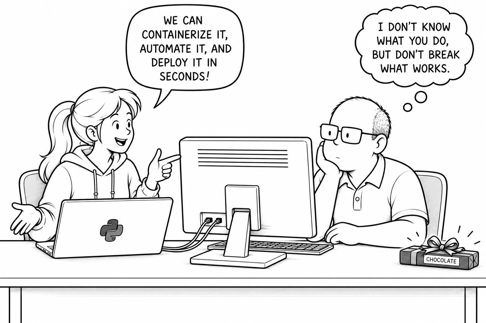

# Python System Environment — The Raise of Python

Alice guides Bob through Ubuntu's system Python, installation footprint, package
targets, and import paths. The technical companion is
[Chapter 01, Section 01](../../docs/chapter-01/section-01.md). Continue with
[The Isolation Awakens](../python_venv_lab/python_venv_lab.ipynb).

## Run the lab

1. Install Docker and the VS Code Dev Containers extension.
2. Open `notebooks/python_system_lab` as the workspace and select **Dev Containers: Reopen in Container**.
3. Open `python_system_lab.ipynb`, select **Python 3 - System Lab**, and run the cells in order.

The Ubuntu 24.04 image provides Python, its development headers, pip, venv,
Jupyter in `/opt/jupyter`, and the `bob` and `alice` accounts. The notebook
uses `/usr/bin/python3` explicitly and installs an APT package
and a user package inside the container; network access is required. Rebuild the
container to reset those installations. The container runs as Bob with sudo;
the commands do not change the host's Python installation. Documentation links
are accessible when browsing the repository; the workspace mount contains only
this lab directory.
