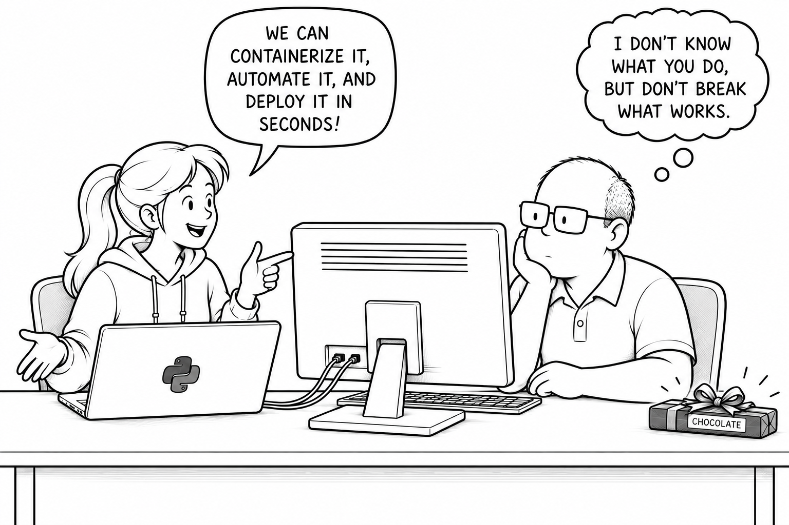

# Python System Environment — The Raise of Python

Alice, a software engineer on *IrisLab*, brings chocolate and ticket **IT-2048** to Bob, the grumpy, old-fashioned IT administrator, requesting an Ubuntu workspace. Bob opens a company Ubuntu machine and insists one shared system Python is enough. Alice demonstrates two package conflicts and solves them with virtual environments; Bob slowly admits she has a point. The hands-on experiments run in a disposable Dev Container.

## Learning Objectives

- See why shared system packages cause version conflicts.
- Learn why user-scoped installations separate users, but not projects.
- Give each project a virtual environment with independent dependencies.

The notebook generates three minimal projects using Linux commands: Bob's Legacy App and Alice's two FastAPI apps. Each prints and checks its dependency versions.

## Documentation

- [Chapter 01, Section 01: Python System Environment](../../docs/chapter-01/section-01.md)
- [Open the notebook](./python_system_lab.ipynb); continue with [The Isolation Awakens](../python_venv_lab/python_venv_lab.ipynb).

## Run the Lab

1. Open `notebooks/python_system_lab` in VS Code with Docker and the Dev Containers extension.
2. Select **Dev Containers: Reopen in Container**.
3. Open the notebook, select **Python 3 - System Lab**, and run all cells in order.

Use a fresh container for the full experiment. Ubuntu 24.04 supplies Python 3.12, Jupyter, and both user accounts; package installations need network access. The system/user stages use `--break-system-packages` to override Ubuntu's externally managed Python protection inside this disposable container.

To reset, delete the notebook-generated `projects/` directory and rebuild the container; rebuilding alone preserves workspace files.
