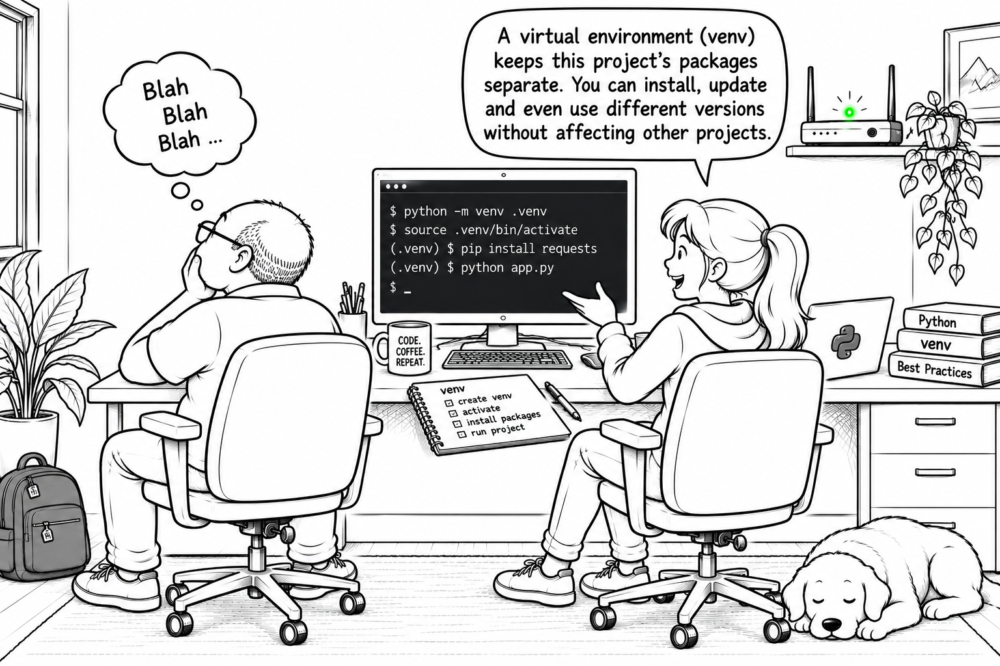

# Python `venv` Environments — The Isolation Awakens

After Alice's chocolate-fueled visit to Bob's office, her request for a remote Ubuntu environment has led them to inspect the shared system Python. Her IrisLab project will eventually expose iris-color analysis through a REST API, protected by middleware and accessible from a CLI. Bob hopes that a single user-level package installation will serve every project, but Alice points out that different projects may require incompatible versions. Together, they give two projects their own virtual environments and explore what remains shared.

## Overview

- Creating project-local environments with Python's standard-library `venv` module.
- Virtual environment layout, interpreter links, and `pyvenv.cfg`.
- Base and environment prefixes, the shared standard library, and package visibility.
- Installing different dependency versions into separate environments.
- Activation, `PATH`, import resolution, and the disposable nature of virtual environments.

## Documentation

- [Chapter 01, Section 02: Python `venv` Environments](../../docs/chapter-01/section-02.md)
- [Open the notebook](./python_venv_lab.ipynb); start with [The Raise of Python](../python_system_lab/python_system_lab.ipynb).

## Getting Started

To run the lab, open `notebooks/python_venv_lab` in VS Code with Docker and the Dev Containers extension, then select **Dev Containers: Reopen in Container**. Open the notebook, select **Python 3 - venv Lab**, and run the cells in order. The first setup cell resets the ignored `lab/` directory, where the notebook creates its two environments; package downloads require network access. The Jupyter kernel stays separate while the cells invoke each environment's interpreter explicitly.
