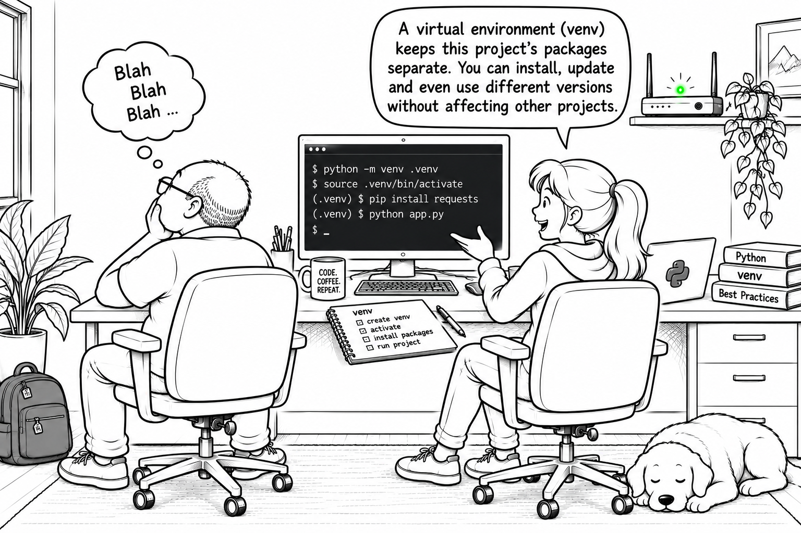

# Python `venv` Environments — The Isolation Awakens

Picking up after their inspection of Ubuntu's system Python, Alice shows Bob how Python's built-in `venv` creates separate package spaces for projects while reusing the base interpreter. The *IrisLab* project will leverage several different Python environments for the distinct components. As Alice grows more enthusiastic about virtual environments, Bob grows more offended but increasingly calm. After every explanation, he silently repeats her words in a childish imitation, then answers aloud with only “Aha,” “Yes,” or “No.” Together, they give two projects separate environments and explore what remains shared.

## Overview

- Creating project-local environments with Python's standard-library `venv` module.
- Virtual environment layout, interpreter links, and `pyvenv.cfg`.
- Base and environment prefixes, the shared standard library, and package visibility.
- Installing different dependency versions into separate environments.
- Activation, `PATH`, import resolution, and the disposable nature of virtual environments.

## Documentation

- [Chapter 01, Section 02: Python `venv` Environments](../../docs/chapter-01/section-02.md)
- [Open the notebook](./python_venv_lab.ipynb); start with [The Raise of Python](../python_system_lab/python_system_lab.ipynb).

## Getting Started

To run the lab, open `notebooks/python_venv_lab` in VS Code with Docker and the Dev Containers extension, then select **Dev Containers: Reopen in Container**. Open the notebook, select **Python 3 - venv Lab**, and run the cells in order. The first setup cell resets the ignored `lab/` directory, where the notebook creates its two environments; package downloads require network access. The Jupyter kernel stays separate while the cells invoke each environment's interpreter explicitly.
