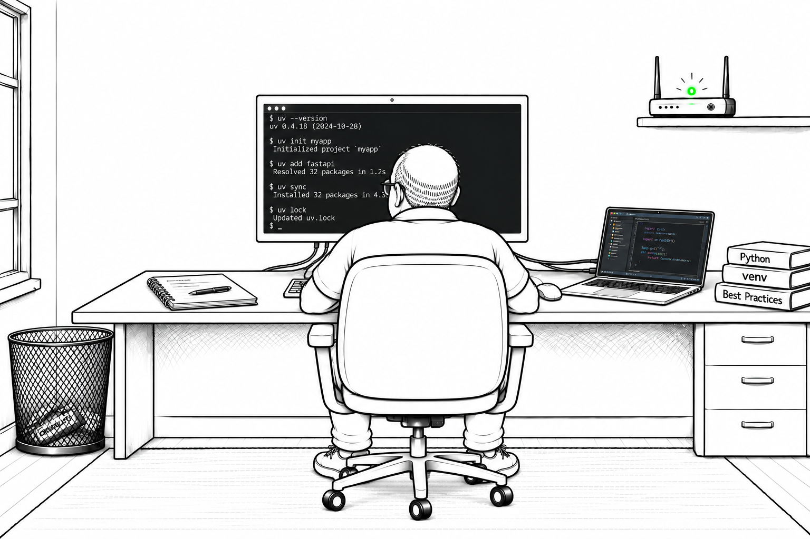

# Dependency Management with uv — Bob Discovers the Force of uv

Having scaffolded his first `uv` workspace, Bob is determined to understand how its dependencies stay under control. Alice's success had left the old-fashioned administrator feeling unused, but his experiments are giving him a new sense of purpose. He takes a small project through dependency changes, locking, and installation, checking the files at every step. By the end, Bob has a practical runbook for keeping project requirements and environments in step.

## Overview

- The roles of `pyproject.toml`, `uv.lock`, and `.venv`.
- Adding and removing dependencies from package indexes and Git repositories.
- Version constraints, dependency groups, and platform markers.
- Lockfile creation, broken pins, upgrades, and freshness checks.
- Default, frozen, and locked synchronization, including non-editable installs.
- Resolution strategies, dependency trees, and exporting requirements.

## Documentation

- [Chapter 03, Section 02: Dependency Management with uv](../../docs/chapter-03/section-02.md)
- [Open the notebook](./uv_dependency_lab.ipynb); continue with [Bob Follows the Cache](../uv_cache_lab/uv_cache_lab.ipynb).

To run the lab, open `notebooks/uv_dependency_lab` in VS Code with Docker and the Dev Containers extension, then select **Dev Containers: Reopen in Container**. Open the notebook, select **Python 3 - uv Dependency Resolution**, and run the cells in order. The first reset cell removes lab-generated `pyproject.toml`, `uv.lock`, `.venv`, `requirements.txt`, `installed-demo/`, `resolution-demo/`, and `local-helper/` from this workspace; keep unrelated work elsewhere. Dependency downloads require network access.
