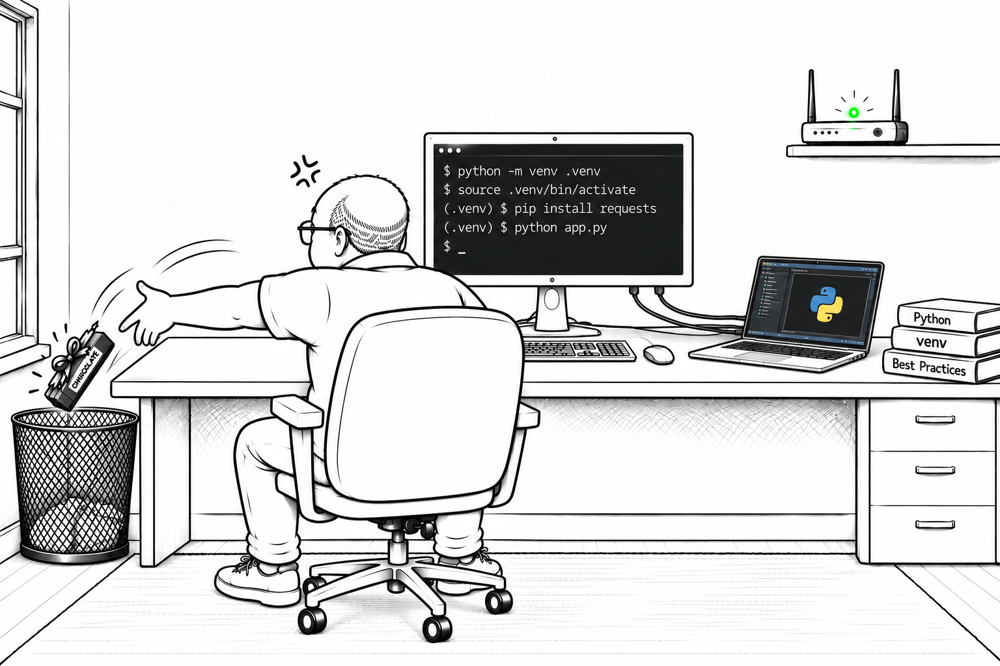

# Project Scaffolding with uv — A New Hope for Bob

After Alice implements the components of her IrisLab project, Bob feels overlooked and foolish beside the young engineer's expertise. The grumpy administrator decides to prove to himself that he can master modern Python workflows, starting with `uv`. He begins by assembling a workspace for a backend and frontend, curious whether one tool can replace pages of his old setup checklist. As the projects take shape, Bob follows them from Python selection through packaging and discovers a new hope for his runbook.

## Learning Objectives

- Install and select Python versions with `uv` and distinguish interpreter pins from supported Python versions.
- Scaffold packaged projects and a shared library in a workspace with one lockfile.
- Declare dependencies, configure development tools, and build distributions with `uv`.

## Overview

- Installing and selecting Python interpreters with `uv`.
- Creating a workspace with a shared lockfile and compatible Python pins.
- Scaffolding packaged backend and frontend projects and adding a shared library as a workspace dependency.
- Adding Bottle, Streamlit, and development dependencies and configuring tools in `pyproject.toml`.
- Building wheels and source distributions with `uv_build` and reviewing publication commands.

## Documentation

- [Chapter 03, Section 01: Project Scaffolding with uv](../../docs/chapter-03/section-01.md)
- [Open the notebook](./uv_proj_scaffolding_lab.ipynb); follow [The Isolation Awakens](../python_venv_lab/python_venv_lab.ipynb) and continue with [Bob Discovers the Force of uv](../uv_dependency_lab/uv_dependency_lab.ipynb).

## Run The Lab

1. Install Docker, VS Code, and the VS Code Dev Containers extension.
2. Open `notebooks/uv_proj_scaffolding_lab` as the folder in VS Code and select **Dev Containers: Reopen in Container**.
3. Open `uv_proj_scaffolding_lab.ipynb`, select the **Python 3 - uv Project Scaffolding** kernel, and run the cells in order.

The first setup cell resets the ignored `lab/` directory containing the generated workspace. Interpreter, dependency, and build-backend downloads require network access. Publishing is explained but not executed.
