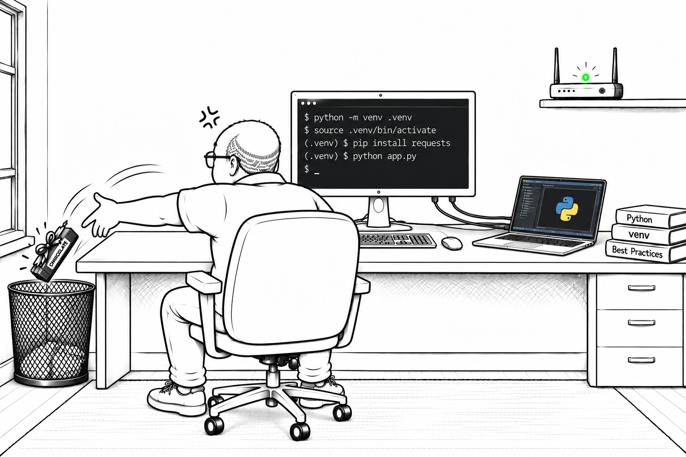

# Project Scaffolding with uv — A New Hope for Bob

After Alice implements the components of her IrisLab project, Bob feels overlooked and foolish beside the young engineer's expertise. The grumpy administrator decides to prove to himself that he can master modern Python workflows, starting with `uv`. He begins by assembling a workspace for a backend and frontend, curious whether one tool can replace pages of his old setup checklist. As the projects take shape, Bob follows them from Python selection through packaging and discovers a new hope for his runbook.

## Overview

- Installing and selecting Python interpreters with `uv`.
- Creating a workspace with a shared lockfile and compatible Python pins.
- Scaffolding packaged Bottle backend and Streamlit frontend projects.
- Adding project and development dependencies and configuring tools in `pyproject.toml`.
- Adding a shared library as a workspace dependency.
- Building wheels and source distributions with `uv_build` and reviewing publication commands.

## Documentation

- [Chapter 03, Section 01: Project Scaffolding with uv](../../docs/chapter-03/section-01.md)
- [Open the notebook](./uv_proj_scaffolding_lab.ipynb); continue with [Bob Discovers the Force of uv](../uv_dependency_lab/uv_dependency_lab.ipynb).

To run the lab, open `notebooks/uv_proj_scaffolding_lab` in VS Code with Docker and the Dev Containers extension, then select **Dev Containers: Reopen in Container**. Open the notebook, select **Python 3 - uv Project Scaffolding**, and run the cells in order. The first setup cell resets the ignored `lab/` directory containing the generated workspace; interpreter, dependency, and build-backend downloads require network access. Publishing is explained but not executed.
