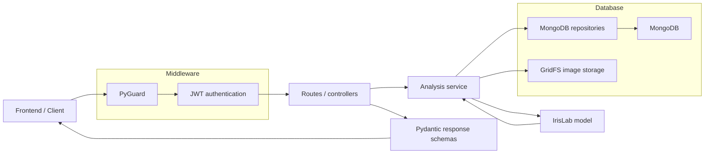
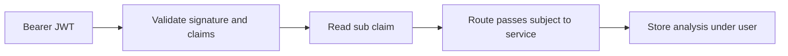

# IrisLab API Backend

The IrisLab API is a [FastAPI](https://fastapi.tiangolo.com/) service for iris
image analysis. It validates uploaded PNG and JPEG images, invokes the IrisLab
analysis model, and returns typed results. MongoDB stores analysis metadata and
user history, while GridFS stores the original images. Protected endpoints use
Keycloak-issued OIDC bearer tokens, and [PyGuard](https://github.com/ValentinTwin1206/modern-python-devops-egineering/tree/main/projects/proj1_pyguard)
adds request security and brute-force protection.

## Architecture

The API uses an MVC-inspired layered structure:

1. **Controller and service — request handling and workflow:** FastAPI routes
   accept HTTP input, obtain the authenticated user's subject, delegate image
   validation, analysis, and persistence to the service, then translate
   expected errors into HTTP responses.
2. **Model — data and persistence:** Pydantic schemas define API input/output;
  database models and MongoDB repositories manage stored users and analyses.
3. **Response representation:** There is no separate HTML view. Typed JSON
  responses are the API's presentation to its clients.



## Basic Components

### Application lifespan

`create_app()` in `src/irislab_api/main.py` creates the FastAPI application, registers middleware and mounts the routers to the application. Its async lifespan opens MongoDB at startup, initializes the repositories and GridFS bucket on `app.state`, then closes the MongoDB client at shutdown.

```python
def create_app() -> FastAPI:

  @asynccontextmanager
  async def lifespan(app: FastAPI):
      client = MongoClient(os.environ["MONGODB_URI"])
      try:
          bootstrap_db(app, client, os.environ["MONGODB_DATABASE"])
          yield
      finally:
          client.close()

    # Create FastAPI app and configure middleware
    app = FastAPI( title="IrisLab API", version="1.0.0", lifespan=lifespan )
    configure_middleware(app)

    # Add routers
    app.include_router( health.router, tags=["health"] )
    app.include_router( analysis.router, prefix="/api/v1", tags=["iris analysis"] )

    return app        
```

### Middleware

`configure_middleware()` in `api/middleware/middleware.py` creates the PyGuard
instance and registers JWT authentication and security middleware.

```python
def configure_middleware(app) -> None:

    app.state.guard = create_security_guard()
    app.middleware("http")(jwt_auth_middleware)
    app.middleware("http")(security_middleware)
```

#### JWT authentication

Protects the analysis and reference-color endpoints. It validates RS256 tokens against the configured issuer and JWKS, optionally checks audience and realm role, and exposes validated claims through `request.state.jwt_claims`. Missing or invalid tokens return 401; missing required roles return 403.



#### PyGuard security 

Checks requests for path traversal and brute-force activity. Repeated authentication failures on protected API paths can be blocked with 429 responses. Defaults are five failed attempts in 60 seconds and a 300-second block; environment variables can adjust these values.


### Routes

Routes are grouped under `api/routes/`. Health checks are public; analysis and
reference-color endpoints require a valid bearer token.

| Method and path | Purpose |
| --- | --- |
| `GET /health/live` | Liveness check |
| `GET /health/ready` | Checks that the IrisLab model file is available |
| `GET /api/v1/reference-colors` | Returns the reference color profiles |
| `POST /api/v1/analyses` | Validates and analyzes an uploaded image, then stores it |
| `GET /api/v1/analyses` | Returns the authenticated user's analysis history |

Uploads are limited to 10 MiB and 20 megapixels and must be valid PNG or JPEG
images. Expected failures use suitable HTTP responses: 413 for oversized files,
415 for invalid or unsupported images, 422 when no iris can be analyzed, and
503 when the model or persistence layer is unavailable. FastAPI provides
interactive documentation at `/docs` and the OpenAPI schema at `/openapi.json`.

### Services and models

`services/analysis.py` contains `AnalysisService`, which validates uploads,
uses a temporary file for the path-based IrisLab inference call, and stores the
result and source image. If persistence fails partway through, it attempts to
remove the created analysis document and GridFS file. History is resolved by
the authenticated OIDC `sub`, so users receive only their own records.

Pydantic schemas in `schemas/analysis.py` define `ReferenceColor`,
`AnalysisResult`, and `AnalysisHistoryItem`, the public JSON response shapes.
Persistence models in `database/models/` define the MongoDB user and analysis
documents. The repositories in `database/mongo/` manage those documents and
initialize the unique user-subject index. GridFS holds image bytes separately
from analysis metadata.

## Project Structure

The implementation is in `projects/proj3_irislab_api`:

| Path | Purpose |
| --- | --- |
| `src/irislab_api/main.py` | App factory, lifespan, and router registration |
| `src/irislab_api/api/routes/` | Health and analysis HTTP controllers |
| `src/irislab_api/api/middleware/` | JWT and PyGuard middleware configuration |
| `src/irislab_api/services/analysis.py` | Image validation, inference, and storage workflow |
| `src/irislab_api/schemas/` | Public Pydantic response schemas |
| `src/irislab_api/database/models/` | MongoDB document models and ObjectId type |
| `src/irislab_api/database/mongo/` | MongoDB repositories and bootstrap |
| `tests/test_api.py` | API contract and persistence tests using fakes |
| `pyproject.toml`, `uv.lock` | Project metadata, dependencies, and lockfile |
| `Dockerfile` | Multi-stage API image build |

## Development Setup

The API requires Python 3.12 and [uv](https://docs.astral.sh/uv/). From the
implementation directory, install the locked dependencies:

```bash
cd projects/proj3_irislab_api
uv sync --locked
```

Set these runtime variables before starting the API:

| Variable | Purpose |
| --- | --- |
| `MONGODB_URI` | MongoDB connection string |
| `MONGODB_DATABASE` | Database name |
| `OIDC_ISSUER_URL` | Expected token issuer |
| `OIDC_JWKS_URL` | Keycloak JWKS endpoint |

`OIDC_AUDIENCE` and `OIDC_REQUIRED_ROLE` are optional. PyGuard thresholds can
be changed with `PYGUARD_MAX_ATTEMPTS`, `PYGUARD_WINDOWS_SECONDS`, and
`PYGUARD_BLOCK_SECONDS`. The model location is supplied by the IrisLab package
or can be overridden with `IRISLAB_MODEL_PATH`.

## Run the API

Start the service on port 8080:

```bash
uv run uvicorn irislab_api.main:app --host 0.0.0.0 --port 8080 --reload
```

The API is available at [http://localhost:8080](http://localhost:8080), with
interactive documentation at [http://localhost:8080/docs](http://localhost:8080/docs).

## Run Tests

Run the API tests from `projects/proj3_irislab_api`:

```bash
uv run pytest
```
