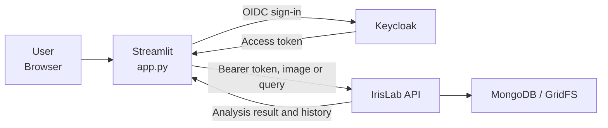

# IrisLab Streamlit Frontend

The IrisLab frontend is a Streamlit application for analyzing iris images. Users
sign in with Keycloak, upload an image for analysis, review recent analyses,
and browse the reference colors supplied by the IrisLab API.

## Architecture

1. The user signs in through Keycloak using OpenID Connect (OIDC).
2. Streamlit exposes the authenticated access token through `st.user`.
3. `app.py` passes the token to `IrisAPIClient` for protected API requests.
4. The API validates the bearer token, performs the analysis, and persists
   results for the authenticated user.
5. The frontend displays the result and loads the user's recent analyses from
   the API.



## Basic Components

Streamlit reruns `app.py` after user interactions. The application uses:

- `st.user`, `st.login()` and `st.logout()` for Keycloak authentication.
- `st.session_state` to retain the selected page and latest analysis result
  across reruns.
- `IrisAPIClient` to make authenticated HTTP requests to the IrisLab API.

### `app.py`

The sidebar provides Dashboard, New Analysis, and Reference Colors views. The
Dashboard displays up to five recent analyses, including an image preview,
filename, timestamp, and available result details. New Analysis accepts PNG or
JPEG images up to 10 MiB; the API also validates image dimensions (up to 20
megapixels). Results are displayed as JSON. The Account menu shows the signed-in
user and provides sign-out.

The OIDC provider is named `keycloak` in Streamlit's secrets configuration.
The configured client is `iris-analysis-frontend` in the `iris-analysis` realm.
The redirect URI registered with Keycloak must match the frontend URL, for
example `http://localhost:8501/oauth2callback` for local development.

### `api/client.py`

`IrisAPIClient` keeps HTTP communication out of the Streamlit UI. It attaches
the access token as a bearer token, reads its base URL from `IRIS_API_URL`, and
raises `IrisAPIError` for HTTP, connection, or invalid-JSON errors.

| Method | API endpoint | Purpose |
| --- | --- | --- |
| `get_reference_colors()` | `GET /api/v1/reference-colors` | Load reference colors |
| `get_analysis_history()` | `GET /api/v1/analyses` | Load the signed-in user's history |
| `analyze_image()` | `POST /api/v1/analyses` | Upload an image and return its analysis |

The API URL defaults to `http://localhost:8000`. The request timeout defaults
to 60 seconds and can be changed with `IRIS_API_TIMEOUT`.

## Project Structure

| Path | Purpose |
| --- | --- |
| `app.py` | Streamlit UI, OIDC session, navigation, and page handlers |
| `api/client.py` | Authenticated HTTP client for the IrisLab API |
| `pyproject.toml` | Runtime and development dependencies |
| `uv.lock` | Locked dependency versions |
| `.streamlit/secrets.toml.example` | Local Keycloak OIDC configuration template |
| `Dockerfile` | Frontend container image definition |
| `entrypoint.sh` | Creates a runtime cookie secret and starts Streamlit |

## Development Setup

### Requirements

- Python 3.12+
- [uv](https://docs.astral.sh/uv/)
- A reachable IrisLab API and Keycloak instance

### Configure Authentication

Copy `.streamlit/secrets.toml.example` to `.streamlit/secrets.toml`, then set
the Keycloak client secret for the `iris-analysis-frontend` client. Do not
commit real credentials. The example uses the `iris-analysis` realm and local
Keycloak URL; update the metadata URL if your Keycloak host differs.

### Run Locally

From this directory, install the locked dependencies and start Streamlit:

```bash
uv sync
export IRIS_API_URL=http://localhost:8000
uv run streamlit run app.py --server.address=0.0.0.0 --server.port=8501
```

Open [http://localhost:8501](http://localhost:8501). Keycloak must be reachable
at the metadata URL, and the IrisLab API must be available at `IRIS_API_URL`.

## Container Build

The frontend image is built by Docker Compose from this directory's Dockerfile.
From the IrisLab Compose project root, provide the required `.env` and API image
(`irislab-api:1.0.0`), then start the stack:

```bash
docker compose up --build
```

Compose supplies the API URL and mounts the Streamlit secrets template. The
frontend entrypoint generates a fresh cookie secret when the container starts.
