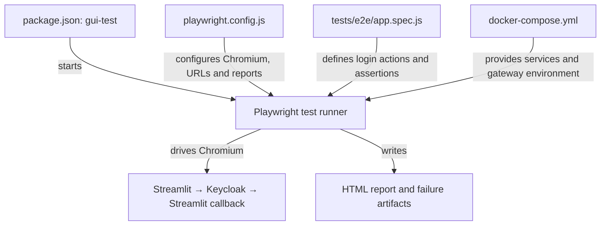
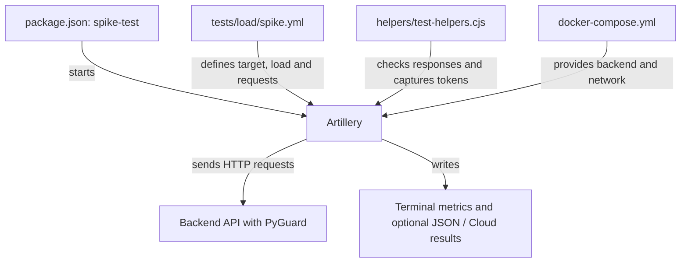

# End-to-End Testing Scenarios

This directory contains browser-based end-to-end tests and an Artillery load test for the license service. Run the tests from the project root inside the Dev Container, where the frontend and backend services are available on the Compose network.

## Structure

The following overview shows the folder and file structure of the test scenarios.

```text
project root/
├── package.json                Defines the test commands
└── tests/
    ├── e2e/
    │   └── app.spec.js         Playwright UI test: sign in through Keycloak
    └── load/
        ├── helpers/
        │   └── test-helpers.cjs Artillery response and token checks
        └── spike.yml           Artillery API load and rate-limit scenario
```

The root `package.json` is the entry point for running tests: 

```json
"scripts": {
    "gui-test": "bunx playwright test",
    "spike-test": "artillery run tests/load/spike.yml"
}
```

`bun run gui-test` runs the Playwright tests, and `bun run spike-test` runs the Artillery load scenario.

## Playwright

Run the test with:

```bash
bun run gui-test
```

The `gui-test` script in [package.json](../package.json) starts Playwright, which loads [playwright.config.js](../playwright.config.js) and runs [app.spec.js](e2e/app.spec.js). The test uses Chromium to verify the Streamlit–Keycloak login flow against the running Compose services and generates a test report.



**Configuration**

The [Playwright configuration](../playwright.config.js) sets Chromium as the browser target and uses `FRONTEND_URL` as its base URL.

The login flow of the example project uses two hostnames defined by the project:

1. `localhost:8501`: the default frontend URL in the [Playwright configuration](../playwright.config.js). The [secrets.toml](../frontend/.streamlit/secrets.toml) set `redirect_uri` to `http://localhost:8501/oauth2callback`, which the [Keycloak client configuration](../keycloak/realm-export.json) allows as a callback.
2. `keycloak.localhost:8081`: the public Keycloak address set by `KEYCLOAK_HOSTNAME` in the [environment configuration](../.env) and passed to Keycloak as `KC_HOSTNAME` by [Compose](../docker-compose.yml). Streamlit's `server_metadata_url` uses this address to discover the login endpoints.

The [Compose stack](../docker-compose.yml) runs Chromium in the Dev Container, separate from Streamlit and Keycloak. Chromium normally resolves both hostnames to loopback—the Dev Container itself, where neither service runs. Compose therefore sets `PLAYWRIGHT_HOST_GATEWAY=172.30.0.1`. The `browserArgs` resolver rules map both names to this network gateway to reach the host-published ports, preserving the configured URLs throughout login and callback.

These rules affect only Chromium. Compose's `extra_hosts` entries separately resolve `keycloak.localhost` for container-side clients such as Streamlit. For host-run tests, leave `PLAYWRIGHT_HOST_GATEWAY` unset. If the Compose subnet changes, update the gateway value and matching `extra_hosts` addresses together.

The configured reporters print a test list and generate an HTML report at `/tmp/playwright-artifacts/report`. Screenshots, videos, and traces are retained for failed tests in `/tmp/playwright-artifacts/results`.

**Test Case**

The GUI test verifies the login flow:

1. [Read credentials](e2e/app.spec.js#L4-L9) from `KEYCLOAK_TEST_USERNAME` and `KEYCLOAK_TEST_PASSWORD`; fail if either is missing *(L4-L9)*.
2. [Open Streamlit](e2e/app.spec.js#L11-L15), check the logged-out UI, and click **Log in with Keycloak** *(L11-L15)*.
3. [Verify the Keycloak redirect and sign in](e2e/app.spec.js#L17-L22) with the supplied credentials *(L17-L22)*.
4. [Check the authenticated UI](e2e/app.spec.js#L24-L26): the username, **Get license** button, and **License Key** field must be visible *(L24-L26)*.

The test checks login and UI visibility; it does not create or validate a license. Use the development realm account (`example-user` / `example-password`) or set the credential variables to another test user. Recreate the Dev Container after Compose changes so its host mapping is applied. Set `FRONTEND_URL` to override the target URL, `HEADED=true` to run a visible browser, or `TEST_ROOT_DIR` to choose another test directory.

A passing run means these browser actions and assertions succeeded; failures are reported in the terminal.

View the report from the Dev Container with:

```bash
bunx playwright show-report /tmp/playwright-artifacts/report
```

## Artillery

The example project provides one Artillery testcase `spike-test` under `tests/load/spike.yml`. The `package.json` already defines the entrypoint. Run the test with:

```bash
bun run spike-test
```

**Test Case**

The load test exercises license requests and rate limiting:

1. [Configure the load](load/spike.yml#L1-L11): target `http://backend:8080`, start 120 virtual users over 60 seconds, and load the response callbacks. This is intended to exceed PyGuard's 100-attempt limit per 60-second window *(L1-L11)*.
2. [Request a license](load/spike.yml#L13-L21): each virtual user sends `GET /licenses` with the development admin API key, then calls `checkResponse` *(L13-L21)*.
3. [Inspect the response](load/helpers/test-helpers.cjs#L1-L29): log **429 Too Many Requests** for rate-limited requests; for a `200` response containing a non-empty `cloudsmith_token`, save the token and set `tokenCaptured` to `true` *(L1-L29)*.
4. [Validate captured tokens](load/spike.yml#L22-L29): only users with `tokenCaptured` send the follow-up request to `/licenses/{{ cloudsmithToken }}`; others skip it *(L22-L29)*.
5. [Check the validation response](load/helpers/test-helpers.cjs#L31-L50): `checkTokenResponse` logs non-`200` responses, invalid JSON, or a `valid` value other than `true` *(L31-L50)*.

These callbacks log problems; they do not assert that rate limiting occurred or automatically fail the run on validation errors. Review the logs and response-status metrics.



To save the detailed results locally and record the run in Artillery Cloud, provide an Artillery Cloud API key:

```bash
artillery run --output spike-report.json tests/load/spike.yml --record --key "$ARTILLERY_CLOUD_KEY"
```

Set `ARTILLERY_CLOUD_KEY` to your Artillery Cloud API key before running the command. Open [app.artillery.io](https://app.artillery.io/) to view and analyze the recorded test run, then share the run or create a report from the dashboard. To save a PDF copy, use the browser's **Print** option and choose **Save as PDF**. The JSON results are also saved locally as `spike-report.json`.

