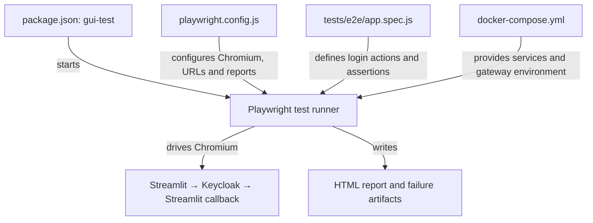
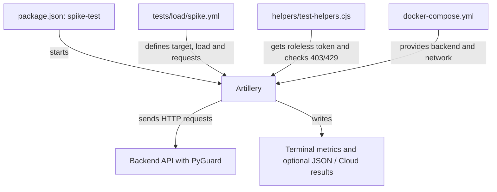

# End-to-End Testing Scenarios

This directory contains browser-based end-to-end tests and Artillery tests for IrisLab. Run the tests from the project root inside the Dev Container, where the API and Keycloak are available on the Compose network.

## Structure

The following overview shows the folder and file structure of the test scenarios.

```text
project root/
├── package.json                Defines the test commands
└── tests/
    ├── e2e/
    │   └── app.spec.js         Playwright UI test: sign in through Keycloak
    └── load/
        ├── helpers/
        │   ├── performance-flow.cjs Browser-authenticated API performance journey
        │   └── test-helpers.cjs roleless token setup and response checks
        ├── performance.yml     Authenticated analysis and history workload
        └── spike.yml           API PyGuard brute-force scenario
```

The root `package.json` is the entry point for running tests: 

```json
"scripts": {
    "gui-test": "bunx playwright test",
    "spike-test": "artillery run tests/load/spike.yml",
    "performance-test": "artillery run tests/load/performance.yml"
}
```

Use these commands to run each test scenario:

| Command | Test scenario |
| --- | --- |
| `bun run gui-test` | Playwright browser tests |
| `bun run spike-test` | PyGuard brute-force scenario |
| `bun run performance-test` | Authenticated API performance scenario |

Check the explanation below for each testcase.

## Preparation

Preparation starts with the integration of keycloak user with the current test setup.

1. **Set the test credentials.** Open `.env` in the project root. Set `KEYCLOAK_TEST_USERNAME` to `example-user` from the Keycloak [configuration](../keycloak/realm-export.json) and `KEYCLOAK_TEST_PASSWORD` to that user's password `value`. The GUI, performance, and spike tests use these credentials.

2. **Set the performance-test secret.** Set the secret of `clientId: "iris-analysis-frontend"` from the Keycloak [configuration](../keycloak/realm-export.json) in the `.env` file as `IRIS_PERF_CLIENT_SECRET`. This identifies the application when the performance test exchanges a successful login for an access token; it is not the user's password.

3. **Check the frontend secret.** In [frontend/.streamlit/secrets.toml](../frontend/.streamlit/secrets.toml), check that `client_secret` matches the same frontend client secret. With the example values, the test settings in `.env` are:

```dotenv
KEYCLOAK_TEST_USERNAME=example-user
KEYCLOAK_TEST_PASSWORD=example-password
IRIS_PERF_CLIENT_SECRET=streamlit-dev-secret
```

## Playwright

Run the test with:

```bash
bun run gui-test
```

The `gui-test` script in [package.json](../package.json) starts Playwright, which loads [playwright.config.js](../playwright.config.js) and runs [app.spec.js](e2e/app.spec.js). The test uses Chromium to verify the Streamlit–Keycloak login flow against the running Compose services and generates a test report.



**Configuration**

The [Playwright configuration](../playwright.config.js) sets Chromium as the browser target and uses `FRONTEND_URL` as its base URL.

The login flow of the example project uses two hostnames defined by the project:

1. `localhost:8501`: the default frontend URL in the [Playwright configuration](../playwright.config.js). The [secrets.toml](../frontend/.streamlit/secrets.toml) set `redirect_uri` to `http://localhost:8501/oauth2callback`, which the [Keycloak client configuration](../keycloak/realm-export.json) allows as a callback.
2. `keycloak.localhost:8081`: the public Keycloak address set by `KEYCLOAK_HOSTNAME` in the [environment configuration](../.env) and passed to Keycloak as `KC_HOSTNAME` by [Compose](../docker-compose.yml). Streamlit's `server_metadata_url` uses this address to discover the login endpoints.

The [Compose stack](../docker-compose.yml) runs Chromium in the Dev Container, separate from Streamlit and Keycloak. Chromium normally resolves both hostnames to loopback—the Dev Container itself, where neither service runs. Compose therefore sets `PLAYWRIGHT_HOST_GATEWAY=172.30.0.1`. The `browserArgs` resolver rules map both names to this network gateway to reach the host-published ports, preserving the configured URLs throughout login and callback.

These rules affect only Chromium. Compose's `extra_hosts` entries separately resolve `keycloak.localhost` for container-side clients such as Streamlit. For host-run tests, leave `PLAYWRIGHT_HOST_GATEWAY` unset. If the Compose subnet changes, update the gateway value and matching `extra_hosts` addresses together.

The configured reporters print a test list and generate an HTML report at `/tmp/playwright-artifacts/report`. Screenshots, videos, and traces are retained for failed tests in `/tmp/playwright-artifacts/results`.

**Test Case**

The GUI test verifies the login flow:

1. [Read credentials](e2e/app.spec.js#L4-L9) from `KEYCLOAK_TEST_USERNAME` and `KEYCLOAK_TEST_PASSWORD`; fail if either is missing *(L4-L9)*.
2. [Open Streamlit](e2e/app.spec.js#L11-L15), check the logged-out UI, and click **Log in with Keycloak** *(L11-L15)*.
3. [Verify the Keycloak redirect and sign in](e2e/app.spec.js#L17-L22) with the supplied credentials *(L17-L22)*.
4. [Check the authenticated UI](e2e/app.spec.js#L28-L29): the dashboard text and **Start a new analysis** button must be visible.

The test checks login and UI visibility only; it does not upload an image or check API permissions. No extra role or test client is needed for this test. Use the development realm account (`example-user` / `example-password`) or set the credential variables to another test user. Recreate the Dev Container after Compose changes so its host mapping is applied. Set `FRONTEND_URL` to override the target URL, `HEADED=true` to run a visible browser, or `TEST_ROOT_DIR` to choose another test directory.

A passing run means these browser actions and assertions succeeded; failures are reported in the terminal.

View the report from the Dev Container with:

```bash
bunx playwright show-report /tmp/playwright-artifacts/report
```

## Artillery

### Authenticated API performance test

#### Setup

This test needs permission to upload images, not just permission to log in. In `keycloak/realm-export.json`, define the required role at the top level (alongside `realm`, `clients`, and `users`):

```json
"roles": {
  "realm": [{ "name": "load-test-required" }]
}
```

Add this field to the existing `example-user` object inside `users`:

```json
"realmRoles": ["load-test-required"]
```

Keep the frontend client's existing login settings. Its default role scope includes the user's role in access tokens. Set `OIDC_REQUIRED_ROLE=load-test-required` in `.env`. The backend checks the role in the JWT middleware ([jwt_middleware.py](../../proj3_irislab_api/src/irislab_api/api/middleware/jwt_middleware.py#L60-L85)); the performance test uses a token with the role, while the spike test uses a separate client that omits it.

After updating the configuration, run these commands from the project directory on the host. Keycloak imports the updated realm, and the backend receives the updated `.env` values:

```bash
docker compose up -d --force-recreate --wait keycloak
docker compose up -d --force-recreate backend devcontainer
```

#### Run

Run the separate one-virtual-user Artillery + Playwright scenario from the Dev Container:

```bash
bun run performance-test
```

**Test flow**

1. **Start one virtual user:** `bun run performance-test` invokes the script in [package.json](../package.json#L9). Artillery loads [performance.yml](load/performance.yml#L1-L14), which targets the API and schedules one virtual user; its Playwright scenario calls `runAnalysisJourney`.
2. **Sign in and obtain a token:** Compose supplies the Keycloak test username and password, plus the performance client settings ([docker-compose.yml](../docker-compose.yml#L37-L42)). The helper checks these values and creates a PKCE verifier, challenge, and state ([performance-flow.cjs](load/helpers/performance-flow.cjs#L14-L43)). It signs in through the browser, validates the callback state, then exchanges the authorization code for an access token ([performance-flow.cjs](load/helpers/performance-flow.cjs#L46-L83)). Set `IRIS_PERF_CLIENT_SECRET` to the confidential frontend client's secret; the helper fails if it is missing. `IRIS_PERF_CLIENT_ID` defaults to `iris-analysis-frontend` and `IRIS_PERF_UPLOADS` defaults to 50. `IRIS_KEYCLOAK_URL` is the browser-facing Keycloak URL; code exchange uses the internal service URL by default and can be overridden with `IRIS_KEYCLOAK_TOKEN_URL`. The API URL can be overridden with `IRIS_API_URL` ([performance-flow.cjs](load/helpers/performance-flow.cjs#L5-L12)).
3. **Upload sample images:** The helper loads PNGs from `tests/samples/`, then randomly selects one for each iteration ([performance-flow.cjs](load/helpers/performance-flow.cjs#L24-L27), [performance-flow.cjs](load/helpers/performance-flow.cjs#L88-L89)). Each image is sent with the bearer token to `POST /api/v1/analyses`; the response must contain the expected analysis fields ([performance-flow.cjs](load/helpers/performance-flow.cjs#L92-L109)). The API endpoint is defined in [analysis.py](../../proj3_irislab_api/src/irislab_api/api/routes/analysis.py#L30-L32).
4. **Read history after every upload:** After each POST, the test calls `GET /api/v1/analyses` and fails unless that upload's filename is present ([performance-flow.cjs](load/helpers/performance-flow.cjs#L112-L120)). The corresponding API route is in [analysis.py](../../proj3_irislab_api/src/irislab_api/api/routes/analysis.py#L19-L27).
5. **Compare step timings:** Artillery records the `keycloak_login`, `analysis_post`, and `analysis_history_get` steps separately ([performance-flow.cjs](load/helpers/performance-flow.cjs#L53-L53), [performance-flow.cjs](load/helpers/performance-flow.cjs#L92-L92), [performance-flow.cjs](load/helpers/performance-flow.cjs#L112-L112)).
6. **Account for retained data:** The API persists each successful image in GridFS and its analysis document in MongoDB ([analysis.py](../../proj3_irislab_api/src/irislab_api/services/analysis.py#L112-L139)). History reads the stored images and embeds them as Base64 ([analysis.py](../../proj3_irislab_api/src/irislab_api/services/analysis.py#L175-L205), [analysis.py](../../proj3_irislab_api/src/irislab_api/schemas/analysis.py#L33-L39)). Records intentionally accumulate, so later history responses grow and can take longer; clear test data manually when a clean baseline is needed. This scenario is separate from the PyGuard brute-force test below.

### PyGuard brute-force test

#### Setup

Add this test-only client to the `clients` array in
`keycloak/realm-export.json`, keeping the existing frontend and CLI clients:

```json
{
    "clientId": "iris-analysis-load-test",
    "name": "Iris Analysis Load Test",
    "enabled": true,
    "protocol": "openid-connect",
    "publicClient": true,
    "standardFlowEnabled": false,
    "implicitFlowEnabled": false,
    "directAccessGrantsEnabled": true,
    "serviceAccountsEnabled": false,
    "fullScopeAllowed": false
}
```

Keep `example-user` assigned the `load-test-required` realm role from the
performance-test setup. `fullScopeAllowed: false` and the absence of role-scope
mappings ensure this client's token omits that role, so API requests receive
`403`. The client has no secret and is only for local testing. After adding it,
run these commands from the project directory on the host:

```bash
docker compose up -d --force-recreate --wait keycloak
docker compose up -d --force-recreate backend devcontainer
```

#### Run

The example project provides one Artillery testcase `spike-test` under `tests/load/spike.yml`. The `package.json` already defines the entrypoint. Run the test with:

```bash
bun run spike-test
```

The test targets the Iris API's protected `GET /api/v1/analyses` endpoint:

1. **Obtain a roleless token:** The helper uses the shared test user's credentials with `iris-analysis-load-test` and caches the access token for the virtual user ([test-helpers.cjs](load/helpers/test-helpers.cjs#L1-L45)).
2. **Send forbidden requests:** Artillery sends 120 requests with that token from one virtual user and source IP ([spike.yml](load/spike.yml#L1-L21)). The token is valid but lacks `load-test-required`, so the API returns `403`.
3. **Check rate limiting:** Responses should be `403` until the configured `PYGUARD_MAX_ATTEMPTS` limit is reached, then `429`. The `checkPyGuard403Response` helper verifies each response ([test-helpers.cjs](load/helpers/test-helpers.cjs#L47-L63)). This fixed scenario supports limits from 1 through 119; adjust the loop and helper validation if you change the attempt limit beyond that range.
4. **Reset before rerunning:** PyGuard keeps block state in memory. Restart the backend or wait for the block duration to expire before rerunning from the same source IP.



To save the detailed results locally and record the run in Artillery Cloud, provide an Artillery Cloud API key:

```bash
artillery run --output spike-report.json tests/load/spike.yml --record --key "$ARTILLERY_CLOUD_KEY"
```

Set `ARTILLERY_CLOUD_KEY` to your Artillery Cloud API key before running the command. Open [app.artillery.io](https://app.artillery.io/) to view and analyze the recorded test run, then share the run or create a report from the dashboard. To save a PDF copy, use the browser's **Print** option and choose **Save as PDF**. The JSON results are also saved locally as `spike-report.json`.
